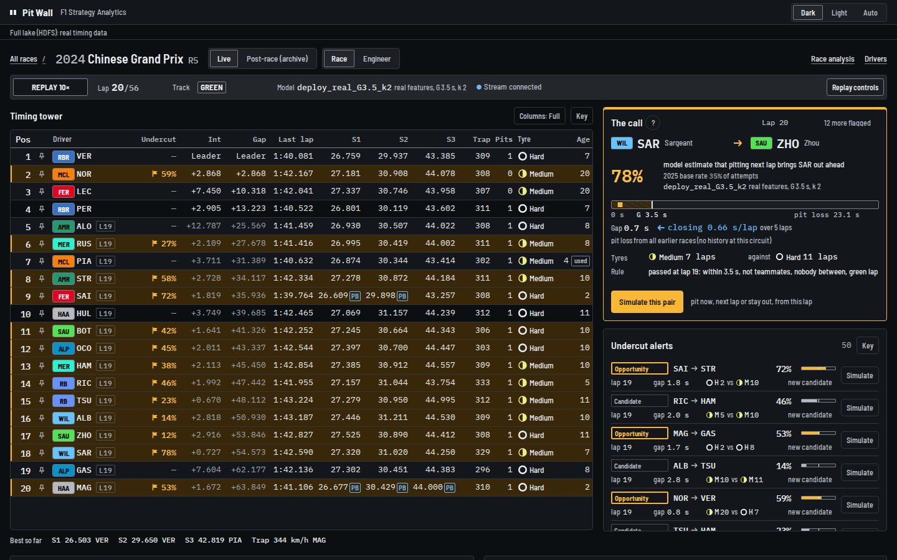
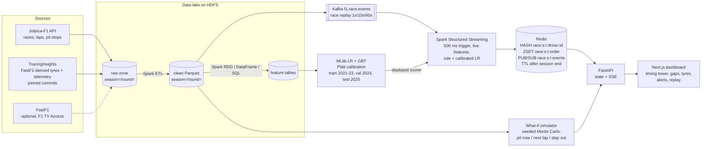

# F1 Strategy Analytics at Scale

An end-to-end big-data pipeline that asks, lap by lap, whether a Formula 1 car that pits to undercut the car ahead
will come out in front.

[](https://github.com/parinithd-27/F1-Strategy-Analytics/actions/workflows/ci.yml)
[](LICENSE)
[](pyproject.toml)
[](web/.nvmrc)



## Key features

- **Partitioned data lake on HDFS:** 2021–2025 (114 races) of Jolpica-F1 timing and FastF1-derived TracingInsights
  tyres and telemetry, as clean Parquet partitioned by `season=` / `round=`.
- **Spark RDD, DataFrame and SQL** feature jobs that use only information available at the end of the previous lap.
- **Calibrated MLlib model** (LR and GBT, Platt calibration): trained on 2021–2023, tuned and calibrated on 2024,
  tested once on a sealed 2025 season under a pre-registered specification.
- **Kafka race replay and Spark Structured Streaming** (500 ms trigger) that flag undercut opportunities lap by lap,
  with the same rule and scorer as the batch path.
- **Redis serving contract** (driver hash, order sorted set, events Pub/Sub, TTL after session end), pushed by
  FastAPI over Server-Sent Events.
- **Next.js dashboard:** timing tower, gaps, tyres, undercut alerts, engineer view, race analysis and telemetry,
  post-race archive and replay controls.
- **Monte Carlo what-if simulator** that compares *pit now*, *pit next lap* and *stay out* from the same race state.
- **Measured at scale:** Spark scaling over 1, 3 and 5 seasons, partitioning and caching, streaming and Redis
  latency.

## Architecture



## Quick start

Needs Docker with 12 GB of memory, GNU `make`, `python3` and [`uv`](https://docs.astral.sh/uv/). Details for
Windows 11 + WSL 2, Linux and macOS: [Prerequisites](docs/reproduce.md#prerequisites).

```bash
git clone https://github.com/parinithd-27/F1-Strategy-Analytics.git
cd F1-Strategy-Analytics
make up            # core profile: kafka, redis, app, api, web (builds the images the first time)
make sample-data   # validates data/sample offline
make demo          # sample pipeline + sample model + a 60x replay of 2024 R5
```

Open http://localhost:3000/race/2024/5 while the replay runs. The demo uses two real Jolpica races with synthetic
tyres and telemetry, so the dashboard shows a **SYNTHETIC DEMO DATA** banner. `make down` stops it.

**Full-data mode** (HDFS, 2021–2025): `make up-full`, then the steps in
[docs/reproduce.md](docs/reproduce.md#2-full-data-mode-hdfs-20212025).

## Key results

From the [report](docs/report/report.md) (2025 is the held-out test season, evaluated once):

- **Undercut model.** On 49 labelled attempts it reached PR-AUC 0.670 [0.421, 0.898] and Brier 0.177
  [0.106, 0.232], better than the rule baseline on every metric but with overlapping intervals.
- **Streaming.** On a single host, for one replayed race (2024 R5, sample lake), steady-state end-to-end latency at
  60x is 798 / 1461.5 / 1757 ms (p50 / p95 / p99).
- **Partitioning and caching.** one race 1.74x (file://), 1.20x (HDFS); full scans 0.30x; `cache()` 1.41x on one
  race.
- **What-if simulator.** monotonicity and determinism pass; ordering 17 of 18; 2025 simulator ECE 0.207.

All numbers, with their intervals and sources: [docs/results.md](docs/results.md).

## Documentation

| Document | What it covers |
|---|---|
| [docs/README.md](docs/README.md) | Index of every document |
| [docs/reproduce.md](docs/reproduce.md) | Prerequisites, sample and full-data mode, every experiment target, tests and CI |
| [docs/architecture.md](docs/architecture.md) | Code map and the design of each layer |
| [docs/results.md](docs/results.md) | All results: model, ablation, what-if, streaming, Redis, Spark |
| [docs/model_results.md](docs/model_results.md) | The 2025 model evaluation |
| [docs/experiments.md](docs/experiments.md) | Spark, streaming and Redis experiments: method and runtime |
| [docs/report/report.md](docs/report/report.md) ([PDF](docs/report/report.pdf)) | The project report |
| [docs/traceability.md](docs/traceability.md) | Every proposal commitment mapped to code, tests and proof |

## Team

IISc MTech DA231o course project by team **Data Wranglers**: Parinith D., Dakshinesh K., Rohan Deore and
Kaushal V. (Indian Institute of Science, Bengaluru).

## Licence and citation

- **Code:** MIT ([LICENSE](LICENSE)).
- **Data** keeps its own terms ([DATA_LICENSES.md](DATA_LICENSES.md)). Jolpica-F1 is CC BY-NC-SA 4.0, and only the
  small sample in `data/sample/` is committed. Formula 1 timing data (through FastF1 or TracingInsights) is owned by
  Formula 1 / FOM, used for private academic study only and never committed.
- Unofficial project; not associated with the Formula 1 companies.
- **Cite:** [CITATION.cff](CITATION.cff) (GitHub shows "Cite this repository").
