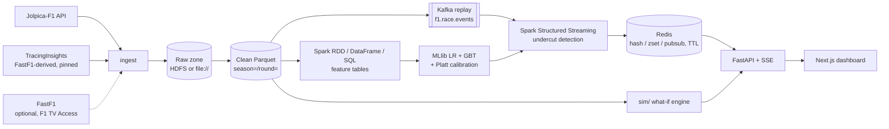
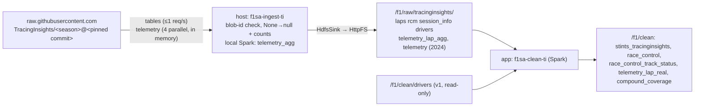

# Architecture

How the pipeline is built, layer by layer (see
[traceability.md](traceability.md) for the proposal requirement each file serves). To run it, see the [README](../README.md) and
[reproduce.md](reproduce.md). All documents: [docs/README.md](README.md).



## Code map

**Why.** An undercut is a pit stop timed to gain track position on fresh tyres. Whether it works depends on
the gap, tyre age and degradation, the pit-lane loss, out-lap pace and traffic, and all of that changes lap by
lap. The project uses that question to exercise the whole big-data stack:
- a lake partitioned by season and race;
- distributed feature engineering;
- a model evaluated strictly chronologically, with a sealed test season;
- an event-driven serving path with measured latency;
- benchmarks of how the Spark jobs scale and what partitioning and caching buy.

| Layer | Code | Details |
|---|---|---|
| Ingestion (rate-limited, cached, resumable) | `src/f1sa/ingest/` | [Ingestion](#ingestion-srcf1saingest) |
| Lake, clean zone, Spark ETL and features | `src/f1sa/{lake,etl,features}/` | this page, [data_dictionary.md](data_dictionary.md) |
| Undercut label and model | `src/f1sa/model/` | [label_definition.md](label_definition.md), [model_spec.md](model_spec.md), [model_spec_v2.md](model_spec_v2.md) |
| Kafka + Structured Streaming | `src/f1sa/streaming/` | [Streaming](#streaming-streaming) |
| Redis serving contract | `src/f1sa/serving/` | 9-field hash, order zset, events channel, TTL (tested in `tests/unit/test_keys.py`) |
| API and dashboard | `src/f1sa/api/`, `web/` | FastAPI docs at `/api/docs` |
| What-if simulator | `src/f1sa/sim/` | [sim_spec.md](sim_spec.md) (pre-registered) |
| Benchmarks | `src/f1sa/bench/`, `experiments/` | [experiments.md](experiments.md) |

## Modules (`src/f1sa/`)
| Package | Responsibility |
|---|---|
| `ingest` | Jolpica client (rate-limited, cached, resumable) and FastF1 loader |
| `lake` | Raw-zone paths, schemas and quality checks (the writers are `ingest/sinks.py` for the raw zone and `etl/io.write_partitioned` for the clean and feature zones) |
| `etl` | Spark jobs that demonstrate the RDD, DataFrame and SQL APIs |
| `features` | Gap change, tyre age, out-lap pace, pit loss, telemetry aggregates, undercut label |
| `model` | Chronological split, LR and GBT training, calibration, explanation, baselines, the deployment model (full and sample) |
| `streaming` | Kafka producer (race replay), Structured Streaming job, Redis sink |
| `serving` | Redis key contract and store (TTL on session end) |
| `sim` | What-if race simulation (pit now / pit next lap / stay out) |
| `api` | FastAPI routes and the SSE stream for the dashboard |
| `archive` | Post-race replay bundles built with the frozen stream path, and the proof that they equal a live replay (display only) |
| `bench` | Spark benchmarks: replication, timing, resource sampling, scalability grid, partitioning/caching (docs/experiments.md); the streaming latency runs and `make experiments` |
| top level | `config.py` (the only source of paths and endpoints), `demo_runs.py` (demo output folders), `demo_replay.py` (`make demo`'s headless replay check) |

## Rules
- Storage root comes **only** from `f1sa.config.Settings.data_lake_uri`. No other module hardcodes paths or endpoints.
- Features for lap *L* use only information available at the end of lap *L-1* (see `docs/label_definition.md`).
- Data is split chronologically: train on 2021–2023, validate and calibrate on 2024, test on 2025.

## Local infrastructure (Docker Compose)
Defined in `docker-compose.yml`, project name `f1sa`. `make up` starts `core`; `make up-full` starts `full` (core + hdfs + spark). `make down` stops all containers and **keeps volumes**. `make nuke CONFIRM=yes` is the only target that deletes volumes.

| Profile | Service | Image | Host port | Internal address |
|---|---|---|---|---|
| core | kafka (KRaft, single node) | `apache/kafka:4.3.2` | 9092 (`PLAINTEXT_HOST`) | `kafka:29092` |
| core | kafka-init (one-shot: creates `f1.race.events`, 3 partitions) | `apache/kafka:4.3.2` | n/a | n/a |
| core | redis (no persistence, `maxmemory 256mb`, `volatile-ttl`) | `redis:8.10.3` | 6379 | `redis:6379` |
| core | app (Python 3.12 + locked deps + Spark Kafka connector) | `f1sa-app:dev` (from `docker/spark/Dockerfile`) | n/a | n/a |
| core | api (FastAPI, `python -m f1sa.api`) | `f1sa-app:dev` | 127.0.0.1:8000 only (`API_HOST_PORT`) | `api:8000` |
| core | web (Next.js dashboard; non-root, read-only root fs) | `f1sa-web:dev` (from `docker/web/Dockerfile`) | 127.0.0.1:3000 only (`WEB_HOST_PORT`) | `web:3000` |
| hdfs | namenode | `f1sa-hadoop:3.4.3` (from `apache/hadoop:3.4.3`) | 9870 (web UI) | `hdfs://namenode:8020` |
| hdfs | datanode | `f1sa-hadoop:3.4.3` | n/a | `datanode:9864` |
| hdfs | httpfs (HDFS REST gateway that proxies bytes, used by the HDFS sink) | `f1sa-hadoop:3.4.3` | 14000 | `http://httpfs:14000/webhdfs/v1` |
| spark | spark-master (standalone) | `f1sa-app:dev` | 8080 (UI) | `spark://spark-master:7077` |
| spark | spark-worker-1, spark-worker-2 | `f1sa-app:dev` | 8081, 8082 (UI) | n/a |

- The web app publishes 3000 and the API 8000, both on the host's 127.0.0.1 only. Every host port can be overridden in `.env` (see `.env.example`). If you change `KAFKA_HOST_PORT` or `REDIS_HOST_PORT`, update `KAFKA_BOOTSTRAP` and `REDIS_URL` to match.
- The app image installs `spark-sql-kafka-0-10_2.13:4.2.1` (plus `kafka-clients`, `spark-token-provider-kafka` and `commons-pool2`) into `$SPARK_HOME/jars` at build time, so Structured Streaming needs no network at runtime. Inside containers, Kafka is `kafka:29092`. From the host, it is `localhost:9092`.
- HDFS is a single-node dev setup: `dfs.replication=1` and permissions disabled (`docker/hadoop/`). The NameNode is formatted on first start only.
- The app container mounts the repo read-only at `/workspace`, with `data/`, `results/` and `models/` mounted read-write over it.
- Images are tagged `${F1SA_IMAGE_TAG:-dev}`, so a second checkout can build its own images (`F1SA_IMAGE_TAG=clone`, with `COMPOSE_PROJECT_NAME` for separate containers and volumes). Without a project `.env`, the Makefile exports `APP_UID=$(id -u)` so the container user can write the bind mounts on any host (CI runners use UID 1001). With a `.env`, its `APP_UID` is used.
- The api container mounts the repo and `data/` read-only, with `data/demo` and `data/checkpoints` read-write on top (a replay's outputs and stream-job state), `results/` read-write (`ui_latency.csv`) and `models/` read-only. `make up`, `up-full` and `api-up` create the host folders of the bind mounts first (`data/demo`, `data/checkpoints`, `models/undercut`, `models/sim`), because Docker would otherwise create them owned by root (a fresh clone has no `models/`). A write anywhere else under `/workspace/data` fails with EROFS (checked: `manifest.json`).

### Memory budget
The Docker Desktop WSL 2 VM is capped by `memory=` in the Windows file `%UserProfile%\.wslconfig`. On the dev machine the VM now has 14 GB and 12 CPUs (`free -g`, `nproc`; it had about 9 GiB and 6 CPUs before the Spark benchmarks). Each container has a hard `mem_limit`:

| Container | Limit | Notes |
|---|---|---|
| kafka | 768 MiB | JVM heap 512 MiB |
| kafka-init | 512 MiB | exits after creating the topic |
| redis | 384 MiB | dataset capped at 256 MiB (`maxmemory`) |
| app | 6 GiB | driver for local Spark jobs; Spark benchmark cells run a 2g driver heap (`local[N]`) plus PySpark Python workers: 3.1-3.6 GiB measured at 1 season x1/x4, which hit the 90 % guard of the earlier 4 GiB limit |
| api | 2 GiB | uvicorn (≈ 100 MiB) + one replay: stream job JVM + producer JVM (measured peaks 1.33 and 1.49 GiB) |
| web | 512 MiB | Next.js standalone server (`node server.js`) |
| namenode | 768 MiB | heap ≤ 512 MiB |
| datanode | 768 MiB | heap ≤ 512 MiB |
| httpfs | 384 MiB | heap ≤ 256 MiB |
| spark-master | 512 MiB | daemon heap 256 MiB |
| spark-worker-1, -2 | 1.5 GiB each | `SPARK_WORKER_MEMORY=1g` for executors + 256 MiB daemon |
| **core total** | **≈ 9.6 GiB** | ≈ 2.6 GiB before the api and web services; app 1.5 → 4 → 6 GiB for the Spark benchmarks |
| **full total** | **≈ 15 GiB** (limits) | above the 14 GB WSL VM (12 CPUs) as ceilings; measured idle use is ≈ 1.6 GiB (before httpfs and api). **During the overnight `make experiments-spark` run, api (2 GiB) and web (0.5 GiB) are stopped (`docker compose stop api web`), leaving ≈ 12.5 GiB of limits**; start them again afterwards (`docker compose start api web`) |

These are ceilings, not reservations. If the full profile runs into memory pressure, lower `SPARK_WORKER_MEMORY` and `SPARK_WORKER_CONTAINER_MEM` in `.env`, or raise `memory=` in `.wslconfig` and run `wsl --shutdown`.

## Ingestion (`src/f1sa/ingest/`)
`f1sa-ingest season-range --seasons 2021-2025 --sources jolpica,fastf1 --sink file|hdfs [--dry-run] [--only-failed]`
(`f1sa-ingest race --season S --round R ...` is the same code path limited to one round).

### Raw zone layout (table first, Hive-style partitions)
Root = `DATA_LAKE_URI` (`file://./data/lake` or `hdfs://namenode:8020/f1`).
```
raw/jolpica/schedule/season=S/schedule.json                  # season-level: fetched once per season
raw/jolpica/drivers/season=S/drivers.json
raw/jolpica/constructors/season=S/constructors.json
raw/jolpica/results/season=S/round=R/results.json            # per race weekend
raw/jolpica/qualifying/season=S/round=R/qualifying.json
raw/jolpica/pitstops/season=S/round=R/pitstops.json
raw/jolpica/laps/season=S/round=R/laps.json
raw/jolpica/sprint_results/season=S/round=R/sprint_results.json   # sprint weekends only
raw/fastf1/laps/season=S/round=R/laps.parquet
raw/fastf1/session/season=S/round=R/session.json
raw/fastf1/telemetry/season=S/round=R/driver=VER/car_data.parquet  # Speed, Throttle, Brake, nGear, RPM
raw/fastf1/position/season=S/round=R/driver=VER/position.parquet
```
- Jolpica files are the JSON pages exactly as received (`[page, page, ...]`). The `parse_*` functions in
  `jolpica_client.py` turn them into typed DataFrames.
- Every partition has a `_manifest.json` with the files, rows, sha256, source URL, licence and `is_synthetic=false`.
- Each table is its own partitioned dataset, so the Spark clean and feature jobs can read `raw/<source>/<table>/` directly.

### Sinks (`ingest/sinks.py`)
Both sinks have the same interface (`write_bytes/json/parquet`, `write_manifest`, `exists`, `cleanup_temp`) and the
same guarantees:
- **Atomic.** Bytes go to a temporary name and are renamed onto the final name only when complete.
- **Repeatable.** Writing a name again replaces the file.
- **Verifiable.** Each write returns size and sha256 to the ingestion manifest.
- **Clean.** Temp files are removed on any failure, including Ctrl+C. `cleanup_temp()` removes leftovers from a
  killed process before a partition is rewritten.

| Sink | Temp name | Commit | Notes |
|---|---|---|---|
| `FileSink` (`file://`) | `.<name>.<random>.tmp` | fsync, then `os.replace` | files are mode 0644 |
| `HdfsSink` (`hdfs://`) | `_tmp.<uuid>.<name>` | `CREATE ...&data=true`, length check, then (`DELETE` old) + `RENAME` | via **HttpFS** |

`HdfsSink` details:
- It talks to the HttpFS gateway (`HDFS_HTTPFS_URL`: `http://localhost:14000` from the host, `http://httpfs:14000` in
  containers). HttpFS streams the bytes itself, so clients never follow WebHDFS redirects to `datanode:9864`, which the
  WSL host cannot resolve.
- Verified on 3.4.3: `RENAME` onto an existing file answers HTTP 200 with `{"boolean": false}`, and
  `renameoptions=OVERWRITE` is ignored. Replacing a file is therefore DELETE + RENAME, and the boolean is always checked.
- Connection errors and 5xx (for example NameNode safe mode) are retried with exponential backoff. 4xx fails
  immediately.
- The `hdfs://host:port` authority in `DATA_LAKE_URI` only names the path. HttpFS uses its own configured
  `fs.defaultFS`.
- `--sink` must match the scheme of `DATA_LAKE_URI`, for example
  `DATA_LAKE_URI=hdfs://namenode:8020/f1 f1sa-ingest ... --sink hdfs`.

### Ingestion manifest (`data/manifest.json`, `ingest/manifest.py`)
- One item per `sink:source:season:round` (or `...:season` for the season tables). Each item holds its status
  (`pending/running/done/failed/interrupted/skipped`), attempts, timestamps, error text (≤ 2 KB) and its files
  (URI, rows, bytes, sha256).
- The manifest is rewritten atomically after **every** status change (temp file, fsync, `os.replace`, then fsync of the
  directory). A kill at any moment leaves the old or the new version, never a torn file. This is tested with a real
  SIGKILL.
- An item still `running` on load belongs to a dead process and is retried.
- `flock` on `manifest.json.lock` stops concurrent runs.
- Resume:
  - The default run processes everything that isn't `done`.
  - `--only-failed` processes `failed` items only.
  - Races not yet run (race date ≥ today) are `skipped` and picked up later.
- Failures:
  - `FastF1AuthError` or `FastF1RateLimitError` aborts the run at once (exit 3). Sign-in is checked before any work.
  - Any other per-item error is recorded and the run continues (exit 1).
  - Ctrl+C or SIGTERM marks the item `interrupted` and exits 130.
  - Items are fetched and validated completely before their first file is written.

### Rate budget
- **Jolpica** allows 4 req/s and 500 req/h per IP. `DualRateLimiter` sits in the transport adapter, so cache hits
  are free:
  - **Per second:** a token bucket with capacity 1, refilled at 3/s, gives at most 4 requests in *any* 1-s window.
  - **Per hour:** a sliding-window log gives at most `JOLPICA_MAX_PER_HOUR` (default 450) in *any* rolling hour. It is
    persisted to `JOLPICA_CACHE_DIR/requests.log`, so resumed and back-to-back runs share one hourly budget.
  - Why not plain token buckets: a bucket of capacity C refilled at R admits C + R·T requests in a window T. The
    first token buckets (4 + 4/s and 450 + 450/h) allowed 8 requests in one second and about 900 in the first hour. The
    real 2021 run hit 63 HTTP 429s from the per-second case before this was fixed.
  - A 429 without `Retry-After` backs off 5, 10, 20, 40 s (capped at 60 s). 5xx and connection errors back off from
    1 s. `Retry-After` is honoured when sent.
  - The SQLite HTTP cache at `JOLPICA_CACHE_DIR` never expires. Pages are `limit=100` (the server caps it); for laps,
    `total` counts *timings*, so pages split laps and are merged by lap number.
- **FastF1** makes its own Jolpica calls (about 3 per race) and about 10 livetiming calls per race. It also raises
  at its own hard limits (200/h jolpi.ca, 500/h overall).
- When **both** sources run:
  - Our Jolpica client gets `450 − 3 × FASTF1_MAX_RACES_PER_HOUR` (default 390/h).
  - FastF1 races are paced to `FASTF1_MAX_RACES_PER_HOUR` (default 20).
  - The passes run one after the other (all Jolpica, then FastF1).
- The plan and the budget split are printed before every run. `--dry-run` stops there. Its only network use is at most
  one schedule request per season.

### FastF1 specifics (`ingest/fastf1_loader.py`)
- `Cache.configure(cache_dir=FASTF1_CACHE_DIR)`, which **must be inside `./data`** (enforced). Nothing from FastF1 is
  written outside `data/` locally.
- The F1 TV token stays at FastF1's default `~/.local/share/fastf1/` (never read by any tool, never in the repo,
  never mounted into containers).
- Empty laps raise `FastF1AuthError`. Missing telemetry or columns raise `FastF1DataError`.
- Races are loaded and written one at a time, one driver partition after another. The session is dropped and
  `gc.collect()` runs before the next race, so at most one race is in memory.

## TracingInsights source (`ingest/tracinginsights_*.py`, `etl/clean_tracinginsights.py`)
FastF1 needs an F1 TV login since Oct 2026, so tyres, race control, exact track status and telemetry come from the
TracingInsights season repositories (audit: `docs/data_source_audit.md`). FastF1 stays as an optional path.



- **Reproducible:** commits are pinned in `ingest/tracinginsights_pins.json`, together with the git blob ids of the
  four table files of every race. Telemetry blob ids come from a blob-free fetch of the pinned tree (a few MB,
  cached in `data/cache/tracinginsights/trees`). Every body is checked against its blob id before anything is
  written. sha256s go into each partition's `_manifest.json` and into `data/manifest_tracinginsights.json`, which is
  resumable, uses `--only-failed`, and is separate from `data/manifest.json`.
- **Telemetry (B4):**
  - one race at a time: download into memory, put the samples on the session clock (`lST + time`, ms), drop the
    boundary sample that consecutive lap files share (keeping the later lap's copy), then aggregate with the
    unchanged `telemetry_agg.assign_to_laps` + `aggregate_samples`;
  - only the aggregates are kept, plus `n_samples` and a coverage flag (`none` / `partial`: span < 90% or a gap
    > 2 s / `full`);
  - raw samples are kept for 2024 only (`--skip-raw-telemetry`);
  - peak local disk ≈ 0. A disk guard checks free space on `/mnt/c` (the Windows drive backing WSL) and refuses
    below 20 GB.
- **Additive:** the new clean tables live in `lake/schemas_tracinginsights.py`, and `etl.clean` never reads them.
  The v1 stints precedence (FastF1 → synthetic → inferred), the neutralisation flag and every v1 table are
  unchanged. A test runs v1 clean with and without TI raw data present and compares the checksums.

### HDFS replication
The cluster has one datanode, but the PySpark Hadoop client in the app image (no `HADOOP_CONF_DIR`) used Hadoop's
default `dfs.replication=3`. So every block written by the Spark jobs (`/f1/clean`, `/f1/features`; 1,936 blocks)
was under-replicated, while HttpFS (which reads `hdfs-site.xml`, replication 1) wrote `/f1/raw` correctly.
`etl.spark.build_spark` now passes `spark.hadoop.dfs.replication` from `HDFS_REPLICATION` (default 1), and
`HdfsSink` sends `replication` on CREATE explicitly. Existing files keep their factor until
`hdfs dfs -setrep -R 1 /f1` is run, which changes metadata only and leaves contents and checksums alone.

## Sample mode (`data/sample/`)
- `make sample-data` validates the bundle **offline**, or builds it if it is missing (`REBUILD=1` to force).
- The bundle is a mini raw lake with the raw-zone layout: real Jolpica pages for 2023 R5 and 2024 R5 plus
  **SYNTHETIC** `raw/synthetic/{tyre_stints,lap_telemetry}` (`is_synthetic=true`, seeded, deterministic). It contains
  no FastF1 data and is under 5 MB (about 0.5 MB). See `docs/data_dictionary.md`.
- Building reads each page from the raw zone, then the HTTP cache, then the network. The network path goes through
  the shared, flock-protected rate-limit log, so it is safe next to a running bulk ingestion. The bundle is assembled
  in `data/sample.tmp-<pid>`, validated, then swapped in.
- Validation checks sha256 and size, schemas, `is_synthetic`, no FastF1, unlisted files and the size limit, and that
  the synthetic tables regenerate byte-identically from the recorded seed.
- Consumers read the bundle read-only and write elsewhere. For example, the clean job's `--source sample` writes to
  `{DATA_LAKE_URI}/clean`, so derived output never lands in the tracked `data/sample/`.

## Clean zone (`etl/clean.py`, `lake/schemas.py`, `lake/quality.py`)
```
raw (Jolpica JSON pages, FastF1 Parquet, synthetic Parquet)
  --Spark: explicit schemas, explode, normalise ids, times -> seconds, gaps, track flags-->
clean/{races,drivers,constructors,results,qualifying,laps,pitstops,stints,telemetry_lap,telemetry_raw}/season=S/round=R/
  + clean/_quality/report.json
```
- **Input**:
  - `--source sample` reads `data/sample/raw` (read-only).
  - `--source lake` reads `{DATA_LAKE_URI}/raw` (file:// or hdfs://).
  - FastF1 data is optional and used per race when present (exact track status, real stints and telemetry).
- **Output**: `{DATA_LAKE_URI}/clean/{table}/`, Parquet, `partitionBy("season","round")`, `mode=overwrite` with
  `spark.sql.sources.partitionOverwriteMode=dynamic`.
  - A rerun replaces only the partitions it writes, so it is **idempotent**: identical per-table content checksums
    are printed and stored in the report.
  - A run over a subset of races leaves the other partitions untouched.
  - In file mode the job refuses to write outside `./data/lake` (gitignored), and Spark scratch goes to
    `data/lake/.spark-tmp`.
- **Reading pandas Parquet**: `spark.sql.legacy.parquet.nanosAsLong=true` lets Spark read FastF1's nanosecond
  timestamps and durations as `long`; the job converts them explicitly.
- **Quality**: hard checks fail the job (exit 1), and soft checks are reported. See `docs/data_dictionary.md`.
- **Run modes**:
  - **file, on the host**: `make etl-sample`, or
    `DATA_LAKE_URI=file://$PWD/data/lake uv run python -m f1sa.etl.clean --source sample`. Spark runs `local[2]`.
  - **hdfs, inside the app container**. The container can resolve `namenode` and `datanode`; the host cannot:
    ```bash
    docker compose exec app env PYTHONPATH=/workspace/src DATA_LAKE_URI=hdfs://namenode:8020/f1 \
        python -m f1sa.etl.clean --source lake
    ```
    `PYTHONPATH` points at the mounted repo (`/workspace`, read-only), so the current code runs without rebuilding
    the image. Spark runs `local[2]` inside the 1.5 GiB app limit. `--master spark://spark-master:7077` switches to
    the standalone cluster (for the Spark benchmarks). *Verified on the full data: the bulk HDFS ingest finished,
    and this run (`make etl-full`) cleaned all 114 races of 2021–2025 with the quality checks passing (no hard-check
    failure; `results/full_data_quality.json`).*

## Feature jobs (`etl/rdd_jobs.py`, `etl/df_jobs.py`, `etl/sql/*.sql`, `etl/sql_jobs.py`, `features/`)
```
clean/{races,drivers,constructors,results,laps,pitstops,stints}   (one directory per table; _quality/ is never read)
  --RDD / DataFrame / Spark SQL-->
features/{laps_enriched,gaps,stints,lap_time_distribution,pit_loss,team_outlap_history,race_summary}/season=S/round=R/
```
`uv run python -m f1sa.features.build --source sample` (or `make features-sample`, or `f1sa-features`).

- `--source sample` builds the races in `data/sample` and fails if one of them is missing from the clean zone
  (run `make etl-sample` first). `--source lake` builds every race in the clean zone.
- Output uses `partitionBy(season, round)` with dynamic overwrite, so a rerun gives identical checksums. In file mode
  the job refuses to write outside `./data/lake`.
- Every table is read back after writing, and the job checks that each target race has a partition and that
  `laps_enriched` has exactly one row per clean lap.

### Where each Spark API is used, and why
| API | Job | Why this API |
|---|---|---|
| **RDD** | `rdd_stints`: `keyBy((season, round, driver))`, then `groupByKey`, then a Python sort of each driver's laps and a split after every pit-in lap that is not the last lap | Stint splitting is a sequential scan over one driver's ordered laps. With an RDD, that is ordinary Python code over a grouped iterator, with no window tricks. One driver has at most about 70 laps, so `groupByKey` is cheap here. |
| **RDD** | `rdd_lap_time_distribution`: `aggregateByKey` over (season, round, circuit) with a custom accumulator (n, mean, M2, min, max, 1-s histogram), combined with Chan's parallel update | It shows a user-defined, mergeable aggregate: partial results are combined on each partition before the shuffle. Welford/Chan keeps the variance stable. The circuit lookup is a broadcast variable. |
| **DataFrame** | `enrich_laps`: joins of laps, results, pit stops (aggregated per lap first), drivers, constructors, stints (a range join on `lap BETWEEN start_lap AND end_lap`) and races; windows for cumulative time, gaps, `lag` changes, tyre age and laps remaining | These are relational joins and window functions, which Catalyst optimises (column pruning, broadcast joins of the small dimension tables, a shared window sort). Every right side is deduplicated on its join key, so the output has exactly one row per lap. |
| **Spark SQL** | `pit_loss_prior`, `team_outlap_prior`, `race_summary` (and the views they build on) | The rules against leakage sit in one readable window frame, `RANGE BETWEEN UNBOUNDED PRECEDING AND 1 PRECEDING` over `race_seq = season*100 + round`. A reviewer can audit that in the `.sql` file without reading Python. |

Each RDD job has a DataFrame implementation of the same logic (`df_stints`, `df_lap_time_distribution`). The tests
assert that the two are equal row for row:
- stints: exact equality, and both also equal the clean stints table on the sample (100/100 rows);
- the distribution: counts, min, max and histograms are exact, and mean and std agree to 1e-9 relative, because
  floating-point sums depend on the order of addition.

### Gaps at the timing line
- `gap_leader_s` = cumulative time − the cumulative time of the car in P1 **at the same lap number**.
  - A lapped car is compared with the time when the leader completed that same lap, not with the leader's position
    when the lapped car crossed the line.
  - So the value is the true time behind and can be longer than a lap. For example, a car lapped at lap 4 is 106 s
    behind in the test fixture, where a lap takes 90 s.
- `gap_ahead_s` is the gap to the car one position ahead at the same lap number. `ahead_driver_id` names that car.
- `gap_*_change_{1,3}l` is the value now minus the value k laps earlier.
  - It is null when the earlier row is not exactly lap − k.
  - For `gap_ahead_change_*`, it is also null when the car ahead is a different driver, so the change always means
    "closing on, or dropping back from, the same car".
- Cumulative time becomes null from the first lap with an unknown time, and every gap that depends on it is null
  too.
- The recomputed gaps equal the clean-zone gaps exactly on the sample (2168/2168 laps).

### Estimated lap timestamps (an approximation)
Jolpica has no per-lap timestamps. `df_jobs.lap_timestamps` estimates them:
```
lap_end_utc   = race_start_utc + START_OFFSET_S + cumulative_time_s      (START_OFFSET_S = 180 s)
lap_start_utc = lap_end_utc - lap_time_s
```
`lap_time_estimated = true` on every row. `race_start_utc` is the scheduled start, which is when the formation lap
begins. Lights out is usually about 2.5 to 4 minutes later, so 180 s is a fixed middle value. Limits:
- **Error of about ±1 minute or more:**
  - the formation lap takes longer or shorter than 180 s;
  - extra formation laps, aborted starts and delayed starts are not modelled;
  - a start behind the safety car changes the timing.
- **Red flags:** Jolpica's lap time for the suspended lap includes the stoppage, so later timestamps stay roughly
  consistent with the wall clock. The exact split inside that lap is unknown.
- **Unknown start time:** Jolpica sometimes has no start time, and the clean zone then stores 00:00:00 UTC. Both
  timestamps are null in that case, as they are when the cumulative time is unknown.
- **Precision:** inherited from the 1 ms lap times. Errors from missing laps add up, which is why the cumulative time
  is null after a missing lap.
- **Intended use:** ordering and replay pacing (streaming). They are not wall-clock truth. FastF1's `LapStartTime` is exact
  when it is available.

### Leakage-safe history (pit loss, team out-lap delta)
- **Per stop** (`pit_cycles.sql`):
  - Pit loss = in-lap + out-lap − 2 × the driver's green median lap. The green median comes from
    `driver_green_pace.sql` and needs at least 5 green laps.
  - Out-lap delta = out-lap − the driver's green median lap.
  - Stops are skipped when:
    - the stop is long (more than 60 s);
    - it is on lap 1;
    - there is no out-lap (a stop on the last lap, or a retirement);
    - the in-lap or out-lap is neutralised or red-flag;
    - the in-lap or out-lap overlaps another pit cycle;
    - a lap time is unknown;
    - the driver has no reference pace.
- **Per race:**
  1. Each race (or each race and constructor) gets one row with its own values in an array.
  2. `flatten(collect_list(vals)) OVER (… ORDER BY race_seq RANGE BETWEEN UNBOUNDED PRECEDING AND 1 PRECEDING)`
     collects the values of strictly earlier races only.
  3. The median of the sorted array is taken with the same linear interpolation as Spark's `median`.

  Spark does not allow `median()` with a window frame, which is why the arrays are used.
- **Fallbacks** use data from earlier races only, never from the current race or a later one:

  | Table | Fallback order | Flag columns |
  |---|---|---|
  | `pit_loss` | circuit prior → global prior → null | `pit_loss_source ∈ {circuit_prior, global_prior, none}`, `pit_loss_missing` |
  | `team_outlap_history` | team prior → circuit prior (all teams) → global prior → null | `outlap_source ∈ {team_prior, circuit_prior, global_prior, none}`, `outlap_missing` |

- History is computed over **all** races in the clean zone and then filtered to the target races. A partial rebuild
  therefore gives the same values as a full one.
- On the sample:
  - 2023 R5 (miami) → `none`.
  - 2024 R5 (shanghai, a new circuit) → `global_prior`, from 2023 R5 only.
  - Team out-laps for 2024 → `team_prior`. Renamed teams (alphatauri → rb, alfa → sauber) get `global_prior`,
    because `constructor_id` changes on a rename.
- Tests: a 4-race fixture with known medians. The data of the target race and every later race is scaled ×100, and
  the target's history is asserted unchanged.

### Time semantics for the model
A feature row for lap L describes the state **at the end of lap L**. The undercut model must use the information
available at the end of lap L − 1, so it joins the lap L − 1 row (gaps, tyre age, laps remaining). Pit-loss and
out-lap history rows are known before the race starts. `race_summary` and `lap_time_distribution` describe the whole
race, so they are reporting tables and must never be joined as features of the same race.

## Telemetry, out-lap pace and team lineage (`features/telemetry_agg.py`, `outlap.py`, `lineage.py`)
- **Telemetry is batch only.** `telemetry_agg` is a DataFrame `groupBy(season, round, driver_id, lap)` job.
  - There is one definition, at full throttle ≥ 98%. The clean zone's FastF1 path calls it too, so the clean and
    feature tables cannot disagree.
  - Samples are assigned to laps by session time in `[lap_start, lap_end)`. The windows come from the new nullable
    clean-laps columns `lap_start_session_s` and `lap_end_session_s`, filled from FastF1.
  - A race with real `telemetry_raw` is aggregated from raw. Any other race passes its clean `telemetry_lap` rows
    through unchanged, keeping `is_synthetic`.
  - Streaming code never imports telemetry, and a test enforces this.
- **Out-lap pace** (definitions in `docs/label_definition.md`):
  - `realised_outlap_delta_s` is an ORACLE value (it uses laps after the stop).
  - `expected_outlap_delta_s` is the decision-time feature: the mean over strictly earlier races, computed with
    `rangeBetween(unboundedPreceding, -1)` on `race_seq`.
  - Fallback order: driver+team → team → circuit → global → null, with a flag column.
  - Like the feature jobs, history is computed over all clean races and then filtered to the targets.
- **Lineage:** `features/lineage.py` holds `LINEAGE` (alphatauri → rb, alfa → sauber) and `STABLE_CONSTRUCTORS`.
  - Team history (the SQL `team_outlap_history` through a `constructor_lineage` view, and `outlap_features` through
    `with_history_key`) is keyed by the lineage key.
  - The build fails when a clean-zone constructor id is in neither set, so a missed rename cannot silently split a
    team's history.
  - The list is verified on the sample only. It is to be checked against the full 2021–2025 data.

## Undercut attempts and the real-time detector (`features/undercut_rule.py`, `undercut.py`, `streaming/detector.py`)
- **One rule, two callers.** `features/undercut_rule.py` is pure Python, with no Spark, pandas or py4j import (a
  subprocess test enforces this). `candidate_pairs(LapSnapshot, RuleParams)` returns every candidate pair at the end of
  a lap, with the reasons it fails:
  - `streaming/detector.detect` keeps the eligible pairs (opportunities before any stop);
  - `features/undercut.evaluate_race` keeps the pairs whose attacker pits on the next lap and evaluates the outcome
    window.

  `tests/unit/test_undercut.py` checks, on every scenario, lap and G, that the detector's flagged pairs (with A
  pitting on L) equal the batch attempts that have `detector_eligible`.
- **Distribution.** Per race, the batch job runs the pure-Python evaluation through the RDD API:
  `keyBy(season, round)` on the lap rows and the pit stops, `cogroup`, then `flatMap(evaluate_race)`. A race is about
  1,200 lap rows, so it fits in one task, and races are independent. Decision-time features are DataFrame windows over
  `laps_enriched` (stint-to-date pace and degradation) plus joins to `pit_loss` and `outlap_features`, made at the
  decision lap L − 1.
- **Grid.** All 9 (G, k) combinations are emitted in one run. `undercut_attempts` is a sparse table, so a target race
  with no attempts gets its stale partition deleted instead of being required.
- **Smoke-test counts.** `--source sample` also writes `results/undercut_counts_sample.csv` (smoke test only).
- **Out-lap plan size.** `outlap_features` reuses the realised out-lap table four times. A `localCheckpoint()` cuts
  its lineage; without it the optimised plan grew to about 13 MB and the test JVM ran out of heap.

## Undercut model (`model/`, `experiments/model_eval.py`)
```
undercut_attempts + stints + telemetry_lap_features --dataset.load_attempts--> one (G, k), labelled rows
  --build_dataset--> train 2021-23 | validation 2024 | SealedSplit(test 2025)
  --train.tune (grid; fit on train, PR-AUC on validation)--> LR (assembler, scaler, LR) and GBT pipelines
  --calibrate.choose (validation scores)--> isotonic or Platt (Platt below 300 rows) or identity
  --evaluate.evaluate_test (opens the test split once)--> metrics plus race-cluster and attempt bootstrap CIs
  --explain--> GBT importances, standardised LR coefficients, validation permutation importance
```
- **Metrics** (`model/metrics.py`) are numpy, so tuning, evaluation, the bootstrap and permutation importance share
  one implementation.
  - PR-AUC is average precision; it does not interpolate like Spark's `areaUnderPR`.
  - ROC-AUC matches Spark's `areaUnderROC` exactly (tested).
- **Refit policy.** The chosen grid point is the model fitted on train only, so validation stays out of sample for
  calibration. There is no CrossValidator across time.
- **Sources** (`model/pipeline.py`):

  | Source | What runs | Output suffix and stamp |
  |---|---|---|
  | `sample` | the real sample features; the test step is skipped | `_sample`, SMOKE TEST |
  | `rehearsal` | GENERATED 2021–2025 data, the whole pipeline (never reads the lake) | `_rehearsal`, REHEARSAL |
  | `full` | the whole lake; needs `--allow-test-season` | no suffix |

- **Outputs:** `results/{model_eval,calibration,feature_importance}*.csv` and
  `results/{reliability,confusion_matrix,feature_importance}*.png`. Models go to
  `models/undercut/{source}_{feature_set}_G{g}_k{k}/{lr,gbt}` (gitignored) with `metadata.json`: features, versions,
  seed, split counts, class weights, the grid and calibrators.

### Deployment model (`model/deploy.py`, `model/lr_scorer.py`, `experiments/model_save.py`)
- `make model-save-full` runs the frozen specification (`docs/model_spec.md`) once, in the app container, on the
  primary setting G=3.5, k=2. It reuses the development path unchanged: `pipeline.load_frame` in no-test mode
  (only the `season=2021..2024` partitions are listed and read), `DEV_SPLIT`, `train.tune` with the frozen grids
  and seed 42, and `calibrate.choose` (Platt, 49 validation rows). `evaluate_test` is never imported. Separate entry
  point, so `pipeline.run` and the test-season path are untouched.
- Layout (gitignored, about 280 KB). The `deploy` source token keeps it apart from the test run's
  `full_real_G*_k*` folder:
  ```
  models/undercut/deploy_real_G3.5_k2/
    lr/   pipeline/ (Spark PipelineModel)  calibrator.json  scorer.json  metadata.json
    gbt/  pipeline/                        calibrator.json                metadata.json
    reproduction.json
  ```
  Each `metadata.json` holds the features in order, the assembled columns, the feature set, G and k, the
  training and calibration seasons, the hyperparameters, the calibrator, `decision_threshold` 0.5, the seed, the
  library versions, the git sha and dirty flag, `test_season_read: false` and the partitions read.
- Writes go to `.staging-*` and are renamed into place only after the **reproduction check** passes:
  - the reloaded models predict exactly like the in-memory models;
  - the parameters, calibrator, raw validation PR-AUC and calibrated validation Brier / PR-AUC equal
    `results/model_dev_*`;
  - the Python scorer equals Spark within 1e-9.

  Otherwise exit 4 and the staging folder is kept. An existing folder is replaced only with `FORCE=1`
  (`--force`).
- **Pure-Python scorer** (`lr_scorer.LRScorer`, reads `lr/scorer.json`, no Spark or numpy import). It
  reproduces the training transforms:
  - assembler order, with 0.0 fill and a `_missing` indicator for numeric inputs;
  - one-hot plus `unknown` for categorical inputs, and NaN/inf rejected as `VectorAssembler(handleInvalid="error")`
    does;
  - the scaler `(x - mean) / std` (0 where std = 0), then the LR sigmoid, then Platt.
- **Streaming deploys the calibrated LR only**, the pre-registered primary model, via the scorer
  (microseconds per pair, no JVM round trip). GBT is saved and loadable for batch and dashboard comparison; a Spark
  `transform` per micro-batch would add a Spark job (tens to hundreds of ms) for a non-primary model.
- **How containers reach `models/`.** The app service mounts `./models:/workspace/models` read-write (the repo
  itself stays `:ro`). The API container mounts `./models:/workspace/models:ro` and loads
  `lr/scorer.json` of `API_MODEL_DIR` (default `models/undercut/deploy_real_G3.5_k2`) without Spark; its replays
  pass the same folder to the stream job (`--model-dir`), so `/api/health` reports the model the replay scores with. The container has no git, so the Makefile passes `F1SA_GIT_SHA` /
  `F1SA_GIT_DIRTY`; without a sha the run refuses.


## Redis serving (`serving/keys.py`, `serving/redis_store.py`)
The key contract below is the only key layout. `keys.py` builds the names and checks every part (season
1950-2100, round 1-30, driverId `[a-z0-9_]+`, ints only), so a malformed key never reaches Redis.

### Key contract (exact, tested in `tests/unit/test_keys.py`)

The keys, types and fields are fixed. A change needs an issue first
([CONTRIBUTING.md](../CONTRIBUTING.md#changes-that-need-an-issue-first)). Additions are marked ADDITIVE and are display only.

```text
- HASH race:{season}:{round}:driver:{driverId} fields: position, gap_ahead_s, gap_leader_s, tyre_compound,
  tyre_age_laps, last_lap_time_s, undercut_flag, undercut_prob, updated_at
- ZSET race:{season}:{round}:order member=driverId score=position
- PUBSUB race:{season}:{round}:events (types: lap, pit_in, pit_out, undercut_alert, session_end)
- All race keys get EXPIRE on session_end (REDIS_TTL_AFTER_SESSION_S) + safety TTL on every write.
- Lifecycle rule (replay-start lifecycle, added 2026-11-18): an API replay start DELs every race:{season}:{round}:* key of
  that race (SCAN + DEL), only when no replay of that race runs and before anything is launched; meta:* and other
  races' keys are untouched; keys and fields unchanged. Tested in test_redis_store.py / test_api_replay_controls.py.
- ADDITIVE, display only (tyre life, added 2026-11-15; the hash, zset and channel above are unchanged):
  HASH race:{season}:{round}:tyre:{driverId} fields: tyre_life_laps, tyre_life_at_start_laps, lap, updated_at
  (real TracingInsights tyre life; same TTL rules; written in the batch's one pipeline; never read by
  the model, the rule, the live features or the what-if). Tested in test_keys.py / test_redis_store.py.
- ADDITIVE API cache, display only (race entrants, added 2026-11-15): STRING meta:entrants:{season}:{round} = JSON of
  GET /api/races/{s}/{r}/entrants tagged with a lake fingerprint, SET EX API_ENTRANTS_CACHE_S; outside race:* (never SCANned by /state or
  expire_race), never touches the driver hash. Tested in test_keys.py / test_api_entrants.py.
- ADDITIVE API cache, display only (race analysis, added 2026-11-16): STRING meta:analysis:{season}:{round}:{view}
  (view = laps|stints|pitstops|race_control|positions) = JSON of GET /api/races/{s}/{r}/analysis/{view} tagged with
  the lake fingerprint, SET EX API_ANALYSIS_CACHE_S; outside race:*, never touches the driver hash; compare has no key.
  Tested in test_keys.py / test_api_analysis.py.
- ADDITIVE, display only (timing tower, added 2026-11-18; the hash, zset and channel above are unchanged):
  HASH race:{season}:{round}:timing:{driverId} fields: lap, sector1_s, sector2_s, sector3_s, speed_trap_kph,
  pb_sector1_s, pb_sector2_s, pb_sector3_s, pb_speed_trap_kph, pit_stops, updated_at (the car's latest lap:
  TracingInsights sectors/speed trap, its best so far over laps <= that lap, its stop count); same TTL rules;
  written in the batch's one pipeline; never read by the model, the rule, the live features or the what-if.
  Tested in test_keys.py / test_redis_store.py / test_redis_sink.py / test_stream_parity.py.
- ADDITIVE API cache, display only (lap telemetry, added 2026-11-18): STRING meta:telemetry:{season}:{round}:laps:{CODE} = JSON
  of GET /api/races/2024/{r}/telemetry/laps?driver=CODE and STRING meta:telemetry:{season}:{round}:trace:{CODE}:{lap}
  = one lap's resampled trace, both tagged with the lake fingerprint, SET EX API_TELEMETRY_CACHE_S; outside race:*,
  never touches the driver hash; compare has no key. Tested in test_keys.py / test_api_telemetry.py.
```

### How the store implements it

- **Driver hash** `race:{s}:{r}:driver:{driverId}`. All 9 fields are written on every update, and every value
  is a string: ints as decimals, floats as `repr`, `undercut_flag` as `"0"`/`"1"`, and `updated_at` as ISO-8601 UTC
  with milliseconds (`2024-05-05T20:14:03.125Z`, set by the store). A missing value is `""` (for example,
  the leader's `gap_ahead_s`, or `undercut_prob` before the car is scored). `tyre_compound` is one of
  SOFT/MEDIUM/HARD/INTERMEDIATE/WET/UNKNOWN, never `""`. `decode_state` is the exact inverse.
- **Tyre hash (additive, display only)** `race:{s}:{r}:tyre:{driverId}`. It is an extension
  next to the contract: the 9-field driver hash, the order zset and the channel are unchanged. It holds 4 string
  fields, `keys.TYRE_FIELDS`:
  - `tyre_life_laps`: the real TracingInsights tyre life, int ≥ 1;
  - `tyre_life_at_start_laps`: laps on the set before the stint, int ≥ 0; > 0 means a used set;
  - `lap`: the lap the value belongs to;
  - `updated_at`.

  Unknown values are `""`. `decode_tyre` is the exact inverse, and its writes are queued in the same pipeline as
  the batch. The key matches `race:{s}:{r}:*`, so it gets the same safety TTL and the same `session_end`
  EXPIRE. Nothing model-related reads it (the stream job never reads Redis, and the what-if uses the driver
  hashes only).
- **Timing hash (additive, display only; timing-tower extras)** `race:{s}:{r}:timing:{driverId}`.
  The 9-field driver hash, the order zset, the channel and the tyre hash are unchanged. It holds 11 string
  fields, `keys.TIMING_FIELDS`: `lap` (the car's latest received lap), `sector1_s` .. `sector3_s` and
  `speed_trap_kph` of that lap, the driver's best so far over its own laps <= `lap` (`pb_sector1_s` ..
  `pb_sector3_s` = minimum, `pb_speed_trap_kph` = maximum), `pit_stops` (Jolpica stops with in-lap <= `lap`) and
  `updated_at`. Unknown values are `""` (the sample has no sectors or speed traps). `decode_timing` is the exact
  inverse. It is written from the lap event alone (the producer computes the running values), in the batch's one
  pipeline; it matches `race:{s}:{r}:*`, so it gets the safety TTL and the `session_end` EXPIRE. Nothing
  model-related reads it.
- **Entrants cache (additive, display only)** `meta:entrants:{s}:{r}`.
  - It is a STRING holding `{"lake": <fingerprint>, "entrants": <response>}`. The fingerprint is the first 16 hex
    digits of sha256(`DATA_LAKE_URI`); the URI itself is never stored.
  - An entry written for another lake (the api switched between the sample and the full lake) is a miss and is
    overwritten.
  - It is written by `api/entrants.py` with `SET … EX API_ENTRANTS_CACHE_S` (default 3600 s).
  - It is deliberately **outside** `race:*`. `race_pattern` never matches it, so `/state`, the SSE snapshots and
    `expire_race` never see it.
  - The 9-field driver hash is never touched. Redis is only a cache: a Redis error is logged and the lake is read
    directly. Negative results (404) are not cached.
- **Analysis cache (additive, display only)** `meta:analysis:{s}:{r}:{view}` for the views `laps`,
  `stints`, `pitstops`, `race_control` and `positions` (`serving/keys.ANALYSIS_VIEWS`).
  - It is a STRING holding `{"lake": <fingerprint>, "data": <response>}` with the same lake fingerprint as the
    entrants cache; an entry of another lake is a miss and is overwritten.
  - It is written by `api/analysis.py` with `SET … EX API_ANALYSIS_CACHE_S` (default 3600 s). `compare` is derived
    from the cached `laps` document and has no key of its own.
  - Outside `race:*` for the same reasons as the entrants key; the 9-field driver hash is never touched; a Redis
    error falls back to the lake; negative results are not cached.
- **Telemetry cache (additive, display only)** `meta:telemetry:{s}:{r}:laps:{CODE}` (a driver's laps
  with a trace) and `meta:telemetry:{s}:{r}:trace:{CODE}:{lap}` (one lap's resampled trace, about 60-80 KB).
  - The same `{"lake": <fingerprint>, "data": <response>}` STRING, written by `api/telemetry.py` with
    `SET … EX API_TELEMETRY_CACHE_S` (default 3600 s). The compare is computed from two cached traces and has no
    key, so the number of keys is bounded by the laps actually viewed.
  - Outside `race:*`, never the driver hash; a Redis error falls back to the lake; 404s are not cached.
- **Order** `race:{s}:{r}:order`: ZADD, member = driverId, score = position (unique ints ≥ 1). Drivers stay in
  the set for the whole session (a DNF keeps its classified position), so the upsert is the complete update.
- **Events** on the channel `race:{s}:{r}:events`: JSON with `type` (lap, pit_in, pit_out, undercut_alert,
  session_end), `season`, `round`, `event_ts` (the caller's event time or null), `published_at` (the store's
  time) and `payload`. NaN or inf in the payload is refused.
- **One pipeline per micro-batch.** `RaceStore.write_batch` / `AsyncRaceStore.write_batch` queue every HSET,
  ZADD, EXPIRE and PUBLISH of the batch on one `pipeline(transaction=False)` and call `execute()` once. All
  validation happens while queueing, so an invalid batch sends nothing.
- **TTL.** Every key write is followed by `EXPIRE REDIS_SAFETY_TTL_S` (6 h by default), so a race without
  `session_end` still expires. `end_session` publishes `session_end`, then `expire_race` SCANs
  `race:{s}:{r}:*` (COUNT 500, never KEYS) and sets `EXPIRE REDIS_TTL_AFTER_SESSION_S` on every key, the sorted
  set included. A write after `session_end` would refresh the safety TTL, so the stream job must stop writing a
  race after its `session_end`. Channels are not keys and have no TTL.
- **Lifecycle rule: fresh replay start.** When the API starts a replay of a
  race, it first deletes every `race:{s}:{r}:*` key of that race (`RaceStore.delete_race` / `AsyncRaceStore.delete_race`:
  the same SCAN as `expire_race`, then DEL in chunks of 500 in one pipeline). It does so only after the slot checks,
  so only while no replay of that race runs, and before anything is launched. A Redis error refuses the start (503)
  with nothing registered. It never reaches another race (the pattern's trailing colon) or `meta:*`. Keys and
  fields are unchanged; the rule only guarantees that a new run never shows an earlier run's keys (a stopped run
  keeps its safety TTL, a finished one its 1 h). Tested in `test_redis_store.py` (other rounds and seasons and the
  entrants / analysis / telemetry caches untouched) and `test_api_replay_controls.py`.
- The sync store serves the Spark `foreachBatch` sink and the benchmark. The async store (`redis.asyncio`)
  serves FastAPI. Both queue the same commands through the same code and differ only in `await
  execute()`. The URL comes only from `Settings.redis_url`.
- **Latency benchmark** (`serving/latency_bench.py`, `experiments/redis_latency.py`, #37): 20 drivers at 1, 10 and
  60 micro-batches/s for 60 s each. Each run times the pipelined batch write, 20 HGETALL and 1 ZRANGE. The
  in-container floor comes from `redis-cli --latency -i 1` repeated 30 times, because without a TTY it exits after
  one 1 s summary. Results go to `results/redis_latency.csv`, and the environment fingerprint is appended to
  `results/README.md`.

## Streaming (`streaming/`)
```
clean zone (one race) --producer: race order x SPEED, key=driver_id, acks=all, idempotent--> Kafka f1.race.events (3 partitions)
  --Structured Streaming: startingOffsets=latest, maxOffsetsPerTrigger, trigger 500 ms, header test=infra dropped-->
  foreachBatch (StreamProcessor, driver-side state) --shared rule + pure-Python calibrated LR-->
  RaceStore.write_batch (one pipeline per micro-batch and race) --> Redis hash / zset / pubsub --> latency subscriber
```
- **Producer** (`producer.py`): reads only the race's `season=S/round=R` clean partitions. Events in race order:
  - `pit_in` (in-lap L) just before `lap` L at the line crossing;
  - `pit_out` (L+1) at the crossing plus the stop time, never after the next crossing;
  - one `session_end` per partition.

  Season 2025 is refused unless `--allow-test-season` is given.
- **Lap-event tyre life** (`producer.ti_tyre_life_at`, display only). It uses the same TracingInsights stint in
  progress (largest `start_lap <= lap`, never `end_lap`):
  - `tyre_life_laps = tyre_age_at_start + lap - start_lap + 1`, equal to FastF1 TyreLife on all 1129 laps of
    2024 R1;
  - `tyre_life_at_start_laps = tyre_age_at_start`.

  Both are null when no stint has started, when the starting life is unknown (never assumed new) and in
  synthetic races. They are the last two `RaceEvent` fields (`events.DISPLAY_FIELDS`), and `tyre_age` is
  unchanged.
- **Lap-event compound** (`producer.resolve_compound`, display only). `tyre_age` always comes from
  `df_jobs.tyre_age` over the v1 clean `stints`, as in the batch features. The compound is resolved per lap:
  1. the real compound of the additive `clean/stints_tracinginsights` stint in progress: the driver's stint with
     the largest `start_lap <= lap` (`sim.whatif.stint_starts`, the what-if's convention). `end_lap` is never
     read and later stints are ignored, so the in-lap keeps the old tyre and the out-lap shows the new one.
     A `compound_conflict` stint has no compound;
  2. else the v1 stint's compound (synthetic in sample mode, null in full mode);
  3. else null, which the Redis hash writes as `UNKNOWN`.

  Names are normalised to SOFT/MEDIUM/HARD/INTERMEDIATE/WET (anything else is null). A race whose v1 stints are
  synthetic ignores TracingInsights, so sample mode keeps its synthetic compounds. Without the table (the sample
  lake) the producer logs a warning and uses the v1 stints. It prints the share per source
  (`compound: … tracinginsights, … v1_stints, … unknown of N laps`). No rule, live feature, scorer input or alert
  reads the compound (`test_tracinginsights_compound_changes_no_model_input`), and `stream-parity-full` replays
  this path.
- **Lap-event tower values** (timing-tower extras, display only; `events.TOWER_FIELDS`, the last nine `RaceEvent`
  fields). The lap's `sector1_s` .. `sector3_s` and `speed_trap_kph` come from the additive
  `clean/analysis_laps` (TracingInsights; optional: without the table, e.g. a lake without `make analysis-*`,
  the producer warns and they are null; the sample has none). `producer.running_timing` adds, per driver in lap
  order, the best so far over **its own laps <= L** (minimum sector, maximum speed trap) and `pit_stops`, the
  number of Jolpica stops with in-lap <= L (the `pit_in` of lap L is sent just before lap L). Only laps that
  have already been sent are read, so cutting the race after lap N leaves every value of laps <= N unchanged
  (tested, also with later laps scaled x100). Deleted laps count, because a deletion is decided after the lap.
  `RaceState.apply` copies only the model's fields into `LapInput`, so these values never reach the rule, the
  live features, the scorer, `state.json` or the alert policy (`test_tower_timing_changes_no_model_input`:
  decisions, alerts, the 9 hash fields and the order are identical with and without `analysis_laps`);
  `stream-parity-full` loads `analysis_laps` too, so the full parity run sends them.
- **Event schema** (`events.py`): `RaceEvent` with JSON (de)serialisation and the matching Spark `StructType`.
  - Besides the requested fields it carries `race_time_s` (pacing and watermark) and three **replayed context**
    fields: `track_neutral`, `track_red_flag` and `race_laps`.
- **Stream job** (`stream_job.py`, `processor.py`):
  - The state is driver-side inside `foreachBatch`; there is no Spark stateful operator.
  - It is snapshotted to `data/checkpoints/<name>/driver_state/state.json` after every batch. A restarted job
    restores it and skips a replayed `batch_id`.
  - On `session_end` from every partition, the job evaluates what is left, writes, calls `end_session`, and then
    writes nothing more for that race.
  - Scoring uses `lr/scorer.json` of `--model-dir` (default `models/undercut/deploy_real_G3.5_k2`; `make demo`
    passes the sample model through the API). The metadata must say `real`, G = 3.5, k = 2.
  - Outputs: `results/stream_progress.jsonl` (`StreamingQueryProgress`) and `results/stream_batches.jsonl`
    (per batch counts and Redis write time), both started fresh each run.
  - On the host, the Kafka connector comes from `spark.jars.packages` (the exact pinned coordinate) with the ivy
    cache in `data/cache/ivy`. In the app image it is already installed.
- **When a decision is evaluated** (`live_state.py`): the batch sees the whole race, the stream only what has
  arrived.
  - A pair with attacker A at decision lap L-1 is evaluated once the watermark (the minimum race-time high-water
    mark over the partitions) passes `T_A(L-1) + max(pit_loss_prior, 0)`. By then every crossing that the rule
    and the rejoin-traffic feature read has arrived.
  - It waits longer if the car at A's position − 1 has not arrived, or if a car whose L-2 crossing lies between
    D and A (or in the rejoin window) has not completed L-1 (a lapped car). The wait ends when that car arrives,
    or after 2 × the leader's lap time, when it is treated as retired.
  - `session_end` flushes everything left.

### Feature parity: the 21 `real` inputs at decision time
| Input | How the stream gets it |
|---|---|
| gap_s, gap_ahead_change_1l/_3l | live: exact port of `df_jobs.timing_gaps` over the received laps |
| attacker_position | live: Jolpica position on A's lap event |
| attacker/defender_stint_laps | live: stint start = 1 + the last `pit_in` lap before the decision lap |
| rejoin_traffic_cars, rejoin_nearest_ahead_s | live: port of `_rejoin_traffic` (with the prior pit loss) |
| pace_delta_last3_s, attacker/defender_deg_slope_s_per_lap, deg_slope_delta_s_per_lap | live ports of `lap_decision_features` (Spark HALF_UP `round`; `regr_slope` = `ck / m2` in Spark's update order). The green-lap filter uses the **replayed** `track_neutral` |
| laps_remaining | **replayed** `race_laps` − (L-1) |
| pit_loss_prior_s, pit_loss_source | prior: `features/pit_loss` row of the race (earlier races only), loaded once per race |
| {A,D}_expected_outlap_pace_residual_s / _source, {A,D}_expected_stop_delta_s | prior: `features/outlap_features`, max per driver (as `_driver_priors`), source → `none` |

The rule also needs the following:
- `team_key`: the lineage key from the entry list, loaded with the priors;
- the pit flags, from the pit events;
- track green and the restart lap: the replayed flags, through the ported 1-lap / 3-lap red-flag rule.

**Hindsight disclosure.** Two inputs cannot be reproduced live from events up to L-1:
- **Track status.** The Jolpica heuristic divides each lap by the whole race's green median, so a lap's flag can
  depend on later laps.
- **`race_laps`.** This is the winner's lap count from the post-race results.

The replay therefore carries the batch values on each lap event. A live deployment would take them from the
race-control feed (SC/VSC/red flag) and the scheduled distance. They are the only non-causal values in the
stream (`events.CONTEXT_FIELDS`, `live_features.CONTEXT_INPUTS`). The stream never reads the target race's clean
or feature tables apart from the earlier-race priors and the entry list.

**Parity check** (`parity.py`, `tests/unit/test_stream_parity.py`, `make stream-parity-full`):
- Races are replayed through `StreamProcessor` in simulated micro-batches (sizes 1, 7 and 50 over 3 partitions,
  plus one variant with a lagging partition).
- The check compares the eligible pair set at every decision lap, and for every labelled attempt the 21 inputs
  and the probability against Spark's `PipelineModel.transform` + `Calibrator` (tolerance 1e-9).
- Full lake, 2021–2024: 90 races, 34,608 eligible pairs and 157 labelled attempts matched. The maximum input
  difference is 0.0 and the maximum probability difference is 3.3e-16 (`results/stream_parity_full.csv`).

### Redis writes and latency fields
- **One `write_batch` per micro-batch and race:**
  - all driver hashes: live position, gaps of the latest lap, compound (real TracingInsights compound in full
    mode, synthetic in sample mode) or `UNKNOWN`, tyre age, last lap,
    `undercut_flag` (1 when the car is a rule-eligible attacker at its latest evaluated decision lap) and
    `undercut_prob` (its calibrated P);
  - the full order set (unique live rank: laps completed, then crossing time);
  - the additive tyre hash of every car whose latest received lap is in the batch. It carries the lap event's
    `tyre_life_laps` / `tyre_life_at_start_laps`, and null values are written too, so a stint with an unknown
    start clears the old value. An older lap never overwrites it. Cost: one HSET and one EXPIRE per lap event,
    in the same pipeline. Measured on 2024 R1 (FULL=1, 60x, two runs before and two after):
    - commands per batch: 50 → 63;
    - `write_ms` p50: 1.19 → 1.32 ms; p95: 1.57 → 1.87 ms;
    - `end_to_end_ms` p50: 705–712 → 703–710 ms, i.e. unchanged within noise;
  - the additive timing hash (timing-tower extras) of the same cars, from the same lap event (null values written, an
    older lap never overwrites). Cost, measured on sample 2024 R5 in the app container against the real Redis
    (db 15 only), micro-batches of up to 7 events per partition over 3 partitions, three alternating runs each
    with and without the timing hashes:
    - commands per batch: 62.2 → 75.1 (one HSET and one EXPIRE per lap event);
    - `write_batch` p50: 1.18 → 1.35 ms; p95: 1.56 → 1.68 ms;
  - `lap` / `pit_in` / `pit_out` events (the lap payload also carries the two tyre-life fields and the nine
    timing-tower fields), and the `undercut_alert` messages the alert policy selects (below).
- **Latency fields.** Every payload carries `produced_at_ms`, `batch_received_at_ms` and `redis_written_at_ms`.
  - A PUBLISH inside the pipeline cannot carry the time the pipeline finished, so `redis_written_at_ms` is the
    client time just before the batch is sent.
  - Redis runs one pipeline in order, so a subscriber sees an event only after the batch's state writes.
  - The measured write time is in `stream_batches.jsonl`.
- **Alert policy** (`alerts.py`). The rule and the scorer still evaluate every eligible pair on every lap,
  and every driver hash still carries `undercut_flag` / `undercut_prob` for its latest decision lap. Only the
  published alerts are thinned, so the dashboard and its aria-live feed see changes, not every candidate on
  every lap. Payload schema: `events.UndercutAlert` + `events.alert_spark_schema()`, with `reason` and
  `trigger`.

  | reason | trigger | published when |
  |---|---|---|
  | `opportunity` | `new_candidate` | the pair is eligible at decision lap L-1 and was not at L-2 |
  | `opportunity` | `probability_crossed` | the pair was eligible at L-2 with P < 0.5 and has P >= 0.5 at L-1 |
  | `attempt` | `pit_in` | the attacker of a pair eligible at L-1 pits on L (P at L-1) |

  - At most one opportunity alert per pair and lap, and one attempt alert per attacker and lap.
  - The threshold is the deployed model's `decision_threshold` (0.5).
  - Each attacker's decisions are evaluated strictly in lap order, so "the previous lap" is always known. The
    attempt alert is emitted by whichever arrives second, the decision or the `pit_in`. Together these make
    the published alerts independent of how the stream is cut into micro-batches (tested).
  - `parity.check_alerts` checks the policy against the batch tables in the unit and integration tests:
    - `new_candidate` alerts equal the batch pairs that become eligible;
    - `attempt` alerts equal the batch attempts with `detector_eligible`, so every labelled attempt has one.
  - Sample 2024 R5: 409 eligible pairs over the race now give 141 alerts (113 new candidates, 19 threshold
    crossings, 9 attempts). The race's one labelled attempt (hulkenberg on bottas, decision lap 7) is among
    the 9.
- **Latency run.** `make stream-demo` (`demo.py`, `experiments/streaming_latency.py`) writes
  `results/streaming_latency.csv` with three segments plus end to end, and the alert `reason` and `trigger`.
  The producer, the job and the subscriber run on one host (the WSL host, or all in the app container with
  `FULL=1`), so all times come from one clock.

## API (`api/`)
```
browser (http://localhost:3000) --CORS--> FastAPI (uvicorn, 127.0.0.1:8000)
  GET  /api/health                         redis PING | Kafka topic describe | deployed model
  GET  /api/races                          clean zone (file:// pyarrow | hdfs:// HttpFS LISTSTATUS+OPEN)
  GET  /api/races/{s}/{r}/state            AsyncRaceStore: SCAN race:{s}:{r}:* + HGETALL pipeline + ZRANGE
  GET  /api/races/{s}/{r}/entrants         meta:entrants:{s}:{r} (SET EX) | clean/entrants partition (display only)
  GET  /api/races/{s}/{r}/analysis/{view}  meta:analysis:{s}:{r}:{view} (SET EX) | clean/analysis_* (display only)
       view = laps | stints | pitstops | race-control | positions;  …/analysis/compare?a=CODE&b=CODE
  GET  /api/races/{s}/{r}/telemetry/laps?driver=CODE  meta:telemetry:…:laps:CODE | clean/telemetry_trace driver partition
       …/telemetry/compare?a=&alap=&b=&blap=  two cached traces -> one distance axis + delta lane (2024 only; telemetry overlay)
  GET  /api/races/{s}/{r}/engineer/{id}?lap=N  lap log (laps <= N) + driver hashes (read only) + earlier-race priors
  GET  /api/races/{s}/{r}/status?lap=N     race-status banner at leader lap N (lake laps/race control <= N | lap log)
  GET  /api/archive                        archive/race_bundle manifests (in-process TTL; HTTP ETag)
  GET  /api/archive/{s}/{r}                archive/race_bundle bundle.json.gz (stored gzip, ETag = sha256)
  GET  /api/races/{s}/{r}/events           SUBSCRIBE race:{s}:{r}:events -> text/event-stream
  POST /api/races/{s}/{r}/replay           DEL race:{s}:{r}:*, then subprocesses: stream_job, producer (ENABLE_REPLAY=1)
  POST /api/races/{s}/{r}/replay/stop      stop both processes (no session_end), state stopped
  POST /api/races/{s}/{r}/replay/pause     | resume | speed {speed}: data/demo/<run_id>/replay_control.json
  GET  /api/replays                        replays holding a slot + the last 20 with state / speed / lap / error
  POST /api/debug/latency                  API_UI_LATENCY_CSV, default data/demo/ui_latency/ (ENABLE_DEBUG=1)
  POST /api/races/{s}/{r}/whatif           Redis state + recorded laps + priors -> sim/
```
Run modes (see also [reproduce.md](reproduce.md)):
- `make up`: the compose `api` service (core profile, app image) in sample mode on 127.0.0.1:8000.
- `make api-up [FULL=1] [REPLAY=1] [DEBUG=1] [TEST_SEASON=1]`: recreates **only** the `api` container
  (`up -d --no-deps --no-build --force-recreate api`). Its first step is the replay guard, `python3 -I src/f1sa/replay_guard.py`
  (stdlib only, run with the system `python3` ≥ 3.8, so it needs neither uv nor the project environment)
  (`GET /api/replays` on `API_GUARD_URL`, default `http://127.0.0.1:${API_HOST_PORT:-8000}`).
  - It **refuses** (exit 2) while a replay is running and lists it, because a replay runs inside the api
    container and a recreate would cut it off mid-race.
  - It also refuses (exit 3) when the answer cannot be read.
  - `FORCE=1` overrides both, still naming what it cuts off.
  - An api that is not reachable (refused or reset connection) has nothing to cut off and passes.
  - `make demo` / `demo-replay` go through the same target.
  - `make up` and `make up-full` run the same check (`REPLAY_GUARD`) before `docker compose up -d --build`,
    which recreates the api whenever its image or configuration changed. `FULL=1` sets `API_DATA_LAKE_URI=hdfs://namenode:8020/f1`
  (read over `http://httpfs:14000`) and refuses unless namenode, datanode and httpfs are healthy. Only `1`
  enables a flag. `make up` returns the container to sample mode.
- `make api`: uvicorn on the host, file lake, `API_PORT` 8001 by default (the container holds 8000). If the
  port is taken, `python -m f1sa.api` exits 2 and names the holder (psutil, else the Docker container
  publishing it) and the remedy, instead of uvicorn's bare "address already in use".

Docs: `/api/docs`, `/api/openapi.json`.

| Endpoint | Status codes |
|---|---|
| `GET /api/health` | 200 all checks pass; 503 with `checks.{redis,kafka,model}.ok/error` naming the failure; `lake: {scheme, mode: sample\|full\|null, synthetic}` is informational; `checks.model` also carries the additive SMOKE TEST fields `smoke_test`, `trained_on`, `model_id`, `stamp` (below) |
| `GET /api/races` | 200 `[{season, round, name, laps, synthetic}]`; 503 clean zone unavailable |
| `GET …/state` | 200; 404 the race has no keys; 422 bad season/round; 500 a hash breaks the contract; 503 Redis down |
| `GET …/entrants` | 200 `{season, round, entrants: [...]}` sorted by grid; 404 no entrants partition (or 2025 sealed); 422; 500 a stored row is malformed; 503 clean zone unavailable |
| `GET …/analysis/{laps,stints,pitstops,race-control,positions}` | 200 `{season, round, coverage, rows: [...]}`; 404 no `analysis_race` row (or 2025 sealed); 422; 500 a stored row is malformed; 503 clean zone unavailable |
| `GET …/analysis/compare?a=&b=` | 200 `{season, round, coverage, a, b, rows: [...]}` (deltas a − b); 404 no analysis or a code without laps; 422 a code not `[A-Z]{3}` or a = b; 500; 503 |
| `GET …/telemetry/laps?driver=CODE` | 200 `TelemetryLapsOut` (`driver_id`, `is_synthetic`, `source`, `grid_step_m`, `fastest_lap`, one summary row per lap); **404 `telemetry traces are available for 2024 only`** for any other season (checked first: no cache read, no lake read, so 2025 is never opened); 404 no traces for the race (`… (run make telemetry-trace-full)`) or none for the driver; 422 a driver not `[A-Z]{3}`; 500 a stored row is malformed; 503 clean zone unavailable |
| `GET …/telemetry/compare?a=&alap=&b=&blap=` | 200 `TelemetryCompareOut` (`distance_m` = A's grid, `a` / `b` on it, `delta_s`, 25 `segments`, `final_delta_s`, `lap_time_delta_s`); the same driver with two laps is allowed; 404 as above, or a lap without a trace; 422 a bad code, a lap outside 1..200, or the same driver and lap twice; 500; 503 |
| `GET …/status?lap=N` | 200 `RaceStatusOut` (`lap`, `status` green / sc / vsc / red / neutralised / unknown, `source` track_status / estimated / none, the latest key race-control `message` with lap <= N and its `message_lap`); N defaults to the leader's latest lap in the lap log; 404 race not in the lake (or 2025 sealed) or no live state; 409 no laps recorded yet, or lap N not reached yet (so the lake's later laps are never shown early); 422 bad lap; 503 Redis or lake unavailable. `engineer.neutral_at`, the engineer view's own function. Never writes Redis; not cached |
| `GET …/engineer/{driverId}?lap=N` | 200 `EngineerOut` (cards ahead/focus/behind, pairs, rejoin, calls; laps <= N only); 404 race not in the lake (or 2025 sealed), no live state or no laps for the driver; 409 no laps recorded yet, or lap N outside the recorded laps; 422 bad driverId or lap; 503 Redis or lake unavailable. Never writes Redis; not cached |
| `GET /api/archive` | 200 `{races: [{season, round, race_name, laps, synthetic, schema_version, model_version, scorer_sha256, sha256, size_bytes, raw_bytes}]}`; 304 on `If-None-Match`; 500 a stored manifest is malformed; 503 archive zone unavailable. 2025 only with `ALLOW_TEST_SEASON=1` |
| `GET /api/archive/{s}/{r}` | 200 the bundle (schema v1 or v2, served as stored; `Content-Encoding: gzip` when accepted, else JSON; `ETag` = sha256 of the stored gzip, `Cache-Control: no-cache`, `Vary: Accept-Encoding`); 304 on `If-None-Match`; 404 no bundle (or 2025 sealed); 422; 500 the bytes do not match the manifest or break the schema; 503 |
| `GET …/events` | 200 `text/event-stream`; 422 bad season/round |
| `POST …/replay` `{speed: 1\|10\|60}` | 202 (with `run_id`, `state`); 403 disabled or 2025; 404 not in the clean zone; 409 running / limit; 422; 500 launch failed; 503 clean zone unavailable, or the race's old keys could not be deleted |
| `POST …/replay/stop`, `…/pause`, `…/resume` | 200 the replay (`stop` returns once both processes are gone); 403 disabled or 2025; 409 no replay of the race is running (or it is stopping); 422 bad path; 500 the control file could not be written |
| `POST …/replay/speed` `{speed: 1\|10\|60}` | as above; 422 for any other body |
| `GET /api/replays` | 200 `{enabled, max_running, running, recent}` (state `starting/running/paused/stopped/finished/failed`, `speed`, `paused`, `lap`, `events_sent`, error, `note`, `started_at` / `running_at` / `paused_at` / `updated_at` / `ended_at`, exit codes) |
| `POST /api/debug/latency` `{event_id, ui_rendered_at_ms}` | 201; 403 disabled; 404 unknown id; 409 already recorded; 422 |
| `POST …/whatif` `{attacker, defender, n?=500, seed?=42}` | 200 three strategies + sensitivity + model P; 404 race not in the lake, no live state or unknown driver; 409 the defender is not directly ahead, or no decision state; 422; 503 Redis, lake or tyre model unavailable |

- **Path parameters** use the key rules of `serving/keys.py` (season 1950–2100, round 1–30, ints only), so a
  request that could not name a Redis key gets 422 before Redis is touched. The 403 of a disabled flag wins
  over body validation (it is a route dependency).
- **State** (`models.DriverStateOut`) has exactly the 9 fields of `keys.DRIVER_FIELDS`, decoded with
  `redis_store.decode_state`: `""` becomes `null`, `undercut_flag` a boolean, `updated_at` the stored ISO
  string. Drivers are keyed by driverId; `order` is the sorted set by position. A key that expires between
  SCAN and HGETALL is skipped.
  - `RaceStateOut.tyres` is optional and additive: `{driverId: {lap, tyre_life_laps, tyre_life_at_start_laps,
    updated_at}}` from the tyre hashes, read in the same pipeline. A malformed one is logged and left out, so it
    never causes a 500. `routes/whatif.py` builds its `LiveDriver`s from `drivers` only
    (`test_the_tyre_hash_never_changes_a_what_if`).
- **SSE framing** (`sse.py`): subscribe, then `retry: 3000` and `: connected`; per message
  `event: <type>`, `id: <event_id>`, `data: <stored JSON + event_id + sse_sent_at_ms>`; `: heartbeat` every
  `API_SSE_HEARTBEAT_S` (15 s) regardless of traffic; the stream ends after `session_end`. Non-JSON, unknown
  types and other races' messages are skipped and counted.
  - **`event: snapshot`** (pushed, never polled). The API reads the race's full state from Redis (every
    driver hash plus the order zset, **one** `pipeline(transaction=False)`, `api/state.py`, shared with
    `GET /state`) and sends `event: snapshot`, `id: snapshot-<lap>`, with data `{type: "snapshot", season,
    round, lap, drivers, order, tyres, timing, event_id, sse_sent_at_ms}` (plus `recent_alerts` on
    `snapshot-0` only, see "Alert history" below):
    - once right after connect (`snapshot-0`; the drivers are found with one SCAN);
    - once per race lap, **before** the first `lap` event whose lap number is higher than the last
      snapshot's (since 2026-11-15; it used to follow that frame).
      - The sink writes a batch's hashes and order set before its PUBLISH in one pipeline, so this
        snapshot already lists the event's car. A client never gets an event for a car before a snapshot
        listing it, unless Redis lacks that car, so the dashboard's "unknown drivers" counter counts only
        those.
      - With the old order, a race that had no keys at connect (an empty `snapshot-0`) always showed
        "1 unknown drivers": the first lap-1 message (2024 R1: leclerc P2; 2024 R5: russell P6).
      - These snapshots read the drivers already known and do not SCAN, except while the last snapshot
        found no driver: then they SCAN again, so the first lap's snapshot holds every hash, not only the
        triggering car's.

    The alert stream only says when a pair *becomes* a candidate, so these snapshots are what clear a stale
    `undercut_flag` in the browser. A snapshot that cannot be read is skipped and logged, and the event
    stream goes on. Snapshots are not latency samples. Tested: one per leader lap plus one after connect,
    not one per event; one pipeline and no SCAN per lap; stale flags refreshed.
  - **Alert history on the connect snapshot (additive, 2026-11-19).**
    `snapshot-0` (and only `snapshot-0`) also carries `recent_alerts`: the current API replay run's newest
    alerts, at most 50 (`RECENT_ALERTS`), oldest first. Each item is exactly the live `undercut_alert` SSE frame
    (the stored message plus `event_id` and `sse_sent_at_ms`) with the same `event_id`, so the client
    deduplicates history and live by id. Every other snapshot field keeps its name and meaning, and per-lap
    snapshots do not carry the key (tested in `tests/unit/test_api_alert_history.py`).
    - **Source:** the API's own recorder, `api/lap_log.py` (`LapLog` / `LapLogManager`). The replay-start route
      already ran one Pub/Sub subscriber per race for the what-if; it now also records the race's
      `undercut_alert` messages (deduplicated by id, capped at 1000 per run). The SSE `on_sent` path feeds the
      same log. The route starts the subscriber with `fresh=True` and the run id: a new run drops the race's
      older log, and only a log tagged with a run id serves history.
    - **Why this source:** no stream-job change and no Redis contract change.
      - Redis holds only each car's current flag, and Pub/Sub keeps nothing.
      - The run folder's `decisions.jsonl` is written only when the stream job stops.
      - Kafka holds the producer's events, not the alerts.
    - **Ordering.** The stream subscribes first, then reads the Redis state, then the history. Before reading,
      `LapLogManager.history` sends a PING with a unique token on the subscriber's own Pub/Sub connection and
      waits (≤ 1 s) for the reply. Redis answers in order, so every message published before the page
      subscribed has then been recorded. An alert published in between arrives both ways, with one id.
      - redis-py 8 on RESP3 with decoded responses returns a subscribed PING's reply as a bare string, which
        `get_message` drops, so the subscriber reads raw replies (`parse_response` + `handle_message`).
      - Tested against the real Redis in `tests/integration/test_alert_history_live.py`.
    - **What it holds:** only alerts already emitted for this run: no future laps, no other run (the log is
      reset per API replay start), no other race (checked twice). It is `[]` when the race has no state in
      Redis (a cleared or expired race), and `[]` for a run the API did not start (`make stream-demo`,
      `make archive-equivalence`).
    - **Limits.** The history is in memory, so an API restart loses it. A restart also stops the API's
      replays, so no live run is affected. A stopped run's log is dropped by the idle/LRU sweep (30 min
      without messages or use, at most 4 races).
  - `event_id` is `payload.event_id` (the producer's uuid4) for lap / pit_in / pit_out. `undercut_alert`
    and `session_end` have no id in the streaming payload (streaming/ is unchanged), so they get
    `uuid5(ns, raw message)`: deterministic, unique per message (`published_at` has ms).
  - Pub/Sub keeps no history: a reconnecting client misses what was published meanwhile and reloads
    `/state`. `Last-Event-ID` is ignored.
  - **Disconnect.** Starlette does not close the body iterator, so `SSEResponse.__call__` closes the
    subscription in a `finally` shielded from cancellation. With ASGI spec < 2.4 the disconnect cancels the
    stream at once; with ≥ 2.4 (uvicorn) it is noticed at the next write, at the latest the next heartbeat.
    Both paths are tested (raw ASGI in unit tests, uvicorn over TCP in `tests/integration/test_api.py`).
- **Replay** (`replay.py`) runs the whole pipeline, like `make stream-demo`, so a replay appears in
  `/state` and on `/events`:
  1. `python -m f1sa.streaming.stream_job --checkpoint data/checkpoints/api_<run_id> --stop-after-session-end S:R
     --ready-file … --results-dir data/demo/<run_id>`. It must write its ready file (its first trigger has
     run, so `startingOffsets=latest` is resolved) within `API_REPLAY_READY_TIMEOUT_S` (60 s). Otherwise it is
     killed and the replay fails with "stream job not ready within 60 s". Exiting before that also fails.
  2. `python -m f1sa.streaming.producer --season S --round R --speed V`; a non-zero exit fails the replay.
  3. The stream job stops by itself after processing `session_end`. It must do so within
     `API_REPLAY_END_TIMEOUT_S` (180 s) of the producer's exit.

  **No orphans.** Each subprocess is started with `start_new_session`, so it leads its own process group,
  and the Spark JVM it launches is in that group. Every outcome (finished, failure, timeout, API shutdown)
  ends with SIGTERM to each group, SIGKILL after 10 s, and a final SIGKILL sweep of the group even after a
  normal exit. Waiting uses the leader's exit code, not pipe closure: with Python 3.12, a straggler holding
  stdout would block `asyncio`'s `wait()`. Tested with real subprocesses whose child sleeps on (the
  timeout path and the finished path), and checked live: only uvicorn is left in the container after a
  replay.

  The slot is then idle again, and the outcome stays in `GET /api/replays`. One replay at a time
  (`API_MAX_REPLAYS=1`): the same race gives 409 "is running", another race 409 "limit reached". 2025 is
  refused with the producer's `check_season` unless `ALLOW_TEST_SEASON=1`, which passes `--allow-test-season`
  to both. Child output is logged line by line, which also keeps the pipes drained. A replay writes only
  `data/checkpoints/api_<run_id>*` and `data/demo/<run_id>/`, never `results/`.

  **Controls.** States: `starting` → `running` ⇄ `paused` → `finished` | `stopped` | `failed`
  (a pause or a speed change is also accepted while `starting`; the producer then starts paused or at that speed).
  - *Pacing only.* Pause, resume and speed write `data/demo/<run_id>/replay_control.json` (`{version, speed,
    paused}`, tmp file + `os.replace`). The producer (`--control-file`, `replay_controlled`) re-reads it between
    sleeps of at most 0.1 s and re-anchors its race clock where it stands (never past the next unsent event), so a
    change applies before the next event. The events are built once before the first send (ids included) and
    each is sent once, in order; only `produced_at_ms` differs. Without a control file the producer runs the
    unchanged `replay()` (parity, archive and `make stream-demo` are untouched).
  - *Lap reached.* The producer writes `replay_progress.json` (the highest lap of a lap event sent, events sent);
    the API reports it as `lap` / `events_sent`.
  - *Stop.* `POST …/replay/stop` takes the failure path's teardown (`_stop_processes`: SIGTERM each group, SIGKILL
    after 10 s, group sweep), then records `stopped` with the lap reached. No `session_end` is published, so the
    race keys keep the safety TTL of their last write; the partial outputs stay in `data/demo/<run_id>/`. A new
    replay of the race starts fresh (the lifecycle rule above, a new checkpoint, `startingOffsets=latest`), and the
    dashboard resets its live view when it sees the new run id.
  - *Pause cap.* The total pause of a run is capped by `API_REPLAY_MAX_PAUSE_S` (1800 s); past it the run is
    stopped with `note` "paused longer than 1800 s". The stream job's backstop is therefore `--timeout-s` =
    ready + 7200 s (the race at 1×) + the cap + end, whatever the start speed. With a control file the producer
    also exits (code 4) when its parent process is gone.
  - *Decisions out.* Replays pass `--decisions-out data/demo/<run_id>/decisions.jsonl` to the stream job (every
    eligible decision, written when it stops; an output only).
  - *Proof.* `make replay-control-check SEASON=2024 ROUND=5 [EXPECT_TRIGGERS=113,19,9 EXPECT_DECISIONS=409]`
    (`streaming/control_check.py`, in the api container, against the running api): an uninterrupted 60× run, then
    1× switched to 60×, a 60× run with a pause, a stop (no process left, no `session_end`) and a fresh run after it.
    Every finished run must equal the uninterrupted one in messages, alerts by trigger, decisions, final Redis
    state and race keys.
  - The replay guard is unchanged: a paused replay is in `running`, so `make up` / `api-up` refuse.
  - `running` lists every replay that holds a slot, including one that has just ended (finished, stopped or
    failed) while its processes are still being stopped; it moves to `recent` when the slot is free. Found live:
    before, such a job was briefly in neither list while a new start still got 409.
- **Demo outputs** (`demo_runs.py`). `make stream-demo` and API replays write to `data/demo/<run_id>/`
  (`DEMO_DIR`). `run_id` is `<season>_<round>_<UTC yyyymmddThhmmss.mmmZ>`. Only `make stream-demo RECORD=1`
  (`--record`, the recorded latency run) writes to `results/`. `tests/unit/test_demo_outputs.py` checks with
  hashes that a default run leaves `results/` unchanged.
  `make demo-clean [CONFIRM=yes]` (`python -m f1sa.demo_runs [--yes]`) deletes the `<run_id>` folders in
  `./data/demo` and the `api_<run_id>` / `demo_<S>_<R>_<unix>` checkpoints (and their `.ready` files) in
  `./data/checkpoints`, and prints each deletion with its size. Without CONFIRM it only lists them and
  exits 1. It refuses (exit 2) any root other than exactly `./data/demo` and `./data/checkpoints`, including
  `..`, absolute paths, a symlinked root or a `DEMO_DIR` pointing elsewhere. Entries with other names
  (`stream_job`) and symlinked entries are kept. Run it while no demo or replay is running.
- **Races** (`catalog.py`): a race is listed when its `races` and `laps` partitions exist; `laps` is the
  producer's distance rule (winner's laps, else the highest lap). `synthetic` is true when the race's clean `stints`
  carry `is_synthetic` (the sample's generated tyre data); `/api/health` `lake.mode` is `sample` when any
  listed race is synthetic. Cached in memory for `API_RACES_CACHE_S`
  (300 s); the full lake over HttpFS takes about 3 s (90 races 2021–2024).
  - **HttpFS reader limits:** only `LISTSTATUS` and `OPEN`, always HTTP GET; every path is normalised and must
    lie in `{lake}/clean/{races,results,laps,stints}` (never `/f1/raw`); `season=2025` directories are never listed
    into or opened unless `ALLOW_TEST_SEASON=1`. The file reader applies the same table and season limits.
- **Debug latency** (`latency.py`): with `ENABLE_DEBUG=1` the SSE stream remembers the timings of the last
  10,000 events it sent. A posted `ui_rendered_at_ms` is joined with them server-side and appended to
  `API_UI_LATENCY_CSV` (`event_id, event_type, season, round, produced_at_ms, batch_received_at_ms,
  redis_written_at_ms, sse_sent_at_ms, ui_rendered_at_ms, recorded_at_ms`), so the client supplies only its
  own render time.
  - The default is `data/demo/ui_latency/ui_latency.csv` (the recording guard; it used to be `results/ui_latency.csv`).
  - An existing CSV under `results/` is refused: by `make api-up DEBUG=1` before the container is
    recreated (`OVERWRITE=1` backs it up), and by the api at start-up.
  - The committed `results/ui_latency.csv` comes only from `make stream-latency-ui RECORD=1`.
- **Security:** binds 127.0.0.1 by default (the container binds 0.0.0.0 and is published on the host's
  127.0.0.1 only); CORS allows the `API_CORS_ORIGINS` list (default `http://localhost:3000` and
  `http://127.0.0.1:3000`; `*` refused), GET/POST, no credentials; replay and
  debug are off by default; `models/` and `data/` (except `data/demo`, `data/checkpoints`) are mounted read-only. Responses and logs never carry
  the Redis URL or other settings: checks report the exception class and a fixed text.
- **Logging** (`log.py`): JSON lines on stderr (`ts, level, logger, msg` + fields). One access line per request
  (`method, path, status, duration_ms`; no query string), written when the response ends, so an SSE line
  carries the stream's duration. Exceptions are logged by class name only.
- **The what-if simulator** added `routes/whatif.py` and one entry in `app.ROUTERS` (see "What-if").

## Spark benchmarks (`bench/`)
Method, grid, memory per cell and the limits of single-host results: `docs/experiments.md`.
- `experiments/scalability.py` / `partitioning.py` run on the host (they sample `docker stats`,
  write CSV/PNG) and execute `python -m f1sa.bench.grid` / `f1sa.bench.partitioning` in the running
  app container with `docker compose exec` (no restart). Each grid cell is its own process and
  JVM (`bench/cell.py`) under a psutil/cgroup sampler with a memory guard (`bench/grid.py`).
- Benchmark data only in `hdfs://namenode:8020/f1/bench` and `./data/bench` (`bench/paths.check_bench_uri`);
  outputs in `data/bench/<run_id>/`, `results/` only with `RECORD=1`.
- The workload calls the production code unchanged: `features.build.compute_features`,
  `etl.io.write_partitioned`, `features.telemetry_agg.aggregate_samples`. `undercut_attempts` goes
  to Spark's `noop` sink (labels are never persisted or read).
- Cluster cells ship the current `src/f1sa` to the executors as a zip (`addPyFile`): the worker
  image holds the `f1sa` of its build, and the cell checks which copy the executors import.

## Dashboard (`web/`)
```
browser ── GET /api/races, /api/health ───────────────► API (CORS: http://localhost:3000 only)
   │    ── EventSource /api/races/{s}/{r}/events ──────► SSE (lap, pit_in, pit_out, undercut_alert, session_end)
   │    ◄─ event: snapshot (after connect, once per leader lap) ─ Redis hash + order zset (pushed)
   │    ── GET /state on a reconnect only ─────────────► Redis hash + order zset
   │    ── POST /replay, GET /api/replays (1 s / 5 s) ─► replay pipeline status
   └─ raceReducer(state, action): the one pure function that turns snapshots and SSE messages into the view
```
- **Versions** (exact pins, `web/package-lock.json`, `save-exact`): Node 26.13.0 (LTS "Lithium"), Next.js
  16.4.5 (App Router), React 19.3.1, TypeScript 6.0.3 (`typescript-eslint` 8.72 supports < 6.1), ESLint 9.39.5
  (the React, jsx-a11y and import plugins do not accept 10 yet), Vitest 5.0.5, Playwright 1.64.1. No UI,
  CSS, chart or schema library: plain CSS with custom properties, hand-written SVG, hand-written type guards.
- **Updates are pushed, never polled** (`lib/useRaceStream.ts`). The race state comes only over SSE: the
  race events, plus the API's `event: snapshot` after connect and once per leader lap, which the reducer
  applies like `/state`.
  - On a **reconnect** (after an error) the client opens the EventSource, then on `open` reloads `/state`
    once and applies the events buffered meanwhile. The API's own connect snapshot follows on the stream.
  - Errors retry with backoff (1, 2, 4, 8, 15 s). After `session_end` the stream closes for good.
  - Measured mid-race (2024 R5 at 60×, the page opened at `127.0.0.1:3000`):
    - 28 snapshots (connect + 27 laps);
    - the UI's flagged-row count equals the snapshot's on every lap, and a direct Redis read right after
      it on 26 of 27 laps (on lap 20 Redis had moved on one batch, 13 vs 12);
    - **0** page requests to `/state`.
  - The page still polls `GET /api/replays` (every 1 s while a replay runs, else every 5 s) for the replay
    control's status, as the dashboard specifies. Replay status is not on the race channel.
  - Replay controls (`components/ReplayControl.tsx`, `lib/replays.ts`): Start (disabled while a
    replay is active), Pause/Resume (one button) and Stop (enabled only while this race's replay is active), and
    the 1×/10×/60× radios, which choose the start speed and, during a run, show and change the API's speed. The
    `role="status"` line (polite) states the state and speed ("Running at 10×.", "Paused at lap 23 (10×).",
    "Stopped at lap 31."); the lap reached is shown next to it, not announced. A new run id of the race
    (`trackRun`) resets the live stream and reloads `/state`.
- **Reducer** (`lib/reducer.ts`, pure, 42 Vitest cases):
  - A snapshot (pushed `event: snapshot` or a reconnect's `/state`) replaces the 9 hash fields (stale
    undercut flags included) and the order zset. It keeps the client-built lap history (the last 20 laps)
    and the alert groups. Snapshot ids repeat across connections, so snapshots are not deduplicated.
  - Alert history: the connect snapshot's `recent_alerts` join their pair groups, oldest first, marked `history`.
    - The kind is `before_open` on the page's first snapshot and `while_away` after a reconnect.
    - Each item is deduplicated by `event_id` against every event applied (`seen`), so a live copy, or the
      same history in a later reconnect's snapshot, counts once.
    - A history alert never sets a row's flag (the hashes do), is never announced, and is never "new".
    - The feed shows the history below a quiet divider, "Received before you opened the page" (or "Received
      while reconnecting"), in muted ink, not the signal colour.
  - A lap event updates the latest lap. Its gaps come from `race_time_s` at the same lap number (the
    `timing_gaps` definition: leader = Jolpica P1, the car ahead = P − 1). The order follows the stream
    job's live rank (`live_state.live_order`).
  - Tyre life (display only): `tyreLifeLaps` / `tyreLifeAtStartLaps` / `tyreLifeLap` come from lap events and
    the snapshot's `tyres`, whichever has the newer lap. A snapshot without `tyres` keeps them. `tyreAgeLaps`
    (the inferred age of the hash) is kept apart.
  - `pit_in` / `pit_out` set and clear "IN PIT" and count stops.
  - Alerts are grouped by attacker → defender (latest P, reason, trigger, count).
  - `session_end` closes the race.
  - A car is shown laps down only when the leader completed lap `L + k` before the car completed lap `L`.
  - Robustness: malformed messages, other races' messages, duplicate ids (the last 5,000 are remembered)
    and events after `session_end` only change counters. An older lap goes to the history only, an
    unknown driver gets a row, and nothing throws.
- **Accessibility:**
  - Semantic landmarks and a skip link. The timing tower is a real `<table>` (caption, `scope`), and the
    scrollable tower and alert list are focusable regions.
  - The picker supports arrow keys, Home and End, with a polite result count. The focus ring is a 3 px
    amber outline with an offset.
  - Tyre age (`components/TyreAge.tsx`, `lib/tyre.ts`), in the Age column and the tyre panel:
    - the real tyre life, plus a text `used` tag when the set had laps before the stint;
    - otherwise the inferred age with an `est.` abbreviation ("estimated: inferred stint age, assumes a new
      set"), or a dash.
    - The visible text is `aria-hidden`; one sentence is read instead (for example "16 laps on a used set (3
      laps before this stint)"). Nothing depends on colour.
    - In sample mode the real value is null (synthetic stints ignore TracingInsights), so the synthetic age is
      shown as `est.`.
  - Compounds are text plus a distinct glyph (solid, half, ring, hatched, drop, dashed "?"). Chart lines
    differ in colour **and** dash, carry end labels with collision layout, and come with a hidden data
    table.
  - The alert feed's `aria-live="polite"` region announces **only** `reason=attempt` and
    `trigger=probability_crossed` (`lib/announce.ts`, tested). New candidates update the list silently.
  - Colour tokens live in `lib/theme.ts`, which feeds both the CSS variables and the contrast tests: text
    ≥ 4.5:1 and UI elements ≥ 3:1, in light and dark, for every foreground/background pair, chart line,
    grid and bar.
  - `prefers-reduced-motion` turns every transition off. Rows have fixed heights, panels reserved heights,
    the banner a fixed strip, and the chart a fixed height drawn at its real width (`ResizeObserver`), so
    updates never shift the layout.
  - Down to 375 px there is no horizontal page scroll; the tower scrolls inside its region (checked by the
    Playwright test).
- **Entrants (display only):**
  - `lib/entrants.ts` holds the guard and helpers; `lib/useEntrants.ts` loads them once per race.
  - In the timing tower, `components/TeamBadge.tsx` shows a team badge: a rounded swatch in the team colour, with
    the short code (FER, MCL, RBR) as text.
    - The badge text colour comes from the API (≥ 4.5:1), and the outline uses the `--border` token (≥ 3:1 on
      every background).
    - Its tooltip holds the team name and the teammate. The teammate is also in the row's screen-reader text.
    - Hovering a row outlines it solidly and its teammate's row dashed (`teamHighlight`).
  - The real code and surname replace the codes guessed from the driverId; without entrants the tower falls back to
    those guesses.
  - `/race/{s}/{r}/drivers` (`components/DriversView.tsx`) is a table sorted by grid. Columns: grid, driver (badge,
    code, name), nationality code, team name, car number, plus a text note on each colour source.
  - There are no logo files and no logo-like artwork (no ``, no `<svg>`), and colour never carries meaning on its
    own.
  - The layout footer says "Unofficial project; not associated with the Formula 1 companies."
- **Race analysis (display only):** `/race/{s}/{r}/analysis` (`components/analysis/`), linked from the
  race page's "Race views" nav, for any race of the clean zone (they are all finished races).
  - `lib/analysis.ts` holds the guards (one bad row rejects a response) and all the pure data shaping;
    `lib/useAnalysis.ts` loads the five views in parallel once per race, and the comparison on demand;
    `lib/plot.ts` holds the generic SVG geometry (linear scales, ticks, paths, label spreading).
  - Seven views behind WAI-ARIA tabs (arrow keys, Home, End; roving `tabindex`): tyre strategy, lap times, tyre
    degradation, positions, compare, pit stops, race control. The view, the marked lap, the degradation driver and
    the compared pair live in the URL (`?view=…&lap=…`), so a lap link in the pit-stop or race-control list is a real
    link that opens the lap-time chart with that lap marked.
  - Hand-written SVG, the gap-chart approach (no chart library; `useWidth` is now shared in `lib/useWidth.ts`).
    Every chart has `role="img"` with a single-string `<title>` and a `<desc>`, a text summary, and its numbers
    in a real table behind a "Show table" disclosure.
  - Compound colours are theme tokens (`--compound-*`, ≥ 3:1 on the panel, bar text ≥ 4.5:1 via `inkOn`); the
    compound is always also a letter (S/M/H/I/W/?), a name or a glyph shape. Position lines use the entrants' team
    colour over a `--border` halo, dashed for a team's second driver, with an end label (code or full name).
  - The degradation view says "A lap-time proxy, not tyre wear" and lists the excluded laps by reason; the sample's
    tyre data is marked SYNTHETIC on the page; what the lake lacks (sectors, deleted laps, race control) is stated
    as text.
- **Engineer view (display only):** an in-page "Race | Engineer" tab pair on the live page (WAI-ARIA
  tabs; the race view stays mounted, so the stream, its history and the alert live region keep running).
  - `GET /api/races/{s}/{r}/engineer/{driverId}?lap=N` (`api/engineer.py`, `api/routes/engineer.py`): the focus car
    against the car directly ahead and behind, from **laps <= N only** (N defaults to the focus's latest lap).
    - Inputs, all read only:
      - the lap log (race time, lap time, position, compound, tyre age, real tyre life, pit flags), and the
        stream's published `undercut_flag` / `undercut_prob` per leader lap;
      - the driver hashes at the current lap;
      - `features/pit_loss` (`pit_loss_prior_s`);
      - `clean/races` and `clean/analysis_stints` of strictly earlier races (the typical stint);
      - `analysis_laps` / `analysis_race_control` of the race, lap N / laps <= N only (track status, via the cached
        analysis service).
    - Order at lap N = race time at lap N. A car that has not completed lap N is projected from lap N−1 with its
      last lap time (marked); a car further back is left out and counted.
    - Gap trend = least-squares slope of the pair's gap over laps N−4..N, after the latest pit lap of either car
      (≥ 3 laps). Pace = mean of the last 3 laps
      without lap 1, pit laps and neutralised laps.
    - Neutralised: the lake's track-status codes where it has race control; otherwise the v1 lap-time rule made
      causal (field median > 1.10 × the median of earlier green laps, or half the field slower than 1.07 ×; red
      flag above 3.0 ×), labelled "estimated".
    - Pit-rejoin estimate: lap-N time + the race's pit-loss prior (shown with its source, e.g. "circuit prior from
      earlier races") among the other cars' lap-N times; in traffic when < 2.0 s behind the car ahead; unreliable
      under SC/VSC/red flag, without a prior, or with projected cars near the rejoin point. **The what-if panel
      additionally adjusts for the driver's expected stop and out-lap, so the two estimates can differ slightly.**
    - Typical stint: the median length of completed stints (ending in a stop) on the compound in strictly earlier
      races at the circuit, else at every earlier circuit (labelled), else none.
  - **Strategy calls** (`engineer.strategy_calls`): display rules, not model output; fixed order, stable ids.
    1. `undercut_window`: the focus's probability ≥ 0.5 (the model's decision threshold), unless the stream
       evaluated it against another car.
    2. `threat`: the behind car's probability ≥ 0.5, unless the stream evaluated it against another car.
    3. `closing`: gap trend to the car ahead ≤ −0.2 s/lap over ≥ 3 laps and gap ≤ 3.0 s.
    4. `being_caught`: the behind car's trend ≤ −0.2 s/lap over ≥ 3 laps.
    5. `rejoin`: whenever an estimate exists (in traffic or clear, plus "estimate unreliable: …").
    6. `tyre_offset`: tyre-life difference to the car ahead ≥ 8 laps.
    7. `long_stint`: the focus's stint ≥ the typical stint.
  - `components/EngineerPanel.tsx` / `lib/engineer.ts`:
    - a focus picker over the live order; the lock is kept per browser (`localStorage`, guarded, read after
      hydration) and falls back to P1;
    - it re-fetches on each new leader lap;
    - three cards (Ahead | Focus | Behind) with team badges, a "teammate" tag, and every value as text;
    - gap sparklines with their values as text;
    - a rejoin bar, with ticks for the cars, a ▼ shape for the slot, and a sentence;
    - the calls, with one polite live region that carries only calls new since the last lap;
    - an `engineer` glossary group.
    Styles use only the shared tokens.
- **Synthetic data:** the banner strip shows **SYNTHETIC DEMO DATA** whenever `/api/health` reports
  `lake.mode = "sample"`, and the picker tags each synthetic race.
- **SMOKE TEST stamp (2026-11-19).** `/api/health` `checks.model` carries four additive fields.
  The top-level `lake` object is unchanged and stays the only "lake" field.

  | Field | Meaning |
  |---|---|
  | `smoke_test: bool` | The sample deployment model is scoring. The rule is the one the dashboard used before: the deployment folder's name (`model_version`) starts with `sample_` (`SAMPLE_PREFIX`, as in `model/deploy.py`). Only `model-save-sample` / `make demo` write such folders, and they stamp their metadata `smoke_test: true`; a test checks the two agree for both deployed folders. |
  | `trained_on: "sample" \| "full"` | The lake the model was trained on: `sample` when the metadata says `source: "sample"`, else `full`. If the metadata is unreadable, the prefix rule decides. |
  | `model_id: str` | The same value as `model_version`, which is unchanged. |
  | `stamp: str \| null` | The metadata's SMOKE TEST sentence, or null. |

  The UI takes the stamp from `smoke_test`. It falls back to the name prefix only when the field is missing
  (an older API).
- **Timing-tower extras (display only)** (`TowerPanel.tsx`, `TimingTower.tsx`, `RaceStatusBanner.tsx`,
  `lib/tower.ts`, `lib/timing.ts`, `lib/raceStatus.ts`; live and post-race):
  - columns S1, S2, S3, Trap and Pits. Each sector and the trap of the car's last lap carries a text tag "PB"
    (the car's best so far, `--ok`) or "OB" (the race's best so far, `--line-4`, a thicker border) and a
    screen-reader sentence. OB is the best personal best of the cars on the tower, so it uses completed laps only;
  - a "Best so far" line (S1 / S2 / S3 / trap value and the car), or "No sector or speed-trap data for this race"
    (the sample);
  - Pits: the stream's count (lap payload / timing hash), else the `pit_in` events seen since connecting;
  - a pin button per row (`aria-pressed`, "Pin VER"; one car), kept per browser (`f1sa.tower.pin`); the pinned row
    has a left bar and a double rule and is scrolled into view (`block: nearest`, no smooth scroll under reduced
    motion) when its place changes, only while the tower is on screen;
  - a "Columns" disclosure: presets Minimal (Gap, Last lap, Tyre, Undercut) and Full (the default), "Custom"
    otherwise, and one checkbox per column, kept per browser (`f1sa.tower.columns`). Pos, Pin and Driver are always
    shown. Native radios and checkboxes; Escape closes the panel and returns focus;
  - the race-status banner above the tower: GREEN / SC / VSC / RED FLAG / SC / VSC (estimated) / UNKNOWN, the latest
    key race-control message with its lap, and the source. It is fetched from `GET …/status?lap=N` once per new
    leader lap. A separate polite live region speaks only when the status changes (a race that starts green is
    silent; "unknown" is never announced). Post-race it reads the bundle's `status` and stays silent, like the
    archive's alert feed; a v1 bundle shows a note instead of the banner and the sector values.
- **UI latency** (`lib/debugLatency.ts`, `NEXT_PUBLIC_DEBUG_LATENCY=1`):
  - every event id applied since the last paint is posted after two animation frames (after the paint)
    to `/api/debug/latency`;
  - it stops on a 403 (API debug off), and at most 50 posts are in flight.
- **Container** (`docker/web/Dockerfile`, compose `web`):
  - three stages on `node:26.13.0-bookworm-slim` (`npm ci`, `next build` with standalone output, runtime
    with `node server.js` as `node`, uid 1000);
  - a read-only root filesystem (tmpfs `/tmp`, `.next/cache`), `cap_drop: ALL`, `no-new-privileges`,
    512 MiB, published on 127.0.0.1:3000 only;
  - headers `nosniff`, `no-referrer`, `frame-ancestors 'none'`, and no `X-Powered-By`;
  - Next.js telemetry is off (`NEXT_TELEMETRY_DISABLED=1`) in the image, the Makefile and CI.

## What-if simulator (`sim/`, `api/routes/whatif.py`, `api/lap_log.py`)
The specification, every constant and the pre-registered checks are in `docs/sim_spec.md`.
```
offline:  clean laps + stints(_tracinginsights) + features/outlap_features  --sim/tyre_model (expanding window)-->
          models/sim/tyre_model_{sample,full}.json   (one entry per race; never written to /f1/*)
request:  Redis hashes (api/state)  +  lap log (race channel)  +  features/pit_loss, outlap_features
          (+ TI stint starts in full mode)  --sim/whatif.build_state-->  DecisionState at the end of lap C
          --sim/race_sim.run_all (seeded Monte Carlo, n=500, NumPy)-->  3 strategies x 2 defender responses
```
- **Question.** At the attacker's latest lap C, with the car directly ahead: P(attacker ahead once both cars have
  stopped), the expected gap and its 80% interval for each strategy. The strategies are `pit_now` (A's in-lap
  L = C+1), `pit_next_lap` (L+1) and `stay_out`, an overcut where A pits the lap after D. D covers one lap after A
  (primary) or k = 2 laps after A (sensitivity). The stream's calibrated `undercut_prob` of the attacker is shown
  next to it, unchanged; it is the stream's latest evaluated decision and may lag by one lap.
- **Tyre model** (`sim/tyre_model.py`, offline, pure Python/NumPy through the API's read-only lake readers):
  - target: lap time minus the driver's green median lap of that race;
  - form `alpha + beta*age (+ gamma*age^2) + phi*lap`, quadratic only if it wins on leave-one-race-out RMSE;
  - levels circuit x compound -> compound -> global -> none, with a source flag;
  - `phi` (fuel trend) is one value per race from a joint fit, because within one stint age and lap are collinear;
  - stop noise is the robust SD (1.4826 x MAD) of earlier races' stop and out-lap residuals;
  - every fit uses strictly earlier races only, tested with x100 scaling.
- **Simulator** (`sim/race_sim.py`): lap time is pace level + f(age, lap) + level noise + lap noise; the stop
  loss is the pit-loss prior + the driver's stop delta + the out-lap residual prior (the pit-loss decomposition of the undercut features)
  + noise. Rejoining 0-1.0 s behind a third car holds the car at 1.0 s behind it; this is monotone in arrival
  time. Common random numbers across strategies, and one seed gives byte-identical results. About 1 ms per
  request for n = 500.
- **Decision state** (`sim/whatif.py`): one code path for live and backtest. Live, C is the attacker's latest
  lap in the lap log, and records after C are dropped (tested with x100 scaling).
  - The Redis channel carries no track flags, so the green-lap filter is causal: within 1.07 x the fastest of
    the last 10 non-pit laps.
  - In full mode the compound comes from the TracingInsights stint that started by lap C (`start_lap`,
    `compound`, `tyre_age_at_start`; never `end_lap`; `compound_conflict` gives UNKNOWN). It is read before the
    race channel and Redis. The producer now puts the same stint's compound on the lap events and the hash, so
    those fallbacks agree with it and the full-mode what-if is unchanged. The backtest
    (`sim/backtest.py`) builds its states from `laps_enriched` and the TI stint starts, not from the producer.
  - The race distance comes from the API catalog.
- **Lap log** (`api/lap_log.py`): per race, the last 30 laps of every car from the race channel. It has two
  feeds:
  - a connected SSE stream, through its `on_sent` hook, with no second subscription;
  - a Pub/Sub subscriber started by a replay start (`fresh`) or the first what-if request.

  Pub/Sub keeps no history. Without laps, the what-if still answers from the Redis hash alone
  (`history: none`, a warning).
  Display-only additions for the engineer view: `lap_rows()` adds the real tyre life of the lap payload,
  and the subscriber records the published `undercut_flag` / `undercut_prob` of every driver hash (ZRANGE + HMGET,
  read only) when the leader's first lap-N event arrives (`probs_at(N)`). `records()`, the what-if input, is
  unchanged.
- **Lake access.** The readers gained a zone and table parameter. The what-if reads `clean/{races, laps, stints,
  stints_tracinginsights}` and `features/{pit_loss, outlap_features}`; the race catalog keeps its four clean
  tables. Still LISTSTATUS/OPEN only, `raw` is never readable, and 2025 needs `ALLOW_TEST_SEASON=1`. The tyre
  model file is chosen per race from the catalog's `synthetic` flag (`API_SIM_DIR`, default `models/sim`).
- **Consistency experiment** (`sim/consistency.py`, `sim/backtest.py`, `experiments/whatif_consistency.py`):
  monotonicity, determinism, ordering on a synthetic grid, and a backtest over the labelled attempts at
  G = 3.5, k = 2, with Brier, 10/5-bin calibration and agreement with the model. 2025 is a separate held-out row,
  read only by `RECORD=1`, and the pre-registered stop rule runs before 2025 is read. Default runs write
  `data/whatif/<source>_<run id>/`.
- **Dashboard** (`web/src/components/WhatIfPanel.tsx`, `web/src/lib/whatif.ts`): labelled selects (the defender
  follows the car ahead), Enter or button to run, a `role=status` line and a `role=alert` error line. The results
  table has a caption and row headers. Each probability is text plus an `aria-hidden` bar (`--bar` token), with
  the expected gap and interval as text. The sensitivity rows are a labelled row group, and the model P is text.
  Reserved height, bar transition only without reduced motion, and the table scrolls inside the panel at 375 px.


## Telemetry lap overlay (`etl/telemetry_trace.py`, `api/telemetry.py`, display only, 2024 only)
```
raw/tracinginsights/telemetry/season=2024/round=R/driver=CODE/telemetry.parquet  (kept raw samples, read-only)
  + clean/analysis_laps (driver_id, lap time, pit / deleted / neutralised, compound; read-only)
  --groupBy(season, round, driver_code, lap).applyInPandas(telemetry_resample.resample_group)-->
clean/telemetry_trace/season=2024/round=R/driver_code=CODE/   (one row per lap: arrays on a 5 m grid + summary)
  --api.telemetry (one driver partition, HttpFS LISTSTATUS/OPEN; meta:telemetry:* cache)--> /api/races/2024/{r}/telemetry/*
  --> TelemetryView (Race analysis tab "Telemetry")
```
- **Only 2024.** The lake keeps raw samples for 2024 only. The job accepts no other season
  (`--seasons 2024`), and the API answers any other season with 404 `telemetry traces are available for 2024 only`
  before touching Redis or the lake; the dashboard shows the same note and sends no request.
- **Writes only `clean/telemetry_trace`** (and its `_quality.json` inside the table directory). `output_path`
  refuses any other location, `raw` included; `/f1/raw` is never written (checked by size and file count around
  the run). The schema lives in `lake/schemas_telemetry_trace.py`, outside every other table list.
- **Resampling** (`etl/telemetry_resample.py`, pure numpy, unit-tested): samples sorted by time; distance made
  monotone (`cummax(max(d, 0))`, corrections counted); a standstill collapses to the time the car leaves; grid
  `0, 5, … ⌊L/5⌋·5` plus `L`; time, speed, throttle and RPM linear in distance; gear, brake and DRS held. Summary:
  top speed (raw samples), distance shares on the grid (full throttle ≥ 98%, brake, DRS), braking zones (brake runs
  ≥ 10 m, merged over gaps ≤ 10 m) with their apex (lowest speed up to 200 m after the zone) and the slowest one.
  Coverage `partial` when a sample gap exceeds 2.0 s or the trace covers < 90% of the lap time (the TracingInsights
  coverage thresholds).
- **Delta time** (`api.telemetry.compare_traces`): the axis is A's grid `x_k`; B is read at the same **fraction of
  its own lap**, `t_B(x_k) = interp(x_k / L_A · L_B, g_B, t_B)`, because TracingInsights integrates each lap's
  distance from speed and lap lengths differ by up to about 0.3% (some 16 m, about 0.2 s at 300 km/h): comparing at
  equal metres would move the finish line. `delta_k = t_A(x_k) − t_B(x_k)`: positive = A behind at that point
  (it needed longer to get there), negative = A ahead; where the curve rises A loses time, where it falls A gains.
  At the line it equals `trace_time_A − trace_time_B`, the lap-time difference from lap 2 on (lap 1 starts at the
  grid slot). 25 equal mini-sectors carry `delta(end) − delta(start)`; they add up to `delta[-1] − delta[0]`
  exactly (a telescoping sum, tested), and the summary names the largest gains and losses.
- **Dashboard** (`TelemetryView.tsx`, `lib/telemetry.ts`, `lib/useTelemetry.ts`): driver + lap pickers for A and B
  (each driver's fastest clean lap by default, marked "(fastest)"; picks in the URL as `ta`, `talap`, `tb`,
  `tblap`); seven stacked SVG lanes (speed, throttle, brake, gear, RPM, DRS, delta) on one distance axis; A solid,
  B dashed, both in team colours over a border halo, so teammates or one driver on two laps stay apart; the brake
  and DRS lanes have one row per car (A filled, B outlined). One crosshair: a focusable `role="slider"` (pointer,
  arrows ±5 m, Shift ±50 m, Page Up/Down ±250 m, Home/End) whose `aria-valuetext` names the distance, both speeds
  and the delta; a readout table of every channel at the crosshair; a text summary and a mini-sector table behind
  "Show table"; notes for SYNTHETIC data, partial traces, pit laps and lap 1; a `telemetry` glossary group. Shared
  theme tokens only.
- **Sample mode:** the sample has no telemetry. `make telemetry-trace-sample` writes a SYNTHETIC 2024 R5 fixture
  (`ingest/synthetic_telemetry.py`, seeded, from the sample's real lap times) under `data/lake/fixtures/` and builds
  the table from it with `is_synthetic = true`; it is for tests and the Playwright smoke only (`make demo` does not
  run it), and the dashboard labels it SYNTHETIC.
- **Isolation:** no feature, model input, rule, alert, stream, what-if, archive bundle or `results/` file reads the
  table or imports the code (a source test checks the packages).

## Post-race archive (`archive/`, `api/archive.py`, display only)
```
clean + features (one race) --producer.build_events--> events --parity.kafka_batches(1 row each), cut per leader lap-->
  StreamProcessor.process_rows (rule, live features, calibrated LR, alert policy: unchanged) --RedisSink-->
  RaceStore (real encoder) on MemoryRedis --after each lap: api.state.read_race_state--> snapshot N
  --> bundle.json.gz + _manifest.json in {lake}/archive/race_bundle/season=S/round=R/  --GET /api/archive/{s}/{r}-->
  web: reset + (lap messages + snapshot) for each lap <= N through the unchanged raceReducer --> tower, gaps, tyres, alerts
```
- **Same code path as live.** The archive builder (`archive/build.py`, `archive/replay.py`) feeds the producer's events
  to `StreamProcessor.process_rows`, the `foreachBatch` function itself. The sink is the stream's `RedisSink` on the real
  `RaceStore`, whose client is an in-process stand-in (`archive/memory_redis.py`: only the commands the store and the
  API reader send, tested against fakeredis). So every hash field, order score and published message is produced by the
  frozen encoder. Each snapshot is read back with the API's `read_race_state`. No alert, probability or state is
  re-derived; the bundle stores what the processor published and scored.
- **Micro-batches.** One per leader lap N: from the leader's first lap-N `lap` event up to, not including, the
  leader's first lap-(N+1) event (a lap-1 `pit_in` before the first crossing joins lap 1; the `session_end` events
  join the last lap). The snapshot of lap N is therefore Redis at the **end of lap N**, a state a live
  replay also passes through. The decisions and alerts do not depend on the micro-batching (parity suite).
- **Determinism (transport only).** Event ids are derived (`uuid5` digests with the uuid4 version bits, because the
  event schema accepts only uuid4), and one simulated clock (race start + 180 s + race time, the `df_jobs`
  lap-timestamp convention) stamps `produced_at_ms` and feeds the processor's, sink's and store's clocks. The rule,
  the live features, the scorer and the alert policy read neither. gzip `mtime=0` and sorted keys: a rebuild is
  byte-identical (tested; also checked on the sample lake by sha256).
- **Schema v2 (timing-tower extras).** Each snapshot also holds the additive timing hash (`timing`, read by the same
  `read_race_state`), and `status[]` holds the race-status banner at the end of every snapshot lap, from the live
  `api.race_status.race_status` over an `api.lap_log.LapLog` fed the bundle's own messages of micro-batches <= N
  (and, in lake mode, the same `analysis_laps` / `analysis_race_control` documents). The reader accepts v1 and v2;
  a v1 bundle has neither field. The equivalence proof compares the timing hash too (`comparable_state`).
- **Bundle (schema v1, `archive/schema.py`).** `meta` (race, laps, synthetic, model version and scorer sha256,
  model and builder git sha, micro-batch rule, clock note), `entrants` (the `GET …/entrants` rows), `snapshots`
  (per lap: the 9 driver-hash fields, the order and the tyre hash, exactly `GET /state`), `messages` (every
  published message verbatim, with the SSE `event_id` and its micro-batch lap), `decisions` (every scored eligible
  pair), `track` (the leader's per-lap SC/VSC/red/neutralised flags from `analysis_laps`) and `race_control`
  (`analysis_race_control`). Validation refuses NaN, unsorted laps, messages of another race, a `session_end`
  outside the last lap and duplicate ids. Sizes on the sample: 123–139 KB gzip per race (1.26–1.42 MB JSON).
- **Lake.** Only `{lake}/archive/race_bundle/season=S/round=R/{bundle.json.gz,_manifest.json}` is written
  (`FileSink` under `./data/lake`, or `HdfsSink` through HttpFS); never `raw`, a clean or feature table, or
  `results/`. 2025 only with `--allow-test-season`. Missing prerequisites (features, entrants, analysis) give exit 1
  with the make target.
- **Proof of equivalence** (`archive/equivalence.py`, `make archive-equivalence`):
  1. the stored bundle equals a rebuild;
  2. its alerts and decisions equal an independent parity-harness run (batch 50, partition 0 lagging), and
     `parity.check_alerts` / `compare_race` pass against the batch tables (sample 2024 R5 with the deployed model:
     113 / 19 / 9, 409 eligible pairs);
  3. a **controlled live replay**: the real stream job (Kafka → Structured Streaming → `RedisSink` → Redis) is fed
     the producer's events up to the end of each checked lap. After the subscriber has seen every lap/pit message sent,
     Redis read by `read_race_state` must equal the bundle snapshot (`updated_at` excluded: wall clock live). After
     `session_end` the final state and every published message (without ids and timing fields) must equal too.
     It refuses while an api replay runs. Unit tests also compare every lap of both sample races with a
     batch-size-1 replay into fakeredis through the real `RaceStore`.
- **API.** Read-only through `catalog.archive_reader` (zone `archive`, table `race_bundle`, `read_file` of the two
  file names only, LISTSTATUS/OPEN only). The listing is cached in process (`API_ARCHIVE_CACHE_S`, 300 s); each new
  sha256 is checked against the manifest and validated once, then served as stored. HTTP caching only: no Redis key.
- **Dashboard.** The race page has a "Live | Post-race (archive)" tab pair (WAI-ARIA tabs; only the selected mode is
  mounted, so the post-race mode opens no event stream). The mode and lap are in the URL (`?mode=archive&lap=N`).
  - `lib/archive.ts` drives the **unchanged** live reducer: for each lap ≤ N its messages (as SSE data lines),
    then its snapshot. Forward moves are incremental, backward moves recompute. Announcements are cleared, so the
    alert feed's live region stays silent.
  - The tower (caption names the archive), gap chart, tyre panel and alert feed are the live components. A
    race-control list shows the messages up to lap N, and the "Race analysis" link opens the lap-time view with
    lap N marked.
  - Controls (`ArchiveControls.tsx`): a native range slider (`aria-valuetext` "Lap N of M"), −1 / Play-Pause / +1
    buttons, and 1×/10×/60× playback, client-side, one leader lap time per lap divided by the speed.
  - Event markers sit under the slider in three labelled lanes: pits P; SC, VSC, red flag R and the estimated
    neutralisation N; the announced alerts A. They form one toolbar (one tab stop; arrows, Home, End). Each marker
    is a button with a text code, a border style per kind and a full accessible name, so colour carries no meaning.
  - Engineer and What-if stay live-only, because they query the current server state.

## Demo and CI
- **`make demo`** (after `make up` and `make sample-data`) needs no credentials, no HDFS and no host Java.
  - **`demo-pipeline`** runs in the app container (`docker compose exec`): sample ETL, sample features (counts to
    `data/demo/<run>/`, never `results/`), the sample deployment model, the sample post-race archive (built
    with the sample model) and the sample tyre model.
  - **`demo-replay`** recreates only the api with `REPLAY=1 MODEL_DIR=models/undercut/sample_deploy_real_G3.5_k2`,
    then runs `f1sa.demo_replay` in the app container against `http://api:8000`:
    - checks: health (Redis, Kafka, model and its version, synthetic lake) and that the race is listed as
      synthetic;
    - then it POSTs a 60x replay, polls `/api/replays` and `/state` until 20 cars are in Redis (with
      `DEMO_WAIT=finished`, until the replay has finished), and prints the dashboard URL;
    - a failed replay stops the wait with its error.
- **Sample deployment model** (`model/deploy.py --source sample`). The same frozen procedure as
  `make model-save-full`, on the two sample races:
  - 2023 R5 trains it, and 2024 R5 calibrates it (identity calibration: only 1 validation row);
  - it writes `models/undercut/sample_deploy_real_G3.5_k2/` and never `deploy_*`;
  - metadata: `source: sample`, `smoke_test: true`, a SMOKE TEST stamp and a sample test-season statement;
  - `reproduction.json` records the development comparison as skipped (there is no development run). The reload
    round trip and the scorer-vs-Spark check (1e-9) must still pass;
  - `results/` is never written;
  - it passes the stream job's `load_model` checks (feature set `real`, G = 3.5, k = 2, inputs equal to the
    metadata features).
- **CI** (`.github/workflows/ci.yml`) runs three parallel jobs, each under 30 minutes:
  - `python`: ruff, format, mypy, `scripts/check_traceability.py`, unit tests;
  - `web`: lint, typecheck, Vitest, build;
  - `e2e`: core profile, `make sample-data`, `make demo DEMO_WAIT=finished`, a check that `results/` is
    unchanged, the Playwright smoke test against the web container, and `make down`.

  It uses the uv and npm caches, and never the full profile, full data or 2025. `tests/integration` (HDFS, HttpFS,
  Spark standalone) is run by hand (`docs/reproduce.md`).
- **`scripts/check_traceability.py`** resolves every backticked file reference in `docs/traceability.md`:
  - repo-relative and package-relative paths, the previous path's folder, `{a,b}` expansion, placeholders and
    globs;
  - `file::test`, `module.attr` and `make <target>`.

  Gitignored outputs (`data/`, `models/`) are reported as GENERATED, not failed.
  Exit 1 on anything missing.
