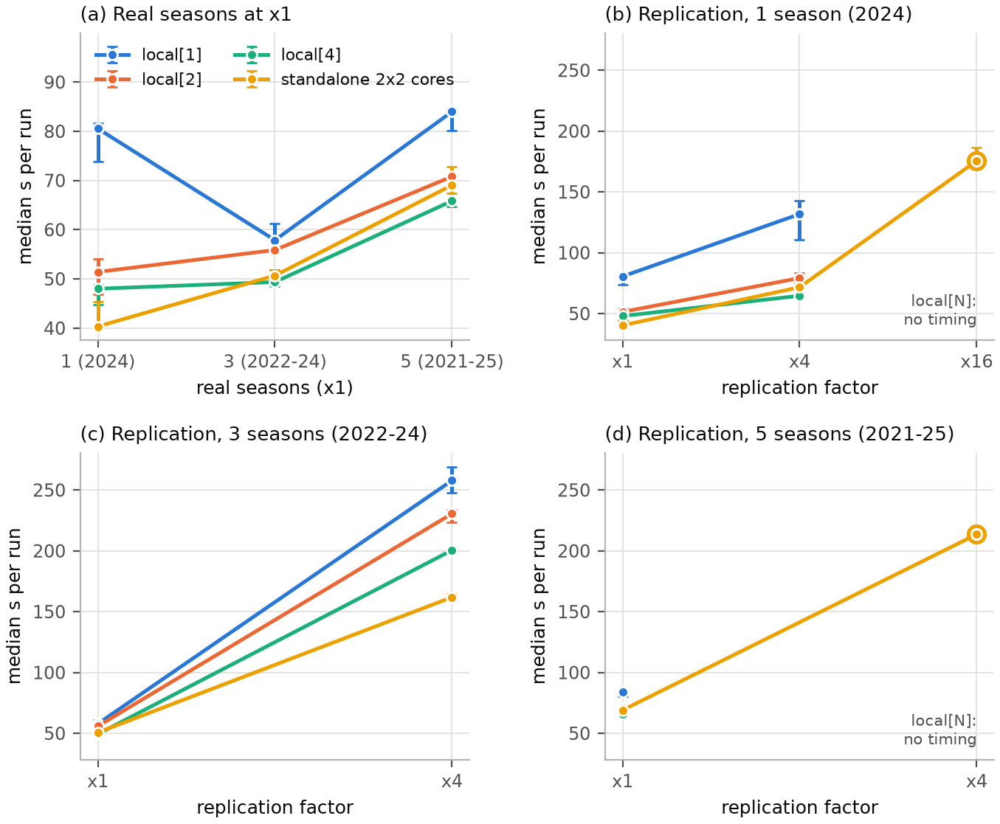
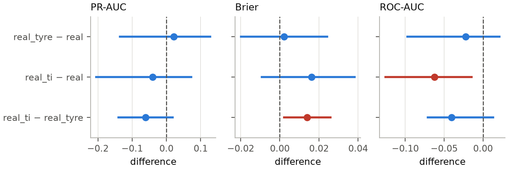

# F1 Strategy Analytics at Scale: Event-Driven Undercut Detection and What-If Race Strategy Simulation

Parinith D. (parinithd@iisc.ac.in) · Dakshinesh K. (dakshineshk1@iisc.ac.in) Rohan Deore (rohandeore@iisc.ac.in) · Kaushal V. (kaushalvadn1@iisc.ac.in) DA231o, Indian Institute of Science, Bengaluru

## 1. Problem

### 1.1 Definition

An undercut is a pit stop timed to gain track position: the car behind stops first and uses fresh tyres to close
the gap while the car ahead is still on worn ones. We ask, for every pair of cars on every lap: if the attacker pits
now, will it come out ahead once the defender has answered with its own stop?

For a gap threshold G and a response window k, an undercut attempt is a tuple (season, round, A, D, L), where
attacker A pits on lap L and defender D is the car directly ahead, such that:

1. at the end of lap L − 1, A runs directly behind D with 0 < gap ≤ G at the timing line, L ≥ 5, the two are not
   teammates, no car crossed the line between them, neither is lapped or on an in-lap or out-lap, and lap L − 1 is
   green and not a restart lap;
2. A pits on lap L, and D responds with its first stop in [L + 1, L + k];
3. the window passes 16 ordered exclusions, among them neutralised laps, retirements, long stops, suspected
   penalties, incidents, wet compounds and the race end.

The label is y = 1 if A is ahead of D on D's out-lap and y = 0 otherwise; if D stays out, the attempt has no label.
The task is to estimate P(y = 1) from what is known at the end of lap L − 1. The primary setting is G = 3.5 s,
k = 2, and G = 5.0 s, k = 3 is a sensitivity check. The definition was frozen early and never changed.

### 1.2 Motivation

Strategists make this call with seconds of margin. The answer depends on the gap, tyre age and degradation, the
pit-lane loss, out-lap pace and traffic at the rejoin point, and all of them change every lap. A data-driven answer
needs many races of history, features that never look ahead, and a live path that updates as each lap completes.
That makes it a natural big-data problem, from a partitioned lake to a measured event-driven serving path.

### 1.3 Design Goals

- **Partitioned multi-season lake:** raw data in HDFS and clean Parquet partitioned by season and race.
- **Decision-time features:** a feature for lap L uses only information available at the end of lap L − 1, built
  with the Spark RDD, DataFrame and SQL APIs.
- **Honest evaluation:** a chronological split (train 2021–2023, validate 2024, test 2025), calibrated
  probabilities and simple baselines to beat.
- **One rule for batch and stream:** the live detector flags the same pairs that the batch label considers.
- **Low-latency serving:** live state in a NoSQL store with namespaced keys and a TTL after the session, pushed to a
  dashboard.
- **Reproducibility:** a fresh clone rebuilds the sample pipeline end to end without credentials.

### 1.4 Features Required

- **Ingestion:** Jolpica (race, driver, constructor, qualifying, pit stop, lap) and FastF1 (timing and telemetry:
  speed, throttle, brake, gear, RPM).
- **Features and model:** gap change, tyre age, out-lap pace and pit loss; undercut detection; an MLlib model of
  undercut success with calibrated probabilities and its main factors explained.
- **Streaming and serving:** Kafka race events, Structured Streaming replay and detection, and Redis (a hash per
  driver, a sorted set for the order, a Pub/Sub channel per race).
- **Dashboard and what-if:** state, gaps, tyres, events and predictions, and a comparison of pit now, pit next lap
  and stay out from the same state.

### 1.5 Scalability and Performance Goals

We measured the system against these goals:
- **Scope:** the 2021–2025 seasons, about 50–100+ races.
- **Spark runtime and scaling trend** for 1, 3 and 5 seasons.
- **Speed-up from partitioning and caching** against an unpartitioned, uncached baseline.
- **Streaming latency** from event to result when one race is replayed, and **event throughput**.
- **Redis read and write latency** at the streaming rate.
- **Resource usage** of the batch and streaming jobs.

## 2. Approach and Methods

### 2.1 High-Level Design

Figure 1 shows the data flow. Ingest clients fill the raw zone of an HDFS lake, and Spark batch jobs clean the data,
build features, label undercut attempts and train the MLlib model. For the live path, a Kafka producer replays a race in race order at a chosen speed; Spark Structured
Streaming turns each micro-batch into features and probabilities and writes Redis; and FastAPI pushes every change
over Server-Sent Events (SSE) to a Next.js dashboard (Figure 2). Everything runs in Docker Compose on one host.

### 2.2 Architecture and Data Model

**Sources.** Jolpica-F1 provides races, drivers, constructors, qualifying, results, pit stops, lap times and
positions for 2021–2025; our client stays under 4 requests/s and 450/h, caches pages and resumes. Tyres, race
control, track status and telemetry were to come from FastF1, but since mid-October 2026 FastF1 downloads need an
F1 TV Access login, which nobody on the team has, and without it the library returns empty sessions. We take the
same FastF1-derived data from the TracingInsights season repositories instead, at pinned commits and checked file
by file.

**Lake zones.** One setting chooses the lake root (HDFS or a local folder), and every zone is partitioned by season
and round. Raw keeps Jolpica JSON as received and the TracingInsights tables, with a manifest per partition. Clean
holds typed Parquet written with dynamic partition overwrite, so a rerun is idempotent. Features holds enriched
laps, gaps, stints, priors and the undercut attempts, and archive holds one compressed bundle per race. The lake
has 114 races and 124,834 laps, with a raw zone of about 2.02 GB in 3,542 files; the 28 checks gave 0 hard failures
and 1 soft issue.

**Core entities.** Race, Driver, Lap, Tyre (compound and age per stint), Pit Stop, Position, Gap (to the car ahead
and the leader, at the timing line) and Telemetry (speed, throttle, brake, gear and RPM, aggregated per lap).

#### Real-Time Serving Layer: Redis 8.10 Schema

| Key (s = season, r = round) | Type | Fields or content | Lifetime |
|---|---|---|---|
| `race:{s}:{r}:driver:{driverId}` | HASH | `position`, `gap_ahead_s`, `gap_leader_s`, `tyre_compound`, `tyre_age_laps`, `last_lap_time_s`, `undercut_flag`, `undercut_prob`, `updated_at` | safety TTL on every write; EXPIRE after `session_end` |
| `race:{s}:{r}:order` | ZSET | member = driverId, score = position | as above |
| `race:{s}:{r}:events` | Pub/Sub | JSON messages: `lap`, `pit_in`, `pit_out`, `undercut_alert`, `session_end` | nothing stored |
| `race:{s}:{r}:tyre:{driverId}` | HASH (display) | `tyre_life_laps`, `tyre_life_at_start_laps`, `lap`, `updated_at` | as the driver hash |
| `race:{s}:{r}:timing:{driverId}` | HASH (display) | `lap`, `sector1_s`–`sector3_s`, `speed_trap_kph`, `pb_sector1_s`–`pb_sector3_s`, `pb_speed_trap_kph`, `pit_stops`, `updated_at` | as the driver hash |
| `meta:entrants`, `meta:analysis`, `meta:telemetry` (per race) | STRING | API response as JSON, tagged with a lake fingerprint | SET … EX, 3600 s by default |

The stream job writes each micro-batch of a race in one pipelined call: every HSET, ZADD, EXPIRE and PUBLISH goes
on a single pipeline, so a batch costs one round trip. Values are strings, and a missing value is the empty string.
Each write refreshes a safety TTL (6 h by default); `session_end` sets the after-session TTL on every key of the
race, and a new replay of a race first deletes only that race's keys. The display-only hashes and caches are never
read by the model, the rule or the what-if. We chose Redis because serving needs three structures at millisecond
latency: per-driver records updated field by field (hashes), a sorted running order (a sorted set) and a fan-out
channel that the API relays as SSE (Pub/Sub). A document or wide-column store would need a second system for the
push.

### 2.3 Big Data Platforms Used

| Platform | Role, and why we used it |
|---|---|
| HDFS 3.4.3 | Holds all lake zones. Ingest writes through HttpFS with an atomic rename and a sha256 per file; Spark reads it natively. |
| Spark RDD | Stint splitting (groupByKey and an ordered scan per driver), a mergeable lap-time distribution (aggregateByKey) and per-race undercut evaluation (cogroup and flatMap): per-key Python logic. Each has a DataFrame twin that agrees row for row. |
| Spark DataFrame | Joins and windows for cumulative time, timing-line gaps, tyre age and laps remaining, planned by Catalyst. |
| Spark SQL | The leakage-safe priors (pit loss, team out-lap) as one auditable window frame over strictly earlier races. |
| Spark MLlib | Logistic regression and gradient-boosted trees in pipelines with class weights. |
| Kafka 4.3 (KRaft) | A race-event topic with 3 partitions keyed by driver; an idempotent producer replays a race at 1x, 10x or 60x. |
| Structured Streaming | Reads Kafka with a 500 ms trigger; foreachBatch keeps per-race state, computes live features, applies the shared rule and the calibrated scorer, and writes Redis. |
| FastAPI + SSE | State, replays and controls, what-if, archive and analysis. SSE relays the race channel plus a full-state snapshot before each lap, so a stale flag clears without polling. |
| Next.js dashboard | TypeScript (strict): live race view, engineer view, what-if panel, post-race archive and race analysis. |

### 2.4 ML Methods Used

The primary feature set has 21 inputs (52 assembled columns): the gap and its change over 1 and 3 laps, stint
lengths, recent pace difference, degradation slopes, a pit-loss prior, an out-lap model and rejoin traffic. The
pit-loss prior is the median, over strictly earlier races, of in-lap + out-lap − 2 × the driver's green median
lap. The out-lap is split into the circuit's stop cost, the team's stop execution and a warm-up residual, the last
two estimated from earlier races and shrunk toward the parent level (κ = 5). A leakage test scales the target race
from lap L on, and every later race, by ×100 and checks that no decision feature moves.

We train LR and GBT on 2021–2023 with class weights from the training rows. LR searches regParam {0.0, 0.01, 0.1} ×
elasticNetParam {0.0, 0.5}, and GBT searches maxDepth {2, 3, 5} × maxIter {20, 50} × stepSize {0.05, 0.1}; the
highest 2024 PR-AUC wins (regParam 0.1, elasticNetParam 0.5; maxDepth 2, maxIter 50, stepSize 0.05). With fewer
than 300 labelled validation rows we use Platt scaling, fitted on 2024 only. The calibrated LR became the primary
model with the lowest calibrated validation Brier, 0.168 against 0.205 (both optimistic, as Platt is fitted and
scored on the same 49 rows). Two fixed baselines are never tuned: the
majority class, and a rule comparing the expected fresh-tyre gain with the gap.

The 2025 season was sealed. Before any 2025 number existed we froze the features, grids, calibration and selection
rules, the 0.5 threshold, the metrics and both settings. A second specification added two ablation sets, `real_tyre`
(TracingInsights compound and tyre age) and `real_ti` (plus per-lap telemetry), which could replace `real` only with
a leave-one-season-out PR-AUC at least 0.02 higher; neither did (0.413 for `real`, 0.402 and 0.374). The margin was
set after the development tables were seen, but both sets score below `real`, so it does not change the outcome. The single
test run covered 3 feature sets × 2 settings. Intervals are 95% percentile intervals from 1000 race-cluster
bootstrap resamples (whole races, seed 42).

Batch and stream call one pure-Python candidate rule. Replaying every 2021–2024 race through the stream processor
in micro-batches of 1, 7 and 50 events over 3 partitions matched 90 races, 34,608 eligible pairs and 157 labelled
attempts, with a maximum probability difference of 3.3e-16. The what-if simulator is a seeded Monte Carlo model
from the latest lap: lap time is pace plus a tyre model per circuit and compound, fitted on earlier races, plus
noise; stop loss follows the out-lap split; and a third car within 1.0 s ahead holds the pitting car 1.0 s behind
it. With 500 draws, seed 42 and common random numbers it reports, for pit now, pit next lap and stay out, the
probability that A ends up ahead, the expected gap and its 80% interval.

## 3. Evaluation

### 3.1 Experiment Design

Everything ran on one 12-CPU WSL 2 VM with about 14 GB of memory; the Spark container had 6 GiB, and a memory guard
killed any cell past 5.40 GiB. The split is train 2021–2023 (108 labelled attempts), validate 2024 (49) and test 2025
(49 in 19 races, base rate 0.347).
- **Scalability:** the feature build on 1, 3 and 5 real seasons and on synthetic copies (x4, x16); telemetry
  aggregation over the real 2024 samples (1.94 GB) with 5, 14 or 24 rounds; local[1], local[2], local[4] and a
  cluster of 2 workers × 2 cores; 1 warm-up + 3 timed runs per cell, median reported.
- **Partitioning and caching:** laps x16 and the 2024 telemetry, unpartitioned or by season and round, on file://
  and HDFS, with no cache, cache() or persist(DISK_ONLY), 5 timed runs.
- **Model and ablation:** the single 2025 run, then the frozen models scored again with one shared set of race
  resamples, giving paired intervals.
- **Streaming:** 2024 R5 (real laps and stops, synthetic tyres; 1,252 messages) at 1x for 900 s, 10x and 60x, on one
  clock, plus a 60x run with the dashboard in headless Chromium.
- **Redis:** the serving contract for 20 drivers at 1, 10 and 60 batches/s, 60 s each.
- **What-if:** pre-registered monotonicity, determinism and ordering checks, and a backtest.

### 3.2 Challenges and Changes

FastF1 began to require an F1 TV Access login and returns empty sessions without one, so tyres, race control and
telemetry moved to TracingInsights. Its compound coverage is low in two 2025 races (55.6% of laps in Miami, 93.5% in
Belgium); both stayed in the test set.

Six feature-build cells failed after 15–20 s with a StackOverflowError. Our race filter built a chain with one OR per
race, and Spark 4 converts such a column recursively: 264 races passed, 384 and 456 overflowed. A single flat IN over
(season, round) keeps the same rows and still prunes partitions. It also made the build faster (64.68 s to 54.03 s
and 49.36 s to 43.71 s in two re-timed cells), so cells timed before and after it are not strictly comparable.

At 1 season x16 and 5 seasons x4, all four local-mode cells hit the memory guard (5.44–5.56 GiB), since driver and
executors share one container. The cluster, whose executors live in the worker containers, finished both (175.6 s
and 213.6 s), but each run lost an executor to a heartbeat timeout and recovered.

Finally, valid undercuts are rare: 2025 has 49 labelled attempts in 19 races. We answered with race-cluster
intervals and pre-registration, not significance claims.

### 3.3 Scalability and Performance Metrics

At small sizes the fixed cost of a job dominates (Figure 3): 1 to 5 real seasons multiplies the lap rows by 4.7 but
the local[4] time only by 1.37 (48.0 → 65.8 s). At 3 seasons x4, local[1] took 257.8 s, local[4] 200.5 s and the
cluster 161.9 s [160.9, 164.8], 1.59x over local[1]. The 1-season local[1] value (80.5 s) sits above its 3-season
value (57.9 s), and we cannot explain it. Telemetry grows about linearly with the data; at 24 rounds local[1] takes
18.01 s, local[4] 7.49 s (2.40x) and the cluster 8.24 s (2.19x).

| Laps x16, speed-up against file://, unpartitioned, no cache | file:// | HDFS |
|---|---|---|
| partitioned, one race (input bytes) | 1.74x (1.29 MB to 4 KB) | 1.56x (11.1 MB to 8.7 KB) |
| partitioned, one season | 1.62x | 1.23x |
| partitioned, full scan / join | 0.30x / 0.32x | 0.14x / 0.12x |

Partitioning helps narrow queries and hurts full scans and joins, which open many small files. cache() gives 1.41x on one race, but materialising it takes 1.13 s, so it pays back only after roughly 25–40
such queries; it does not help telemetry (0.93-1.05x), and persist(DISK_ONLY) is mostly slower than no caching.

<figure><figcaption>Figure 3. Feature-build runtime by real seasons and by replication factor, per master (median with IQR bars; a hollow marker is a re-run after the race-filter fix).</figcaption></figure>

| Streaming, 2024 R5, steady state | 1x (first 900 s) | 10x | 60x |
|---|---|---|---|
| Produced → Pub/Sub, p50 / p95 / p99 | 729 / 1039 / 1115.4 ms | 786.5 / 1227.0 / 1586.5 ms | 798 / 1461.5 / 1757 ms |
| Redis write → SSE client, p50 / p99 | 2 / 5.4 ms | 2 / 8 ms | 2 / 5 ms |
| Throughput (messages/s) | 0.27 | 2.08 | 12.71 |

The 500 ms trigger and the Kafka hop take about 0.73–0.80 s of the median; every serving hop is a few
milliseconds, and the first race batch costs about 1.3–1.4 s more because it loads the priors. At 60x, SSE send to
browser paint is 28 / 37 / 40 ms and produced to paint 855 / 1519.5 / 3443.5 ms. Throughput equals the produced rate
with no backlog; the maximum was not load-tested. At 60 batches/s a 20-driver Redis write took 1.21 / 1.59 / 1.78 ms
and HGETALL 0.18 / 0.32 / 0.41 ms (p50 / p95 / p99), with 0 late ticks. An earlier run on a smaller, busier VM had
2876 late ticks, which we put down to that host. The streaming job tree peaked at 1.62 GiB at 60x (mean CPU 70 %),
Kafka at 641 MiB and Redis at 23 MiB.

### 3.4 Feature Metrics

| 2025, G = 3.5 s, k = 2 | PR-AUC | Brier | ROC-AUC | F1 (positive) | ECE (10 bins) |
|---|---|---|---|---|---|
| **Calibrated LR (primary)** | **0.670** **[0.421, 0.898]** | **0.177** **[0.106, 0.232]** | 0.792 [0.667, 0.929] | 0.571 [0.323, 0.778] | 0.107 [0.076, 0.234] |
| Rule baseline | 0.513 [0.246, 0.799] | 0.273 [0.168, 0.353] | 0.702 [0.516, 0.860] | 0.357 [0.000, 0.542] | 0.258 [0.162, 0.360] |
| Majority-class baseline | 0.347 [0.162, 0.517] | 0.229 | 0.500 | 0.000 | 0.051 |

The primary model beats the rule baseline on every metric, but the per-model intervals overlap widely, so we make no
significance claim. At the sensitivity setting (60 attempts in 20 races) its PR-AUC is 0.723 [0.541, 0.858].
Calibrated GBT has a slightly higher point PR-AUC, 0.703 [0.505, 0.872], but a worse Brier (0.194).

In the paired ablation (Figure 4), 46 of the 48 intervals contain 0. The two exceptions, both calibrated LR at the
primary setting, are `real_ti − real` ROC-AUC −0.062 [−0.126, −0.015] and `real_ti − real_tyre` Brier +0.014
[+0.002, +0.026]; with 48 intervals one or two are expected to exclude 0 by chance, so neither counts as a finding.
The tyre and telemetry inputs do not improve the model, and the deployed model stayed unchanged.

The what-if simulator passes monotonicity (0 of 155 states show a rise in P(pit now) with a larger pit loss) and
determinism (157 of 157 states identical under the same seed). Ordering passes 17 of 18 rows; the failing cell has
P(pit next lap) − P(pit now) = +0.022, because the extra simulated lap widens the spread. On 2025 the simulator has
Brier 0.245 and ECE 0.207 and over-predicts success (mean P 0.395 against an observed 0.347), while the calibrated
model stays at 0.177 and 0.107.

### 3.5 Analysis

What rests on engineering discipline worked. The features pass the leakage test, and the stream reproduces the
batch probabilities on all 90 development races in simulated micro-batches, so live alerts are the decisions we evaluated. Redis and SSE add
milliseconds, and the 500 ms trigger sets the end-to-end delay. The model's 2025 ECE (0.107) is well below the
rule's (0.258), so its probabilities read as probabilities.

Three things fell short. The model's lead over the rule is not established: with 49 test attempts the intervals are
wide, and in development the rule beat every model on leave-one-season-out PR-AUC (0.559 against 0.533). The LR is
also simple: it keeps 6 of the 52 columns, essentially the gap, its trend and the attacker's degradation, and the
richer tyre and telemetry inputs did not change that. Its probability is the chance of success given that D
responds within k laps, which is itself unknown at decision time. The replay also carries two hindsight inputs,
the heuristic track status and the race distance, which a live deployment would take from race control. And the
simulator compares strategies from one state; it does not give calibrated odds. The scaling results hold for this host only: every node
is a container on one VM, with no network shuffle or data locality, and inputs beyond the real data (about 2 GB raw)
are exact copies with shifted keys.

## 4. Summary

| Goal | Achieved |
|---|---|
| Multi-season lake, 2021–2025, about 50–100+ races | 114 races in an HDFS lake partitioned by season and round |
| F1 against the majority-class baseline | 0.571 [0.323, 0.778] against 0.000; PR-AUC 0.670 against 0.347 |
| Calibration | ECE 0.107 [0.076, 0.234]; Brier 0.177 [0.106, 0.232] |
| Spark runtime and scaling trend | telemetry 18.01 s → 7.49 s (2.40x) on local[4]; build at 3 seasons x4 fastest on the cluster, 1.59x over local[1] |
| Speed-up from partitioning and caching | one race 1.74x (file://), 1.20x (HDFS); full scans 0.30x; cache() 1.41x on one race |
| Streaming latency | end to end at 60x 798 / 1461.5 / 1757 ms; SSE send → paint 28 / 37 / 40 ms |
| Event throughput | 12.71 messages/s at 60x, equal to the produced rate; maximum not load-tested |
| Redis read/write latency at streaming rate | write 1.21 / 1.59 / 1.78 ms at 60/s; 0 late ticks |
| Resource usage | host job tree 1.62 GiB at 60x; Spark cells measured against a 5.40 GiB memory guard |
| Useful and consistent what-if comparisons | monotonicity and determinism pass; ordering 17 of 18; 2025 simulator ECE 0.207 |
| Interactive dashboard | live race, engineer, what-if, archive and analysis views; UI paint p50 28 ms |

### 4.1 Achievement of Design Goals

Every design goal was met: the lake is partitioned in HDFS, the features pass the leakage test, 2025 was opened once
under a frozen specification, batch and stream agree, and serving adds only milliseconds. A fresh clone runs the
sample demo in about 193 s with a warm image cache and no credentials.

### 4.2 Changes and Additions

We evaluated logistic regression and gradient-boosted trees, and deployed the calibrated logistic regression for
its lower validation Brier score. FastF1 gave way to TracingInsights, scale-up beyond the real data uses synthetic copies, and
the cluster is two worker containers on one machine. We also added features: an engineer view of one car's
neighbours, tyres and rejoin point; a post-race archive replayed through the live code and checked equal to a live
replay; race analysis (tyre strategy, lap times, degradation, positions, pit stops, race control) with a telemetry
overlay for 2024; and replay controls to pause, change speed or stop.

### 4.3 Future Extensions

Real race-control track status would replace our hindsight heuristic and admit wet and drying laps, after a fresh
review on 2021–2024. More labelled attempts (more seasons, sprint races) would narrow the intervals. A multi-host
cluster and a load test would measure network shuffle and the streaming path's maximum throughput.

## References

1. Jolpica-F1 API, https://github.com/jolpica/jolpica-f1 (CC BY-NC-SA 4.0).
2. TracingInsights season repositories, https://github.com/TracingInsights (FastF1-derived Formula 1 timing data).
3. FastF1, https://github.com/theOehrly/Fast-F1.
4. Apache Spark 4.2.1, Apache Hadoop 3.4.3, Apache Kafka 4.3, Redis 8.10, FastAPI and Next.js 16.4.5.
