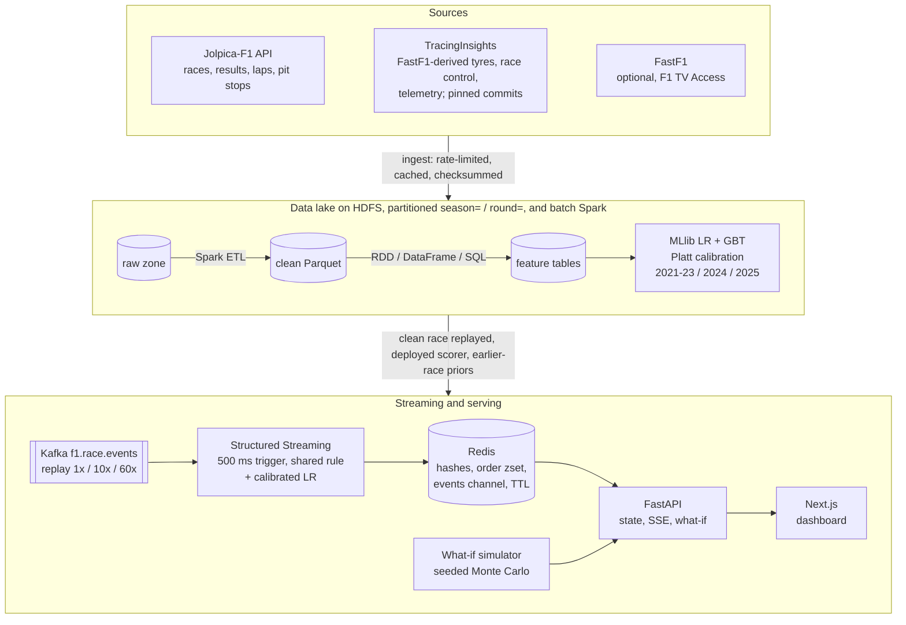
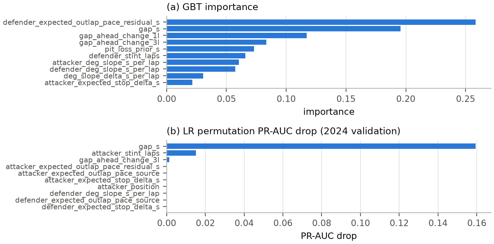
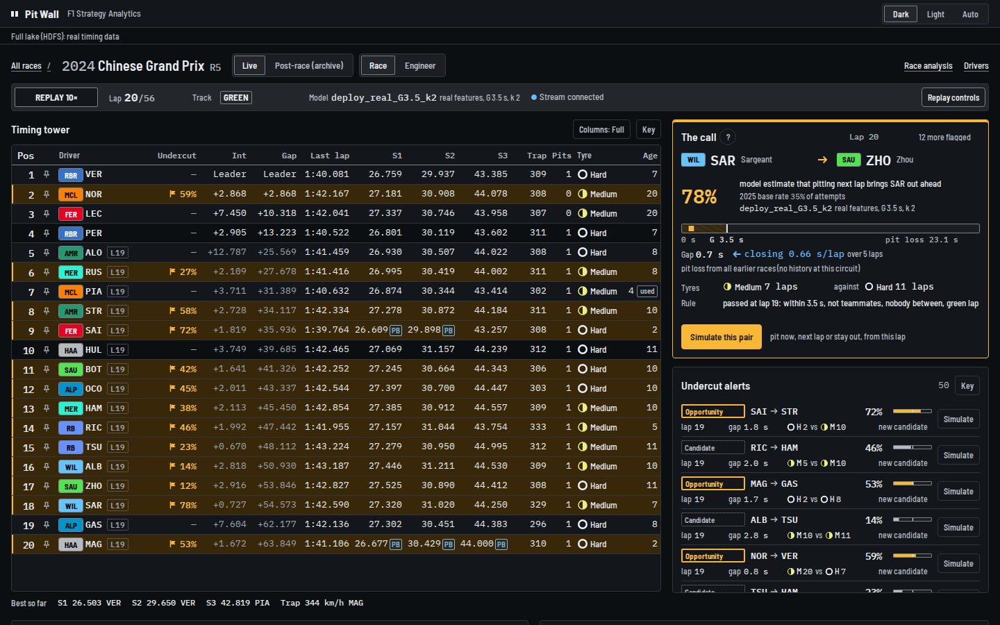
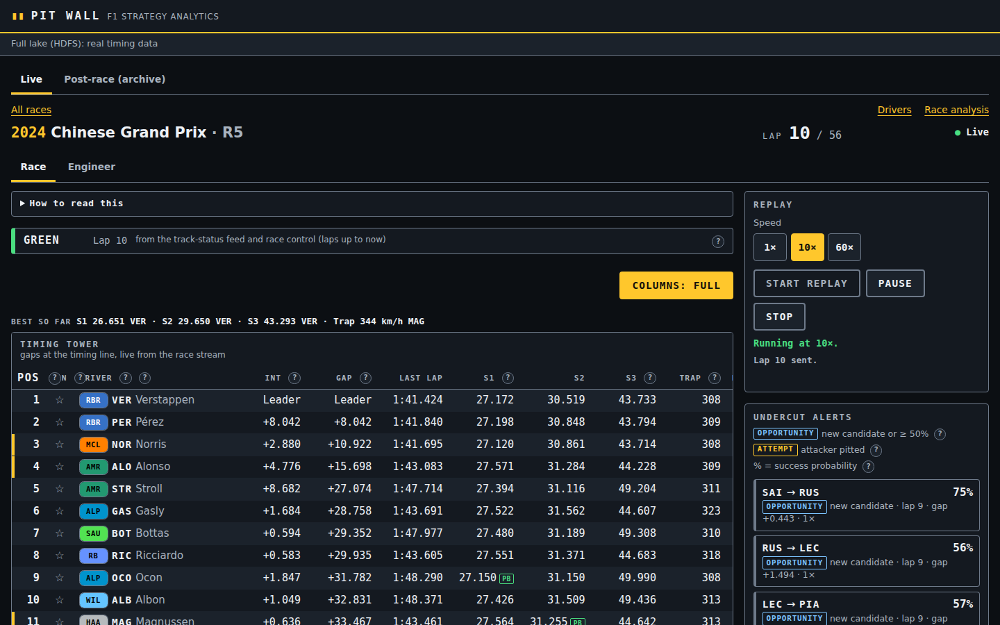
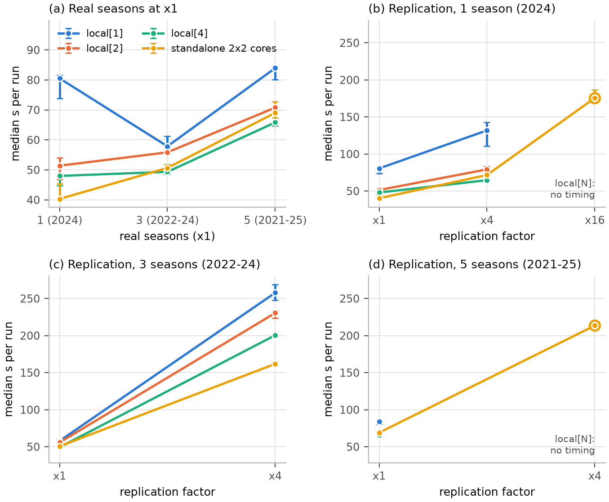

# F1 Strategy Analytics at Scale

**Final report.** DA231o course project, M.Tech, Indian Institute of Science (IISc), Bengaluru.
Team **Data Wranglers**: Parinith D., Dakshinesh K., Rohan Deore, Kaushal V.
Repository state: `main` after the final dashboard audit and the final proofs (2026-11-20). Code: MIT. Data: see §4.5.

Every number is copied from a committed file in `results/` or `docs/`, and its source is named after each table or
claim. Appendix A lists every headline number with its source; a unit test checks that each appears there verbatim.
Where the project docs make no significance claim, this report makes none.

<!-- toc -->

## 1. Abstract

An undercut is a pit stop timed to gain track position on fresh tyres. We built an end-to-end big-data pipeline that
asks, lap by lap, whether a car that pits to undercut the car ahead will come out in front. Timing for 2021–2025 (114
races) from Jolpica-F1 and TracingInsights lands in an HDFS data lake partitioned by season and round. Spark RDD,
DataFrame and SQL jobs build features that use only information available at the end of the previous lap. A
calibrated MLlib logistic regression, trained on 2021–2023 and tuned and calibrated on 2024, was tested once on 2025
under a pre-registered specification. On 49 labelled attempts it reached PR-AUC 0.670 [0.421, 0.898] and Brier 0.177
[0.106, 0.232], better than the rule baseline on every metric but with overlapping intervals. Kafka replays feed
Spark Structured Streaming, which applies the same rule and scorer as the batch path (parity on 90 races) and writes
Redis. FastAPI pushes the state over Server-Sent Events to a Next.js dashboard with a Monte Carlo what-if simulator.
On a single host, for one replayed race (2024 R5, sample lake), steady-state end-to-end latency at 60x is 798 /
1461.5 / 1757 ms (p50 / p95 / p99).

## 2. Problem and motivation

**The question.** Car A runs directly behind car D. If A pits now, does A come out ahead of D once D has answered with
its own stop? The answer depends on the gap, tyre age and degradation, the pit-lane loss, out-lap pace and traffic,
and all of them change lap by lap.

**Why it suits a big-data course.** The question needs the whole stack: a multi-season lake partitioned by season
and race; distributed feature engineering whose features may use only information available when the decision is
made; a model evaluated strictly in time order with a sealed test season; an event-driven serving path whose delay is
measured; and benchmarks of how the Spark jobs scale and what partitioning and caching buy.

**Scope of the commitments.** The 44 proposal commitments are tracked in `docs/traceability.md`, and this report
follows their order. The proposal PDF itself is not in the repository, so the matrix is the reference.

## 3. System design

### 3.1 Architecture

Figure 1. Data flow from the sources to the dashboard (rows: sources, lake and batch Spark, streaming and serving). Every component runs in Docker Compose on one host
(`docker-compose.yml`, profiles `core` and `full`). Source: `docs/architecture.md`, README "Architecture".

### 3.2 The role of each platform

| Platform | Role in the pipeline | Code |
|---|---|---|
| HDFS 3.4.3 (namenode, datanode, HttpFS) | Holds the raw, clean, feature and archive zones. The ingest writes through HttpFS: atomic temp name, then rename, with a sha256 per file | `ingest/sinks.py` (`HdfsSink`), `lake/paths.py` |
| Spark RDD | Stint splitting (`groupByKey`, then a sequential scan per driver), a mergeable lap-time distribution (`aggregateByKey`), and per-race undercut evaluation (`cogroup` + `flatMap`) | `etl/rdd_jobs.py`, `features/undercut.py` |
| Spark DataFrame | Joins and window functions: cumulative time, timing-line gaps, tyre age, laps remaining, decision-lap features | `etl/df_jobs.py`, `features/` |
| Spark SQL | The leakage-safe priors (pit loss, team out-lap) as one auditable window frame over strictly earlier races | `etl/sql/*.sql`, `etl/sql_jobs.py` |
| Spark MLlib | Logistic regression (LR) and gradient-boosted trees (GBT) in `Pipeline`s, a time-ordered split, Platt calibration | `model/` |
| Kafka 4.3 (KRaft) | Topic `f1.race.events`, 3 partitions. The producer replays one race in race order at a speed factor (acks=all, idempotent, key = driver) | `streaming/producer.py` |
| Spark Structured Streaming | Reads Kafka with a 500 ms trigger. `foreachBatch` keeps per-race state, computes live features, applies the shared rule and the calibrated scorer, and writes Redis | `streaming/stream_job.py`, `processor.py` |
| Redis 8.10 | Live state (hashes, sorted set), a Pub/Sub channel per race, and TTLs | `serving/keys.py`, `serving/redis_store.py` |
| FastAPI + SSE | `GET …/state`, `GET …/events` (Server-Sent Events from the race channel), replays and their controls, the what-if, the archive and the analysis views | `api/` |
| Next.js dashboard | Live race view, engineer view, what-if panel, post-race archive, race analysis and telemetry | `web/` |

Source: `docs/architecture.md` ("Where each Spark API is used, and why", "Streaming", "API").

### 3.3 Redis schema (exact, tested in `tests/unit/test_keys.py`)

| Key or channel | Type | Content | Lifetime |
|---|---|---|---|
| `race:{season}:{round}:driver:{driverId}` | HASH | the 9 fields `position`, `gap_ahead_s`, `gap_leader_s`, `tyre_compound`, `tyre_age_laps`, `last_lap_time_s`, `undercut_flag`, `undercut_prob`, `updated_at` | safety TTL on every write; EXPIRE after `session_end` |
| `race:{season}:{round}:order` | ZSET | member = driverId, score = position | as above |
| `race:{season}:{round}:events` | PUB/SUB | JSON messages of type `lap`, `pit_in`, `pit_out`, `undercut_alert`, `session_end` | channels have no TTL |
| `race:{season}:{round}:tyre:{driverId}` (additive, display only) | HASH | `tyre_life_laps`, `tyre_life_at_start_laps`, `lap`, `updated_at` | as the driver hash |
| `race:{season}:{round}:timing:{driverId}` (additive, display only) | HASH | `lap`, `sector1_s`, `sector2_s`, `sector3_s`, `speed_trap_kph`, `pb_sector1_s`, `pb_sector2_s`, `pb_sector3_s`, `pb_speed_trap_kph`, `pit_stops`, `updated_at` | as the driver hash |
| `meta:entrants:{s}:{r}`, `meta:analysis:{s}:{r}:{view}`, `meta:telemetry:{s}:{r}:laps:{CODE}`, `meta:telemetry:{s}:{r}:trace:{CODE}:{lap}` (additive API caches) | STRING | JSON tagged with a lake fingerprint | `SET … EX` (default 3600 s); outside `race:*` |

Every value is a string; a missing value is `""`, and `tyre_compound` is `UNKNOWN` rather than empty. One
`write_batch` per micro-batch and race queues every HSET, ZADD, EXPIRE and PUBLISH on one pipeline. Every write is
followed by `EXPIRE REDIS_SAFETY_TTL_S` (6 h by default); on `session_end`, `expire_race` SCANs `race:{s}:{r}:*` and
sets `REDIS_TTL_AFTER_SESSION_S` on every key. An API replay start first deletes every `race:{s}:{r}:*` key of that
race (SCAN + DEL), only while no replay of that race runs, and never `meta:*` or other races. The tyre hash, the
timing hash and the caches are display only: the model, the rule, the live features and the what-if never read them.
Source: `CLAUDE.md` "Redis contract", `docs/architecture.md` "Redis serving".

## 4. Data

### 4.1 Sources

| Source | What it provides | Why |
|---|---|---|
| Jolpica-F1 API | races, drivers, constructors, qualifying, results, pit stops, lap times and positions | the backbone: every race 2021–2025. The client keeps to at most 4 requests/s and 450/h, and caches and resumes (`ingest/ratelimit.py`, `ingest/manifest.py`) |
| TracingInsights season repositories | FastF1-derived compounds, tyre life, race control, track status, per-lap telemetry (speed, throttle, brake, gear, RPM) | replaces direct FastF1. Files are downloaded at pinned commits and each is checked against its git blob id |
| FastF1 (optional) | the same timing and telemetry directly | kept, tested and failing loudly, but unused for results |

**Why TracingInsights instead of FastF1.** "Since mid-October 2026, FastF1 downloads need an F1 TV Access login,
which nobody on the team has." Without it FastF1 returns empty sessions, so compounds, tyre life, race control and
telemetry would have been null or synthetic in full mode. TracingInsights publishes the same FastF1-derived data per
season. Commitment #4 is therefore **partial**: the data is there, but it does not come through the FastF1 library.
Source: `docs/data_source_audit.md`, `docs/traceability.md` #4.

### 4.2 Scope

The lake holds 2021–2025 (114 races in the lake). The API catalog serves the 90 races of 2021–2024, because 2025 is
the sealed test season (`docs/traceability.md` #6).

**Volume.** The HDFS raw zone holds 2,024,360,565 B and 3,542 files (about 2.02 GB) (`docs/data_dictionary.md`,
telemetry trace table). The clean zone has 124,834 laps over the five seasons (`docs/experiments.md`, real seasons
at x1). The 2024 per-lap telemetry trace table, resampled on a distance grid, is 209,217,336 B (209 MB, zstd) on
HDFS.

| Season | Races | Results | Laps | Pit stops | Stints | Undercut rows (all 9 G, k settings) |
|---|---|---|---|---|---|---|
| 2021 | 22 | 440 | 23,688 | 798 | 1,223 | 3,543 |
| 2022 | 22 | 440 | 23,529 | 805 | 1,232 | 3,321 |
| 2023 | 22 | 440 | 24,386 | 912 | 1,342 | 4,074 |
| 2024 | 24 | 479 | 26,574 | 825 | 1,289 | 3,582 |
| 2025 | 24 | 479 | 26,657 | 821 | 1,285 | 4,257 |

Source: `docs/data_dictionary.md` "Coverage" (from `results/full_data_quality.json`).

TracingInsights compound coverage is low in two 2025 races: Miami R6, where 55.6% of laps have a compound, and
Belgium R13, at 93.5%. Both stay in the test set unchanged (`docs/model_results.md`).

### 4.3 Lake zones and partitioning

- **Raw zone** (`raw/<source>/<table>/season=S/round=R/`): Jolpica JSON pages exactly as received, plus TracingInsights
  tables. Every partition has a `_manifest.json` with files, rows, sha256, source URL, licence and `is_synthetic`.
- **Clean zone** (`clean/{table}/season=S/round=R/`): typed Parquet tables (races, drivers, constructors, results,
  qualifying, laps, pit stops, stints, telemetry), written with `partitionBy("season","round")` and dynamic
  partition overwrite. A rerun is idempotent.
- **Feature zone** (`features/{table}/season=S/round=R/`): `laps_enriched`, `gaps`, `stints`,
  `lap_time_distribution`, `pit_loss`, `team_outlap_history`, `race_summary`, `outlap_features`, `undercut_attempts`.
- The storage root comes only from `Settings.data_lake_uri` (`hdfs://namenode:8020/f1` or `file://./data/lake`).

Source: `docs/architecture.md` "Raw zone layout", "Clean zone", "Feature jobs".

### 4.4 Quality checks

`lake/quality.py` runs hard checks (null and duplicate keys, schemas) that fail the job, and soft checks that are
reported. On the full lake: "28 checks: 0 hard failures and 1 soft issue". The soft issue is 5 disqualified drivers
whom Jolpica gives `laps = 0` although they have lap rows. Two complete runs gave identical table checksums.
Source: `docs/data_dictionary.md` "Quality checks".

### 4.5 Licences

- **Jolpica-F1:** CC BY-NC-SA 4.0. Only the small sample in `data/sample/` (two races) is committed.
- **Formula 1 timing data**, through FastF1 or TracingInsights, is owned by Formula 1 / FOM. It is used for private
  academic study only and never committed. The TracingInsights repositories are MIT (2021–2024) or Apache-2.0
  (2025), but those licences do not cover the underlying data.
- **The sample's tyres and telemetry are synthetic** and marked `is_synthetic=true`.

Source: `DATA_LICENSES.md`.

## 5. Processing and features

**Terms used below.**
- **SC / VSC:** safety car / virtual safety car. Laps run under either (or under a red flag) are *neutralised*.
- **The timing line** is the start/finish line, where every lap time is recorded. Gaps are measured there, as the
  difference of cumulative race times at the same lap number.
- **Decision lap L − 1 and attempt lap L:** L is the lap on which the attacker pits (its in-lap). The decision is
  made at the end of lap L − 1, the last completed lap before the stop, and features may use nothing later.

### 5.1 The three Spark APIs

| API | Job | Why this API |
|---|---|---|
| RDD | `rdd_stints`: `keyBy((season, round, driver))` → `groupByKey` → a sorted scan that splits after each pit-in lap | a sequential scan over one driver's ordered laps (at most about 70) is plain Python over a grouped iterator |
| RDD | `rdd_lap_time_distribution`: `aggregateByKey` with a mergeable (n, mean, M2, min, max, histogram) accumulator, combined with Chan's update; circuit lookup as a broadcast variable | a user-defined aggregate combined before the shuffle |
| RDD | undercut evaluation: `keyBy(season, round)` on laps and pit stops, `cogroup`, `flatMap(evaluate_race)` | one race (about 1,200 lap rows) fits in a task, and races are independent |
| DataFrame | `enrich_laps`: joins of laps, results, pit stops, drivers, constructors, stints (range join) and races; windows for cumulative time, gaps, `lag` changes, tyre age, laps remaining | Catalyst optimises the joins and windows |
| Spark SQL | `pit_loss_prior`, `team_outlap_prior`, `race_summary` | the leakage rule sits in one readable window frame: `RANGE BETWEEN UNBOUNDED PRECEDING AND 1 PRECEDING` over `race_seq = season*100 + round` |

Each RDD job also has a DataFrame implementation, and the tests assert that the two agree row for row. Source:
`docs/architecture.md` "Where each Spark API is used, and why", "Undercut attempts and the real-time detector".

### 5.2 Features

- **Gap and gap change.**
  - `gap_ahead_s` is the difference of cumulative times at the same lap number, measured at the timing line.
  - `gap_ahead_change_1l` and `gap_ahead_change_3l` are its change over 1 and 3 laps. They are null if the car
    ahead changed.
- **Tyre age.**
  - Stint length from real stint boundaries (`attacker_stint_laps`, `defender_stint_laps`) in the primary feature set.
  - TracingInsights compound and tyre life in the ablation sets (§7.5).
- **Pace and degradation.** `pace_delta_last3_s` (the mean of the last up to 3 green laps of the stint, attacker
  minus defender) and the least-squares lap-time slope per tyre-age lap (`*_deg_slope_s_per_lap`).
- **Pit loss.** `pit_loss_prior_s` = the median, over strictly earlier races, of in-lap + out-lap − 2 × the driver's
  green median lap. It falls back from circuit to global, with a source flag.
- **Out-lap pace.** The realised out-lap delta is split into three parts:
  - the circuit's stop cost;
  - the team's stop execution (`expected_stop_delta_s`);
  - a warm-up residual (`expected_outlap_pace_residual_s`).

  The last two are estimated from strictly earlier races and shrunk toward the parent level (κ = 5).
- **Rejoin traffic.** `rejoin_traffic_cars` and `rejoin_nearest_ahead_s`: cars whose on-track gap behind A at L − 1
  lies in (pit_loss − 3.0 s, pit_loss], so A would rejoin just behind them.

The primary feature set `real` has 21 inputs, which become 52 assembled columns. A numeric null becomes 0.0 plus a
`_missing` indicator, and a categorical null becomes an `unknown` level. Source: `docs/label_definition.md`
"Decision-time features", `docs/model_spec.md` "Feature set".

### 5.3 Leakage rules

The core rule: a feature for a decision at lap *L* may only use information available at the **end of lap L − 1**.
1. Lap-level features are joined at the decision lap L − 1, never at L.
2. Priors (pit loss, out-lap residual, stop delta) use expanding windows over strictly earlier races.
3. Realised out-lap values of the current race are ORACLE-only. ORACLE means known only after the decision, and
   allowed only in a labelled ablation.
4. **Leakage test** (`tests/unit/test_undercut.py`, `test_outlap.py`): the target race from lap L on, and every later
   race, are scaled ×100. Every decision feature must stay unchanged.

The track-status heuristic uses the whole race's median lap. It is therefore used only for eligibility and
exclusion, never as a feature. Source: `docs/label_definition.md` "Leakage rules", "Track status".

**Why labels still use the heuristic although TracingInsights has track status.** The label definition was frozen
(git tag `label-definition-v1`, 2026-11-11) before the TracingInsights ingest (2026-11-12), and changing it would
change labels. TracingInsights track status is therefore used only for display: the race-analysis tables, the
dashboard's race-status line and the archive's flag lane. Its two forms, per-lap codes and race-control periods,
agree with each other: "463 leader laps flagged by both, 0 by only one source" (`docs/PROGRESS.md`, race-analysis
evidence). This checks the display data only; the heuristic itself was not compared with TracingInsights.

## 6. Undercut definition and detection

**Definition** (frozen, git tag `label-definition-v1`). For a gap threshold G and a response window k, an undercut
attempt is a tuple (season, round, attacker A, defender D, lap L) such that all of the following hold:
1. **The candidate rule holds at the end of lap L − 1.**
   - A is directly behind D, with 0 < gap ≤ G.
   - L ≥ 5.
   - A and D are not teammates.
   - No other car crossed the line between them.
   - Neither car is lapped, on an in-lap or on an out-lap.
   - Lap L − 1 is green and not a restart lap.
2. **A pits on lap L.**
3. **D responds** with its first stop in [L + 1, L + k]. If D stays out, the outcome is `defender_stayed_out`, which
   is not labelled.
4. **The window passes 16 ordered exclusions**, among them neutralised laps, retirements, long stops, suspected
   penalties, incidents, wet compounds and the race end.

**Label** = 1 if A is ahead of D on D's out-lap, else 0. The primary setting is G = 3.5 s, k = 2, and the
sensitivity setting is G = 5.0 s, k = 3.

**One rule, two callers.** `features/undercut_rule.py` is pure Python (no Spark, pandas or py4j; a subprocess test
enforces it). The batch label (`features/undercut.py`) and the real-time detector (`streaming/detector.py`) both call
it. A test checks, on every scenario, lap and G, that the detector's flagged pairs, where A pits on L, equal the batch
attempts with `detector_eligible`.

**Labelled attempts at the primary setting:** train 2021–2023 108 (32, 32, 44) (one figure per season), validation 2024 49,
test 2025 49. Source: `docs/label_definition.md`, `docs/data_dictionary.md` "Undercut attempt counts".

## 7. Model

### 7.1 Split, baselines and candidates

**Chronological split.** Train 2021–2023, validate 2024, test 2025.
- Validation is used for hyperparameter selection and for calibration.
- The test split is a `SealedSplit`: only `evaluate.evaluate_test` can open it, and only once per setting.
- Class weights come from the training rows only.

**Baselines.** These are fixed reference points, never candidates and never tuned:
- the **majority-class** baseline, which predicts the training positive rate;
- the **rule** baseline, which compares the expected fresh-tyre gain with the gap and uses decision-time inputs only.

**Candidates.** Each model is fitted on 2021–2023, and the grid point with the highest 2024 PR-AUC is kept (seed 42):

| Model | Pipeline | Grid | Selected |
|---|---|---|---|
| LR | VectorAssembler → StandardScaler → LogisticRegression (maxIter 200, weightCol) | regParam {0.0, 0.01, 0.1} × elasticNetParam {0.0, 0.5} | regParam 0.1, elasticNetParam 0.5 |
| GBT | VectorAssembler → GBTClassifier (weightCol, seed 42) | maxDepth {2, 3, 5} × maxIter {20, 50} × stepSize {0.05, 0.1} | maxDepth 2, maxIter 50, stepSize 0.05 |

Source: `docs/model_spec.md`.

**Metrics** (defined once here):
- **PR-AUC** is step-wise average precision.
- **Brier** is the mean squared error of the probability.
- **ECE** (expected calibration error) uses 10 equal-width bins.
- **F1** is for the positive class at the fixed threshold 0.5, set before any full-data run and never tuned.
- **Intervals** are 95% percentile intervals from 1000 **race-cluster** bootstrap resamples (whole races resampled,
  seed 42).

### 7.2 Calibration and the primary model

With fewer than 300 labelled validation rows, Platt scaling is used without comparing it with isotonic. That gives
Platt for both models in both settings (49 and 64 validation rows).

The **primary model is the calibrated LR**, because it has the lowest calibrated validation Brier: 0.168 against
0.205 for calibrated GBT at G=3.5, k=2 (Platt is fitted and scored on the same 49 validation rows, so both Brier
values are optimistic). 2024 is used both to select the grid point and to fit the calibration; there is no separate
calibration season. The primary model was named before the test run and not re-chosen afterwards. The same
specification, trained once without reading 2025 (`make model-save-full`), is the deployed model. Streaming scores it
with a pure-Python scorer that equals Spark within 1e-9. Source: `docs/model_spec.md` "Calibration",
"Primary model", "Deployment artefact".

### 7.3 Explanations

`model/explain.py` reports three things: GBT importances, standardised LR coefficients, and permutation importance on
validation, all in `results/feature_importance_G3.5_k2.csv` (Figure 2).

At the primary setting:
- **The gap dominates.**
  - LR coefficient of `gap_s` on the standardised column: -0.694987 log-odds per 1 sd. A larger gap lowers the odds.
  - LR permutation PR-AUC drop for `gap_s`: 0.159439.
  - GBT importance of `gap_s`: 0.195536.
- **GBT's largest importance is `defender_expected_outlap_pace_residual_s`** (0.258437), the defender's prior
  out-lap residual.
- **The attacker's degradation slope** has the second-largest LR coefficient (0.212565).
- **The LR is sparse.** The elastic net (regParam 0.1, elasticNetParam 0.5) leaves 6 of the 52 assembled columns
  non-zero: `gap_s`, `attacker_deg_slope_s_per_lap`, `gap_ahead_change_1l` (-0.163837), `attacker_stint_laps`
  (-0.059743), `defender_expected_outlap_pace_residual_s` (0.049918) and `gap_ahead_change_3l` (-0.029925). The
  pit-loss prior, rejoin traffic, laps remaining, both stop-delta priors and the attacker's out-lap residual get
  zero weight. In effect the model is gap + gap trend + attacker degradation, with two small terms. The deployed
  scorer (`models/undercut/deploy_real_G3.5_k2`) has the same 6 non-zero columns, and the permutation drop is
  material only for `gap_s`.

### 7.4 Pre-registration and the single 2025 run

- **v1 (`docs/model_spec.md`, tag `model-spec-v1`)** froze the following before any 2025 number was seen: the
  features, grids, calibration rule, selection rule, threshold, metrics, headline metrics and settings.
- **v2 (`docs/model_spec_v2.md`, tag `model-spec-v2`)** added two ablation feature sets and a rule for when one of
  them could replace `real`: a mean leave-one-season-out PR-AUC at least 0.02 above it.
  - Leave-one-season-out (LOSO) fits on three of 2021–2024 and scores the fourth.
  - Neither set qualified: 0.413 for `real`, 0.402 for `real_tyre` and 0.374 for `real_ti`, so `real` stayed primary.
  - The form of the rule was written before any development table for the two sets existed, but the 0.02 margin
    was fixed after those tables had been seen. Both sets score below `real`, so the outcome is the same for any
    margin of 0 or more (`docs/model_spec_v2.md` §2).
- **Approval.** On 2026-11-13 the specs were approved for the single test run "by Parinith D. on behalf of the team"
  (the approval record at the end of `docs/PROGRESS.md`).
- **The one run.** `make model-test-full CONFIRM=yes` ran 3 feature sets × 2 settings. It refuses to run again once
  its files exist. An earlier attempt crashed overnight before any test number was written, and the rerun rule
  allowed it to be repeated.

## 8. Streaming and serving

- **Replay.** The producer reads only the race's `season=S/round=R` clean partitions and sends `pit_in`, `lap`,
  `pit_out` and `session_end` events in race order, scaled by the replay speed (1x, 10x, 60x). Season 2025 is refused
  unless `--allow-test-season` is given.
- **Micro-batches.** Structured Streaming reads Kafka with a 500 ms trigger.
  - The state is held driver-side inside `foreachBatch` and snapshotted after every batch. A restarted job restores it.
  - A decision at lap L − 1 is evaluated once every crossing the rule needs has arrived: the watermark must pass
    `T_A(L-1) + pit loss`. A car missing for 2 leader lap times is treated as retired.
- **Hindsight inputs.** Two inputs cannot be reproduced live from events up to L − 1: the heuristic track status
  (it divides by the whole race's median lap) and `race_laps` (the winner's lap count). The replay carries the batch
  values on each lap event. They are the only non-causal values in the stream. A live deployment would take them from
  race control and the scheduled distance.
- **Parity with batch.** `make stream-parity-full` replays every race through the stream processor:
  - simulated micro-batches of 1, 7 and 50 events over 3 partitions, plus a lagging-partition variant;
  - a comparison with Spark's `PipelineModel.transform` + calibrator of the eligible pair set at every decision lap,
    the 21 inputs of every labelled attempt, and its probability.

  On the full lake, 2021–2024: 90 races, 34,608 eligible pairs and 157 labelled attempts matched. The maximum input
  difference is 0.0, and the maximum probability difference is 3.3e-16. Source: `docs/architecture.md`
  "Feature parity", `results/stream_parity_full.csv`.
- **Alert policy.** The rule and the scorer evaluate every eligible pair on every lap, but only changes are
  published:

  | Reason | Published when |
  |---|---|
  | opportunity | the pair becomes eligible |
  | opportunity | its P crosses the deployed threshold 0.5 |
  | attempt | the attacker of an eligible pair pits |

  The published alerts do not depend on how the stream is cut into micro-batches (tested). On the sample race
  2024 R5, 409 eligible pairs over the race now give 141 alerts (113 new candidates, 19 threshold crossings, 9
  attempts). Source: `docs/architecture.md` "Redis writes and latency fields".
- **SSE push.** `GET /api/races/{s}/{r}/events` subscribes to the race channel.
  - It sends each message as an SSE frame, plus a full-state `snapshot` before the first `lap` frame of every race
    lap, so a stale `undercut_flag` is cleared without polling.
  - The connect snapshot also carries the current run's newest alerts (at most 50).
  - Pub/Sub keeps no history, so a client sees only what is published after it subscribes.

  Source: `docs/architecture.md` "SSE framing".

## 9. What-if simulator

The simulator answers one question from the race state at the end of lap C (the attacker's latest lap), for the car
directly ahead. For each strategy it gives the probability that A is ahead once both cars have stopped, the expected
gap, and its 80% interval. The strategies are `pit_now` (A's in-lap is C + 1), `pit_next_lap`, and `stay_out` (an
overcut, where A pits the lap after D).
Two defender responses are simulated: D covers one lap after A (primary) or k = 2 laps after (sensitivity).
Everything below was pre-registered in `docs/sim_spec.md` before any backtest:
- **Lap time** = driver pace level + a tyre model f(compound, age, lap) + noise.
- **The tyre model** is fitted on green laps of strictly earlier races per circuit × compound, with fallbacks.
- **Stop loss** uses the out-lap decomposition of §5.2 (pit-loss prior + team stop delta + out-lap residual) plus noise with a
  robust (1.4826 × MAD) SD.
- **Traffic:** a third car within 1.0 s ahead holds the pitting car to 1.0 s behind it.
- **Draws:** 500 by default, seed 42, common random numbers across strategies.

The calibrated model probability is shown next to the simulator's, unchanged. Source: `docs/sim_spec.md`,
`docs/architecture.md` "What-if simulator".

## 10. Dashboard

The dashboard is a Next.js app (TypeScript strict) at `http://localhost:3000`. It was redesigned in November 2026
around one question, "is there a call now?". The live race view has four parts:
- **Status strip:** the replay mode (REPLAY 10×, PAUSED, STOPPED, FINISHED, or NOT REPLAYING when the page holds an
  earlier run's state and nothing streams), the lap, how many running cars crossed the line on the leader's lap,
  the track status, the scoring model's id, the connection state and the Replay controls.
- **The call:** the best eligible pair, with the calibrated probability labelled "model estimate" and the model id,
  a gap gauge with the 3.5 s rule window and the trend to next lap, the pit loss, both cars' tyres, the rule
  checks and "Simulate this pair". When the alert's defender is no longer directly ahead, the call keeps that
  defender and reads "flagged at lap N against D; order changed since", with a muted gauge and the rule checks not
  shown as passing.
- **Alert feed:** candidate, opportunity and attempt alerts grouped by pair, the newest marked "new".
- **Timing tower:** position, interval and gap, last lap, sectors and speed trap, stops, tyre and age, with the
  undercut flags; a car with no crossing for 2 leader laps shows "no timing since L…".

<figure class="pair">

<figcaption>Figure 4. Live race view, full lake, 2024 Chinese Grand Prix (R5), 10x replay. Top, after the redesign (lap 20): the call (SAR → ZHO, 78% model estimate that pitting next lap brings SAR out ahead, model deploy_real_G3.5_k2) leads, with its gap gauge, pit loss, tyres and rule line; the timing tower (SAR and ZHO highlighted) and the alert feed are its evidence. Bottom, before the redesign (captured 2026-11-18, lap 10): the replay control and the alerts sat in a side column with no single call.</figcaption>
</figure>

**The other views** (final screenshots in `docs/design/after/`):
- **Engineer tab** ([d-dark-engineer.png](../design/after/d-dark-engineer.png)): one car's seat. Ahead, focus and
  behind columns with tyres, stint, pace and the undercut probability, a "Data to lap N" line, the gaps to both
  neighbours with their trend, and where the car would rejoin if it pitted now.
- **What-if panel** (Figure 3): a run for the chosen pair; the results are "share of sim runs ahead", the expected
  gap and its 80% range.
- **Post-race (archive)** ([d-dark-archive.png](../design/after/d-dark-archive.png)): a stored bundle replayed
  through the live reducer. A POST-RACE strip with the lap, the track status and the latest key race-control
  message, then lap controls, a lap slider and Flags, Pits and Alerts lanes above the tower and the alerts.
- **Race analysis** ([d-dark-analysis-strategy.png](../design/after/d-dark-analysis-strategy.png)): tyre strategy,
  lap times, tyre degradation, positions, compare, pit stops, race control and, for 2024, telemetry overlays. Each
  chart has a text summary and a table.
- **Drivers:** the entrant list.
- **Race picker** ([d-dark-picker.png](../design/after/d-dark-picker.png)): a "Start here" card (the race replaying
  now, else the demo race 2024 R5), a search box and the 90 races by season.

The archive is built by the stream's own processor and checked equal to a live replay at the compared laps
(`make archive-equivalence`).

**Honesty labels** (`docs/design/DESIGN.md` "Honesty rules"):
- Probabilities are labelled as model estimates with the model id.
- What-if results are labelled as modelled ranges, not odds.
- SMOKE TEST (the sample model) and SYNTHETIC DEMO DATA (the sample lake) are always visible when they apply, in
  the live view and the archive.
- An earlier run's state with nothing streaming is NOT REPLAYING, never LIVE, and the call then shows no pair.
- Nothing in the live view uses a lap the stream has not reached. After a late join, history from before the page
  opened is shown as "not received", never back-filled.
- Every empty value says why.

**Final audit** (`docs/PROGRESS.md` "UI redesign Step 5"). Every screen was checked at 1440, 1280, 1024, 768 and
390 px and at 200% zoom, in the dark, light and Auto themes, with a keyboard-only Tab walk and Escape, landmarks and
headings, reduced motion, layout shift and long tasks. axe runs on every screen in both themes in the end-to-end
tests (0 serious/critical). The fixes it led to: the tower's Driver column no longer collapses below 1440 px, the
call never relabels its defender ("order changed since"), a stored state reads NOT REPLAYING, and the archive
stamps SMOKE TEST for a bundle scored by the sample model.

## 11. Evaluation

All measurements ran on one 12-CPU WSL 2 VM with about 14 GB of memory. The fingerprints are in
`results/README.md`. Read every timing as a trend on this host.

### 11.1 Scalability: runtime for 1, 3 and 5 seasons (#27, #33)

**Method.**
- `features.build.compute_features` (the RDD, DataFrame and SQL jobs) is run unchanged over 1 (2024), 3 (2022–2024)
  and 5 (2021–2025) real seasons.
- Larger inputs are synthetic copies of the lap tables (x4, x16) with shifted keys.
- Telemetry aggregation runs over the real 2024 raw samples (1.94 GB), using 5, 14 or 24 rounds.
- Masters: `local[1]`, `local[2]`, `local[4]`, and a standalone cluster of 2 workers × 2 cores.
- Each cell runs in a fresh JVM: 1 warm-up + 3 timed runs, and the median with its IQR is reported. With 3 runs,
  q1 and q3 are interpolated halfway between the median and the fastest or slowest run, so the IQR bars show half
  the spread of the three runs, not a robust quartile range.
- A memory guard kills a cell when the app container passes 90% of its 6 GiB (5.40 GiB).

| Feature build, real seasons at x1 | local[1] | local[2] | local[4] | cluster |
|---|---|---|---|---|
| 1 (2024) | 80.5 s | 51.4 s | 48.0 s | 40.3 s |
| 3 (2022-24) | 57.9 s | 55.9 s | 49.4 s | 50.7 s |
| 5 (2021-25) | 84.0 s | 70.8 s | 65.8 s | 69.0 s |
| 1 season x4 | 131.8 s | 79.2 s | 64.7 s | 71.7 s |
| 3 seasons x4 | 257.8 s | 230.5 s | 200.5 s | 161.9 s |

| Telemetry, rounds (about % of bytes) | local[1] | local[2] | local[4] | 2-worker cluster |
|---|---|---|---|---|
| 5 (20 %) | 3.85 s | 2.53 s (1.52x) | 1.72 s (2.24x) | 2.17 s (1.77x) |
| 14 (60 %) | 11.01 s | 6.46 s (1.70x) | 4.53 s (2.43x) | 5.13 s (2.15x) |
| 24 (100 %) | 18.01 s | 10.44 s (1.72x) | 7.49 s (2.40x) | 8.24 s (2.19x) |

Source: `docs/experiments.md` "Final findings", `results/scalability.csv`.

**Reading.**
- **Fixed overhead dominates at small sizes.** Going from 1 to 5 real seasons multiplies the lap rows by 4.7, but
  the `local[4]` time only by 1.37 (48.0 → 65.8 s).
- **Per-core scaling shows only with more work.** At 3 seasons x4 the cluster was fastest, at 161.9 s
  [160.9, 164.8], 1.59x over `local[1]`.
- **Telemetry grows about linearly** with the rounds. The speed-up from more cores is about 1.7x for two cores and
  2.4x for four.
- **A race-filter cost in the recorded cells.** The recorded build cells used the old race filter (one `OR` per
  race), whose cost grows with the number of races. The later fix made two re-timed cells faster:
  `build_s1_x4_local4` (96 races) from 64.68 s to 54.03 s (−16%), and `build_s3_x1_local4` (68 races) from
  49.36 s to 43.71 s (−11%) (`docs/experiments.md` "StackOverflowError in six build cells, and the fix"). The growth
  of the recorded times with input size therefore partly reflects the filter, not only the build. How the filter
  cost splits between the driver and the cores was not measured.
- **The 1-season `local[1]` value (80.5 s)** is above its 3-season value (57.9 s), in Figure 6 (a). The series is
  not monotonic there, and no cause is documented (`docs/experiments.md` says it is not explained; the CSV rows have
  no note). It is not explained here either: its three timed runs (67.2348 to 82.8875 s) do not overlap those at
  3 seasons (56.6513 to 64.5230 s), so run-to-run variance alone does not account for it
  (`results/scalability.csv`, `build_s1_x1_local1` and `build_s3_x1_local1`).
- **The largest cells.** At 1 season x16 and 5 seasons x4, all four `local[N]` cells were stopped by the memory guard
  (5.44–5.56 GiB). The cluster finished them, at 175.6 s [169.6, 186.7] and 213.6 s [211.2, 216.6].
  - Each of these cluster runs lost an executor to a heartbeat timeout and recovered, so the medians may include
    recovery time.
  - The six re-run cells use the fixed race filter (`select_races`; a StackOverflowError at 384 or more races), so
    they are comparable only with each other.

  Source: `docs/experiments.md` "Supplementary re-run".

### 11.2 Partitioning and caching (#28, #34)

**Method.** Two datasets on `local[4]`, 1 warm-up + 5 timed runs:
- laps x16 (synthetic copies of 2021–2025);
- the real 2024 telemetry.

They are stored unpartitioned or with `partitionBy(season, round)`, on file:// and on HDFS, with no cache, with
`cache()` or with `persist(DISK_ONLY)`. Every query's checksum matches across layouts, variants and file systems.

| Laps x16, no cache | file:// | HDFS |
|---|---|---|
| one race, time | 0.164 to 0.095 s (1.74x) | 0.127 to 0.106 s (1.20x same fs; 1.56x vs simplest) |
| one race, input | 1.29 MB to 4 KB | 11.1 MB to 8.7 KB |
| one season, time | 0.147 to 0.091 s (1.62x) | 0.121 to 0.120 s (1.005x same fs; 1.23x vs simplest) |

Source: `docs/experiments.md` "Partitioning and caching", `results/partitioning.csv`.

**Reading.**
- **Pruning helps the narrow lap queries, mostly on file://.** One-race queries are 1.74x faster on file:// and
  1.20x on HDFS.
- **Full scans and joins get slower on the partitioned layout,** which has many small files: 0.30x and 0.32x on
  file://, and 0.14x and 0.12x on HDFS, against the simplest baseline.
- **Caching helps only the small lap queries.** `cache()` gives 1.41x on one race, but materialising it takes
  1.13 s, so it pays back only after roughly 25–40 such queries. It does not help telemetry (0.93-1.05x).
- **`persist(DISK_ONLY)` is mostly slower than no caching.**

### 11.3 Model evaluation on 2025 (#29, #16, #17, #18, #39)

The single pre-registered run covers 49 labelled attempts in 19 races at the primary setting, with a base rate
of 0.347.

| Model (primary setting) | PR-AUC [95% CI] | Brier [95% CI] | ROC-AUC [95% CI] | F1 positive class [95% CI] | ECE, 10 bins [95% CI] |
|---|---|---|---|---|---|
| **Calibrated LR, feature set `real` (primary)** | **0.670 [0.421, 0.898]** | **0.177 [0.106, 0.232]** | 0.792 [0.667, 0.929] | 0.571 [0.323, 0.778] | 0.107 [0.076, 0.234] |
| Rule baseline | 0.513 [0.246, 0.799] | 0.273 [0.168, 0.353] | 0.702 [0.516, 0.860] | 0.357 [0.000, 0.542] | 0.258 [0.162, 0.360] |
| Majority-class baseline | 0.347 [0.162, 0.517] | 0.229 | 0.500 | 0.000 | 0.051 |

Source: `README.md` "Key results", `docs/model_results.md`, `results/model_eval_G3.5_k2.csv`.

**Reading.**
- The primary model scores better than the rule baseline on every metric, but the intervals are per-model and
  overlap widely, so **no significance claim is made**.
- At the sensitivity setting (60 attempts in 20 races) its PR-AUC is 0.723 [0.541, 0.858].
- Calibrated GBT has a slightly higher point PR-AUC at the primary setting (0.703 [0.505, 0.872]) but a worse Brier
  (0.194). It was not re-chosen.
- **In development the rule beat every model on LOSO at the primary setting:** mean PR-AUC 0.559 for the rule
  against 0.533 for the best model, `real_tyre` GBT (`docs/model_spec_v2.md` §7; LOSO uses raw scores at the first
  grid point, so it is not comparable with the calibrated columns). The 2025 advantage over the rule may therefore
  partly reflect this sample.

### 11.4 Ablation: with and without tyre and telemetry inputs (#30)

**Method.**
- The six frozen test-run models scored the 2025 split again; nothing was retrained.
- One shared list of 1000 race-cluster resamples is applied to every feature set, so each difference gets a paired
  interval.
- First, all 720 committed `model_eval` rows had to reproduce exactly. They did.
- `real_tyre` adds the TracingInsights compound and tyre age. `real_ti` adds those plus per-lap telemetry.

| Calibrated LR, G=3.5, k=2 | `real_tyre − real` | `real_ti − real` | `real_ti − real_tyre` |
|---|---|---|---|
| PR-AUC | +0.021 [-0.136, +0.128] | -0.040 [-0.205, +0.072] | -0.061 [-0.140, +0.018] |
| Brier | +0.002 [-0.020, +0.024] | +0.016 [-0.009, +0.038] | +0.014 [+0.002, +0.026] |
| ROC-AUC | -0.022 [-0.097, +0.021] | -0.062 [-0.126, -0.015] | -0.040 [-0.071, +0.013] |

Source: `docs/model_results.md` "Paired ablation intervals", `results/ablation_paired.csv`.

**Reading.**
- 46 of the 48 paired intervals contain 0. The two that do not are both calibrated LR at the primary setting:
  - `real_ti − real` ROC-AUC, −0.062 [−0.126, −0.015];
  - `real_ti − real_tyre` Brier, +0.014 [+0.002, +0.026].

  With 48 intervals, one or two are expected to exclude 0 by chance, so neither is read as a finding.
- On this sample the tyre and telemetry inputs do not improve the model, and the deployed model is unchanged.

**ORACLE variant, development data only.** Adding the attacker's realised out-lap delta, which is not known at
decision time, lifts 2024 validation PR-AUC from 0.594 [0.444, 0.817] to 0.693 [0.482, 0.861] for calibrated LR. It
was never evaluated on 2025. It shows how much of the outcome the out-lap explains; it is not a deployable model.
Source: `docs/model_results.md` "ORACLE variant".

### 11.5 Streaming latency and throughput (#31, #35, #36)

**Method.**
- 2024 R5 from the sample lake (real Jolpica laps and pit stops, synthetic tyres): 1,252 messages per full race.
- Only the core profile was running, and all components share one kernel clock.
- Three runs: 10x and 60x over the full race, and 1x for the first 900 wall seconds.
- Every message was seen on both Pub/Sub and SSE.
- Steady state excludes the first race batch, which loads the priors.

| Segment | 1x (15 min) p50 / p95 / p99 | 10x p50 / p95 / p99 | 60x p50 / p95 / p99 |
|---|---|---|---|
| Produced → Pub/Sub (end to end) | 729 / 1039 / 1115.4 ms | 786.5 / 1227.0 / 1586.5 ms | 798 / 1461.5 / 1757 ms |
| Redis write → SSE client | p50 2 / p99 5.4 ms | p50 2 / p99 8 ms | p50 2 / p99 5 ms |

Source: `README.md` "Streaming, UI and Redis latency", `docs/experiments.md`, `results/streaming_latency_summary.csv`.

**Reading.**
- **The trigger and the Kafka hop dominate.** The 500 ms trigger and the Kafka hop take about 0.73–0.80 s of the
  median, while every serving hop is a few milliseconds.
- **The first race batch costs about 1.3–1.4 s more.**
- **UI at 60x:** API SSE send → browser paint is p50 / p95 / p99 28 / 37 / 40 ms, and produced → paint is
  855 / 1519.5 / 3443.5 ms (`results/ui_latency_summary.csv`).
- **Throughput** equals the produced rate, 12.71 messages/s at 60x, with no backlog. The maximum was not load-tested.
- **Measured before two later SSE changes.** The per-lap snapshot now comes before the lap's first frame, which
  adds about +3 ms at the median to that frame (measured separately; `docs/experiments.md`, the section on the snapshot order).
  The connect snapshot now also carries the run's recent alerts. It is sent once per connection, and its effect
  was not measured. The end-to-end runs above were not repeated after either change.

### 11.6 Redis latency at streaming rates (#37)

**Method.** The serving contract for 20 drivers was driven at 1, 10 and 60 batches/s for 60 s each. Each tick timed
one pipelined batch write, 20 HGETALL and 1 ZRANGE, from the host through the Docker port forward, on a quiet stack.

| Rate | Operation | p50 / p95 / p99 ms | Achieved rate / late ticks |
|---|---|---|---|
| 1/s | write (20-driver batch) | 1.69 / 2.57 / 2.59 | 1.00/0 |
| 10/s | write | 1.61 / 2.64 / 3.06 | 10.00/0 |
| 60/s | write | 1.21 / 1.59 / 1.78 | 60.00/0 |
| 60/s | HGETALL | 0.18 / 0.32 / 0.41 | |
| 60/s | ZRANGE | 0.24 / 0.34 / 0.41 | |

Source: `docs/experiments.md` "Redis latency" (quiet rerun), `results/redis_latency_quiet.csv`.

**Reading.** Every rate met its schedule, and every p99 is below 3.1 ms. An earlier run fell behind at 60/s (2876
late ticks) on the earlier VM configuration (6 logical CPUs, 9.7 GiB) under background load. It is kept as
`results/redis_latency.csv`. The two runs differ in both host size and load, so the difference cannot be put down
to load alone (`docs/experiments.md` "Redis latency").

### 11.7 Resource usage (#38)

| Run | Host job tree (demo + stream-job JVM + producer): peak RSS / peak CPU / mean CPU | kafka | api | redis | web |
|---|---|---|---|---|---|
| s10 | 1.85 GiB / 494 % / 23 % | 639 MiB, 170 % | 82 MiB, 8.7 % | 28 MiB, 2.7 % | 110 MiB, 12.7 % |
| s60 | 1.62 GiB / 502 % / 70 % | 641 MiB, 171 % | 73 MiB, 7.6 % | 23 MiB, 2.7 % | 109 MiB, 9.9 % |
| s1w900 | 1.63 GiB / 511 % / 11 % | 642 MiB, 166 % | 73 MiB, 7.7 % | 27 MiB, 2.8 % | 132 MiB, 13.6 % |

Source: `docs/experiments.md` "Resources", `results/streaming_resources.csv`.

For Spark, `results/scalability.csv` records each cell's peak RSS and container memory. `build_s1_x4_local4` peaked
at 3.49 GiB container memory against the 5.40 GiB guard (`docs/experiments.md` "Memory re-check"). CPU % is per
core. The peaks come from JVM and Spark start-up.

### 11.8 What-if consistency and backtest (#32, #40)

**Pre-registered checks** (`results/whatif_consistency.csv`):
- **Monotonicity: passes.** A larger pit loss for the attacker never raises P(`pit_now`): 0 of 155 states have an
  increase.
- **Determinism: passes.** The same seed gives byte-identical results in 157 of 157 states, and seed + 1 moves P by
  at most 0.06.
- **Ordering: 17 of 18 pass/fail rows pass.** The failing cell has the attacker losing 0.5 s/lap at a 5 s gap,
  where P(`pit_next_lap`) − P(`pit_now`) = +0.022. The extra simulated lap widens the spread and lifts a small tail
  probability, even though the mean gap worsens. The rule was kept unchanged, and the failure is part of the result.

**Backtest of P(`pit_now`) against the real outcomes:**

| Subset | Attempts | Simulator Brier | Simulator ECE, 10 bins | Simulator mean P | Observed rate | Model Brier | Model ECE, 10 bins |
|---|---|---|---|---|---|---|---|
| 2021–2024 (development) | 155 | 0.185 | 0.090 | 0.295 | 0.303 | 0.152 (157; its own training and calibration rows) | 0.058 |
| **2025 (held out)** | 49 | **0.245** | **0.207** | **0.395** | 0.347 | 0.177 | 0.107 |

Source: `README.md` "What-if simulator", `results/whatif_consistency.csv`.

**Reading.**
- On 2025 the simulator over-predicts success (mean P 0.395 against an observed 0.347).
- Its ECE is more than twice the development value.
- The calibrated model stays better calibrated than the simulator.

Read the simulator's probabilities as a comparison between strategies from the same state, not as calibrated odds.

## 12. Results against the success metrics

| # | Metric (proposal) | Result | Status | Source |
|---|---|---|---|---|
| 17 | F1 vs. majority-class baseline (positive class, fixed threshold 0.5) | 0.571 [0.323, 0.778] against 0.000; PR-AUC 0.670 against 0.347 | done | `docs/model_results.md` |
| 33 | Spark runtime and scaling trend | telemetry 18.01 s → 7.49 s (2.40x) on `local[4]`; build at 3 seasons x4 fastest on the cluster, 1.59x over `local[1]` | done (single host) | `docs/experiments.md` |
| 34 | Speed-up from partitioning and caching | one race 1.74x (file://), 1.20x (HDFS); full scans 0.30x; `cache()` 1.41x on one race | done | `docs/experiments.md` |
| 35 | Streaming latency | end to end at 60x 798 / 1461.5 / 1757 ms; SSE send → paint 28 / 37 / 40 ms | done | `README.md` |
| 36 | Event throughput | 12.71 messages/s at 60x, equal to the produced rate; maximum not load-tested | done | `docs/experiments.md` |
| 37 | Redis read/write latency at streaming rate | write 1.21 / 1.59 / 1.78 ms at 60/s; 0 late ticks | done | `README.md` |
| 38 | Resource usage | host job tree 1.62 GiB at 60x; Spark cells measured against a 5.40 GiB memory guard | done | `docs/experiments.md` |
| 39 | Calibration | ECE 0.107 [0.076, 0.234]; Brier 0.177 [0.106, 0.232] | done | `docs/model_results.md` |
| 40 | Useful and consistent what-if comparisons | monotonicity and determinism pass; ordering 17 of 18; 2025 simulator ECE 0.207 | done, with the weakness reported | `README.md` |
| 41 | Interactive dashboard | live race view, engineer, what-if, archive, analysis; UI paint p50 28 ms | done | `docs/traceability.md` #41 |

Of the 44 commitments in `docs/traceability.md`, #4 (FastF1 data via TracingInsights), #43 (timeline) and #44
(report and demo rehearsal) are partial. None is dropped.

**Timeline (#43), planned against actual.** The proposal's own week dates are not in the repository. The planned
week below is the week tag on each step in `docs/PROGRESS.md`. The actual column is the date the work was committed
(`git log`), so it shows order and slippage, not effort.

| Planned week | Work | Committed |
|---|---|---|
| W1 | scaffold and tooling, Docker Compose, ingestion clients | 2026-11-10 |
| W2 | bulk raw-zone ingestion and HDFS sink, offline sample bundle, clean zone | 2026-11-10 |
| W3 | Spark RDD / DataFrame / SQL feature tables | 2026-11-10 |
| W4 | telemetry and out-lap features, undercut labels and the shared rule; full-data HDFS run | 2026-11-10 to 11-11 |
| W5 | MLlib model, development mode, deployment model; Redis serving; Spark scalability experiments | 2026-11-11 to 11-14 |
| W6 | Kafka replay and Structured Streaming; FastAPI with SSE | 2026-11-12 |
| W7 | live dashboard; what-if simulator | 2026-11-12 to 11-13 |
| not tagged (last steps) | final experiments, hardening and CI; this report and the demo script | 2026-11-14; 2026-11-19 |
| unplanned | TracingInsights instead of FastF1 (2026-11-12); the single 2025 test run (2026-11-13); dashboard features, the dashboard redesign and its final audit (2026-11-15 to 11-19) | as listed |
| open | the demo rehearsal | not done |

## 13. Limitations and threats to validity

- **A small labelled set, so wide intervals.** The test season has 49 labelled attempts in 19 races, and the training
  set has 108. The 2025 intervals are wide, and no difference between models or feature sets is claimed as significant.
  The model choice rests on an in-sample 2024 Brier (§7.2).
- **The label depends on the defender's response.** An attempt is labelled only when D makes its first stop in
  [L + 1, L + k]. If it does not, the outcome is `defender_stayed_out`, which is not part of the binary label, and
  those rows are dropped from the model data (`docs/label_definition.md` "Definition", item 3, and "Model inputs").
  The model's probability is therefore the chance of success given that D responds within k laps, and whether D
  will respond is not known at decision time.
- **A single host.**
  - Every "node" is a container on one VM: there is no network shuffle and one HDFS datanode (no data locality), and
    the page cache is shared, so timed runs read warm.
  - The "cluster" is 2 workers × 2 cores on the same CPUs as the driver.
- **Synthetic scale-up.** Inputs above x1 are exact copies of the lap tables with shifted keys, so skew, cardinality
  and compression are idealised. Telemetry is real but only one season.
- **Modest real data.** The real data is about 2 GB raw (§4.2). Scale behaviour beyond it comes only from synthetic
  replication.
- **The largest local cells have no timing.** Four `local[N]` cells were stopped by the memory guard. The two
  cluster cells that finished each lost an executor and may include recovery time. One of them had 0.2 GiB of
  memory margin.
- **FastF1 was replaced by TracingInsights.**
  - The data is FastF1-derived but comes through a third party at pinned commits.
  - Compound coverage is low for 2025 Miami R6 (55.6%).
  - The direct FastF1 path is tested only on hand-made files.
- **Hindsight track status and race distance in the replay.** Track status (a whole-race heuristic) and `race_laps`
  are carried on the replayed events. They are the only non-causal inputs of the stream. In batch they are used only
  for eligibility and exclusion.
- **Jolpica data gaps.** Lap timestamps are estimated (about ±1 min or more). Penalties are not in the data, so they are inferred
  as heuristics. Wet running is excluded as neutralised rather than as wet.
- **A stale gap for up to one lap after a late join.** When a page opens mid-lap or reconnects, the leader's
  crossing for that lap can arrive only in the connect snapshot. Until the next per-lap snapshot, a car's gap to
  the leader (and its interval) can then be the previous lap's value. The tower never shows "Leader" off P1, but a
  stale non-zero gap can remain for up to one lap. The fix belongs in the web reducer (`lib/reducer.ts`) and was not
  made.
- **The inferred stale-car rule.** The dashboard marks a car "no timing since L…" after 2 leader laps without a
  crossing. This is inferred, not a retirement signal: a car in a long repair stop is marked stale until it crosses
  again.
- **The simulator's weaker calibration.**
  - On 2025: Brier 0.245 and ECE 0.207, against the model's 0.177 and 0.107.
  - One pre-registered ordering cell fails (+0.022).
  - Traffic is third cars only, and the compound after a stop follows a fixed rule.
- **Streaming load.** Latency was measured at replay rates of at most about 13 events/s. The pipeline's maximum
  throughput was not load-tested.
- **The demo model** in sample mode is a smoke-test model trained on one sample race. It shows the plumbing, not
  model quality.

Source: `README.md` "Limitations", `docs/PROGRESS.md` "Known issues", `docs/experiments.md`.

## 14. Reproducibility

- **Sample demo, no credentials.** `make up`, `make sample-data`, `make demo` run the sample pipeline, build a SMOKE
  TEST model and the archive, and replay 2024 R5 at 60x. A clean clone on 2026-11-19 took `make demo` about 193 s
  (`make up` 63 s), with a warm image cache (README "Run it").
- **Full mode.** `make up-full`, then `make pipeline-full`, `make etl-ti-full`, `make model-dev-full`,
  `make model-save-full` and the single `make model-test-full CONFIRM=yes`. Targets with `RECORD=1` write `results/`
  and refuse to overwrite. `make experiments` reruns every regenerable generator in a sandbox and compares it byte for
  byte: 66 OK, 2 DIFF (the expected what-if 2025 row).
- **CI** (`.github/workflows/ci.yml`): `python` (ruff, mypy, the traceability check, unit tests), `web` (ESLint,
  `tsc`, Vitest, build) and `e2e` (core profile, `make demo`, Playwright smoke).
- **Final proofs** (2026-11-20, on the dev host): python 2340 passed, web 563 Vitest, sample e2e 40 passed /
  1 skipped (the latency spec runs only on request). The traceability check prints OK 506, GENERATED 2; the
  archive equivalence check on sample 2024 R5 is EQUIVALENT at laps 5, 22 and 45; `make experiments-sample` gives
  OK 7, OK (metadata differs) 1, DIFF 0; and `results/` is unchanged (`docs/PROGRESS.md` "Step 18 final").
- **This report.** `make report-pdf` renders it to `docs/report/report.pdf`.

Source: `README.md`, `docs/reproduce.md`, `docs/experiments.md`, `docs/PROGRESS.md`.

## 15. Conclusion and future work

The pipeline answers the undercut question end to end: a partitioned 2021–2025 lake on HDFS; features from all
three Spark APIs under explicit leakage rules; a pre-registered, calibrated MLlib model evaluated once on a sealed
season; a stream processor that matches the batch path in simulated micro-batches (Kafka itself is not in the
parity check); and a Redis-backed dashboard with a what-if simulator.
On 2025 the calibrated LR is better than the rule baseline on every point estimate, and better than the majority
baseline on PR-AUC, ROC-AUC, F1 and Brier (the majority baseline's ECE, 0.051, is lower). The sample is
too small to call the difference with the rule significant. Tyre and telemetry inputs did not help. The simulator is
useful for comparing strategies but is not calibrated odds.

Future work:
1. Real FastF1 TrackStatus and race-control data. They would replace the hindsight heuristic and re-open wet and
   drying laps. That changes labels, so it would need a fresh review on 2021–2024 first.
2. More labelled attempts (more seasons, or sprint races) to narrow the intervals.
3. A multi-host cluster and a synthetic load test for the streaming path's maximum throughput.
4. The demo rehearsal; a race summary for a page opened after the session ended (it needs an additive API change);
   and the web reducer fix for the stale gap after a late join (§13).

## 16. Team contributions

| Member | Contributions |
|---|---|
| Parinith D. | TO BE COMPLETED BEFORE SUBMISSION |
| Dakshinesh K. | TO BE COMPLETED BEFORE SUBMISSION |
| Rohan Deore | TO BE COMPLETED BEFORE SUBMISSION |
| Kaushal V. | TO BE COMPLETED BEFORE SUBMISSION |

## 17. References

Data sources and licences:
1. Jolpica-F1 API, https://github.com/jolpica/jolpica-f1. Licence CC BY-NC-SA 4.0.
2. TracingInsights season repositories `TracingInsights/2021`–`2025`, https://github.com/TracingInsights. Repository
   licences MIT (2021–2024) and Apache-2.0 (2025); the underlying data is Formula 1 / FOM timing data.
3. FastF1, https://github.com/theOehrly/Fast-F1 (MIT, library code only).
4. OpenF1, https://openf1.org (compound cross-check in the audit only).

Tools (versions pinned in the repository):

5. Apache Spark / PySpark 4.2.1 (RDD, DataFrame, SQL, MLlib, Structured Streaming) on Java 17; Apache Hadoop HDFS
   3.4.3 with HttpFS; Apache Kafka 4.3 (KRaft) with `spark-sql-kafka-0-10_2.13:4.2.1`; Redis 8.10.
6. FastAPI (Python 3.12) with Server-Sent Events; Next.js 16.4.5, React 19.3.1, TypeScript (strict), Playwright
   1.64.1, Vitest; Docker Compose on WSL 2; marked and mermaid (only to render this report).

Project documents cited: `docs/traceability.md`, `docs/label_definition.md`, `docs/model_spec.md`,
`docs/model_spec_v2.md`, `docs/model_results.md`, `docs/sim_spec.md`, `docs/experiments.md`, `docs/architecture.md`,
`docs/data_dictionary.md`; the others are named where they are used.

<!-- appendices -->

## Appendix A. Claims and sources

Each value below appears verbatim in this report and in its source file (`tests/unit/test_repo_docs.py` checks
both, ignoring line breaks). Paths are relative to the repository root.

| # | Claim | Value | Source | Where |
|---|---|---|---|---|
| A1 | Races in the lake, 2021–2025 | 114 races in the lake | docs/traceability.md | row 6, Status |
| A2 | Quality checks on the full lake | 28 checks: 0 hard failures and 1 soft issue | docs/data_dictionary.md | Full-data quality notes, Quality checks |
| A3 | Laps in 2024 | 26,574 | docs/data_dictionary.md | Coverage table, 2024 |
| A4 | Laps in 2025 | 26,657 | docs/data_dictionary.md | Coverage table, 2025 |
| A5 | Labelled training attempts at G=3.5, k=2 | 108 (32, 32, 44) | docs/data_dictionary.md | Undercut attempt counts |
| A6 | 2025 compound coverage, Miami R6 | 55.6% | docs/model_results.md | Miami R6 / Belgium R13 |
| A7 | Primary model, 2025 PR-AUC | 0.670 [0.421, 0.898] | README.md | Key results, Undercut model vs baselines |
| A8 | Primary model, 2025 Brier | 0.177 [0.106, 0.232] | README.md | Key results, Undercut model vs baselines |
| A9 | Primary model, 2025 ROC-AUC | 0.792 [0.667, 0.929] | README.md | Key results, Undercut model vs baselines |
| A10 | Primary model, 2025 F1 positive class at 0.5 | 0.571 [0.323, 0.778] | README.md | Key results, Undercut model vs baselines |
| A11 | Primary model, 2025 ECE 10 bins | 0.107 [0.076, 0.234] | README.md | Key results, Undercut model vs baselines |
| A12 | Rule baseline, 2025 PR-AUC | 0.513 [0.246, 0.799] | README.md | Key results, Undercut model vs baselines |
| A13 | Rule baseline, 2025 Brier | 0.273 [0.168, 0.353] | README.md | Key results, Undercut model vs baselines |
| A14 | Majority baseline, 2025 PR-AUC | 0.347 [0.162, 0.517] | README.md | Key results, Undercut model vs baselines |
| A15 | Calibrated GBT, 2025 PR-AUC (primary setting) | 0.703 [0.505, 0.872] | docs/model_results.md | Results, G=3.5, k=2 table |
| A16 | Primary model, 2025 PR-AUC at the sensitivity setting | 0.723 [0.541, 0.858] | docs/model_results.md | Results, G=5.0, k=3 table |
| A17 | Calibrated validation Brier, LR vs GBT | 0.168 against 0.205 | docs/model_spec.md | Primary model |
| A18 | Mean LOSO PR-AUC of `real` (LR) | 0.413 | docs/model_spec_v2.md | §2 Application table |
| A19 | Mean LOSO PR-AUC of `real_ti` (LR) | 0.374 | docs/model_spec_v2.md | §2 Application table |
| A20 | LR standardised coefficient of `gap_s` | -0.694987 | results/feature_importance_G3.5_k2.csv | model=lr, method=lr_std_coefficient, feature=gap_s |
| A21 | LR permutation PR-AUC drop of `gap_s` | 0.159439 | results/feature_importance_G3.5_k2.csv | model=lr, method=permutation_pr_auc_drop, feature=gap_s |
| A22 | GBT importance of `defender_expected_outlap_pace_residual_s` | 0.258437 | results/feature_importance_G3.5_k2.csv | model=gbt, method=gbt_importance |
| A23 | Ablation intervals containing 0 | 46 of the 48 | docs/model_results.md | Paired ablation intervals, Reading |
| A24 | `real_ti − real` ROC-AUC, calibrated LR, primary | −0.062 [−0.126, −0.015] | docs/model_results.md | Paired ablation intervals, Reading |
| A25 | `real_ti − real_tyre` Brier, calibrated LR, primary | +0.014 [+0.002, +0.026] | docs/model_results.md | Paired ablation intervals, Reading |
| A26 | ORACLE validation PR-AUC (calibrated LR, development) | 0.693 [0.482, 0.861] | docs/model_results.md | ORACLE variant table |
| A27 | Stream–batch parity on the full lake | 90 races, 34,608 eligible pairs and 157 labelled attempts matched | docs/architecture.md | Feature parity, Parity check |
| A28 | Parity: maximum probability difference | 3.3e-16 | docs/architecture.md | Feature parity, Parity check |
| A29 | Alerts on sample 2024 R5 | 141 alerts (113 new candidates, 19 threshold crossings, 9 attempts) | docs/architecture.md | Redis writes and latency fields, Alert policy |
| A30 | End to end at 60x, p50 / p95 / p99 | 798 / 1461.5 / 1757 ms | README.md | Streaming, UI and Redis latency |
| A31 | End to end at 1x, p50 / p95 / p99 | 729 / 1039 / 1115.4 ms | README.md | Streaming, UI and Redis latency |
| A32 | End to end at 10x, p50 / p95 / p99 | 786.5 / 1227.0 / 1586.5 ms | README.md | Streaming, UI and Redis latency |
| A33 | SSE send → browser paint at 60x | 28 / 37 / 40 ms | README.md | Streaming, UI and Redis latency |
| A34 | Produced → browser paint at 60x | 855 / 1519.5 / 3443.5 ms | README.md | Streaming, UI and Redis latency |
| A35 | Throughput at 60x | 12.71 messages/s at 60x | README.md | Streaming, UI and Redis latency |
| A36 | Redis write at 60/s, p50 / p95 / p99 | 1.21 / 1.59 / 1.78 | docs/experiments.md | Redis latency table, 60/s write |
| A37 | Redis HGETALL at 60/s, p50 / p95 / p99 | 0.18 / 0.32 / 0.41 | docs/experiments.md | Redis latency table, 60/s HGETALL |
| A38 | Redis late ticks, earlier busy run at 60/s | 2876 late ticks | docs/experiments.md | Redis latency, reading |
| A39 | Host job tree at 60x: peak RSS / peak CPU / mean CPU | 1.62 GiB / 502 % / 70 % | docs/experiments.md | Resources table, s60 |
| A40 | Telemetry aggregation, 24 rounds, local[1] | 18.01 s | docs/experiments.md | Telemetry aggregation table |
| A41 | Telemetry aggregation, 24 rounds, local[4] | 7.49 s (2.40x) | docs/experiments.md | Telemetry aggregation table |
| A42 | Feature build, 3 seasons x4, cluster | 161.9 s [160.9, 164.8] | docs/experiments.md | Feature build, Per-core scaling |
| A43 | Cluster over local[1] at 3 seasons x4 | 1.59x over `local[1]` | README.md | Spark scalability |
| A44 | Build time growth 1 → 5 seasons, local[4] | 48.0 → 65.8 s | README.md | Spark scalability |
| A45 | Supplement cluster cell, 1 season x16 | 175.6 s [169.6, 186.7] | docs/experiments.md | Supplementary re-run table |
| A46 | Supplement cluster cell, 5 seasons x4 | 213.6 s [211.2, 216.6] | docs/experiments.md | Supplementary re-run table |
| A47 | Memory guard | 5.40 GiB | docs/experiments.md | Memory limits, Supplementary re-run |
| A48 | One-race speed-up with partitioning, file:// | 0.164 to 0.095 s (1.74x) | docs/experiments.md | Partitioning and caching table |
| A49 | Full scans and joins, partitioned, file:// | 0.30x and 0.32x | README.md | Spark scalability, Partitioning |
| A50 | Full scans and joins, partitioned, HDFS | 0.14x and 0.12x | README.md | Spark scalability, Partitioning |
| A51 | `cache()` speed-up on one race | 1.41x | README.md | Spark scalability, Caching |
| A52 | `cache()` materialisation time | 1.13 s | README.md | Spark scalability, Caching |
| A53 | What-if monotonicity | 0 of 155 states | README.md | What-if simulator, Pre-registered checks |
| A54 | What-if determinism | 157 of 157 states | README.md | What-if simulator, Pre-registered checks |
| A55 | What-if ordering | 17 of 18 pass/fail rows pass | README.md | What-if simulator, Pre-registered checks |
| A56 | What-if failing ordering cell | +0.022 | README.md | What-if simulator, Pre-registered checks |
| A57 | What-if 2025 simulator ECE, 10 bins | 0.207 | README.md | What-if backtest table, 2025 row |
| A58 | What-if 2025 simulator mean P | 0.395 | README.md | What-if backtest table, 2025 row |
| A59 | What-if 2025 simulator Brier | 0.245 | README.md | What-if backtest table, 2025 row |
| A60 | Clean-clone `make demo` | 193 s | README.md | Run it |
| A61 | Final local proofs | python 2340 passed, web 563 Vitest, sample e2e 40 passed / 1 skipped | docs/PROGRESS.md | Done, Step 18 final |
| A62 | `make experiments` regeneration result | 66 OK, 2 DIFF | docs/experiments.md | `make experiments` (full lake) |
| A63 | Majority baseline, 2025 ECE 10 bins (lower than the primary model's) | 0.051 | docs/model_results.md | Results, G=3.5, k=2 table, majority baseline |
| A64 | LOSO mean PR-AUC of the rule, development, primary setting | 0.559 | docs/model_spec_v2.md | §7 Disclosure |
| A65 | LOSO mean PR-AUC of the best model (`real_tyre` GBT), development | 0.533 | docs/model_spec_v2.md | §7 Disclosure |
| A66 | `build_s1_x4_local4`, recorded median (old race filter) | 64.68 s | docs/experiments.md | StackOverflowError section, timing table |
| A67 | `build_s1_x4_local4`, median with the fixed filter | 54.03 s | docs/experiments.md | StackOverflowError section, timing table |
| A68 | `build_s3_x1_local4`, recorded median (old race filter) | 49.36 s | docs/experiments.md | StackOverflowError section, timing table |
| A69 | `build_s3_x1_local4`, median with the fixed filter | 43.71 s | docs/experiments.md | StackOverflowError section, timing table |
| A70 | Host of the earlier Redis latency run | 6 logical CPUs, 9.7 GiB | docs/experiments.md | Redis latency, Different hosts |
| A71 | HDFS raw zone size and file count | 2,024,360,565 B and 3,542 files | docs/data_dictionary.md | Telemetry trace table, `/f1/raw` row |
| A72 | Laps 2021–2025 | 124,834 | docs/experiments.md | Feature build, real seasons at x1 |
| A73 | 2024 telemetry trace table size on HDFS | 209,217,336 B | docs/data_dictionary.md | Telemetry trace table, Size row |
| A74 | TracingInsights track-status cross-check (per-lap codes vs race-control periods) | 463 leader laps flagged by both, 0 by only one source | docs/PROGRESS.md | Done, race-analysis evidence |
| A75 | Snapshot-before-frame change, lap's first frame at the median | +3 ms | docs/experiments.md | "the per-lap snapshot now precedes its lap frame" (2026-11-15) |
| A76 | LR standardised coefficient of `gap_ahead_change_1l` | -0.163837 | results/feature_importance_G3.5_k2.csv | model=lr, method=lr_std_coefficient |
| A77 | LR standardised coefficient of `attacker_stint_laps` | -0.059743 | results/feature_importance_G3.5_k2.csv | model=lr, method=lr_std_coefficient |
| A78 | LR standardised coefficient of `defender_expected_outlap_pace_residual_s` | 0.049918 | results/feature_importance_G3.5_k2.csv | model=lr, method=lr_std_coefficient |
| A79 | LR standardised coefficient of `gap_ahead_change_3l` | -0.029925 | results/feature_importance_G3.5_k2.csv | model=lr, method=lr_std_coefficient |
| A80 | `build_s1_x1_local1`, fastest timed run | 67.2348 | results/scalability.csv | cell_id=build_s1_x1_local1, min_s |
| A81 | `build_s1_x1_local1`, slowest timed run | 82.8875 | results/scalability.csv | cell_id=build_s1_x1_local1, max_s |
| A82 | `build_s3_x1_local1`, fastest timed run | 56.6513 | results/scalability.csv | cell_id=build_s3_x1_local1, min_s |
| A83 | `build_s3_x1_local1`, slowest timed run | 64.5230 | results/scalability.csv | cell_id=build_s3_x1_local1, max_s |
| A84 | Dashboard audit widths | 1440, 1280, 1024, 768 and 390 px and at 200% zoom | docs/PROGRESS.md | Done, UI redesign Step 5, Audit |
| A85 | axe on every screen, both themes | 0 serious/critical | docs/PROGRESS.md | Done, UI redesign Step 5, Tests |
| A86 | Traceability check | OK 506, GENERATED 2 | docs/PROGRESS.md | Done, Step 18 final |
| A87 | `make experiments-sample` result | OK 7, OK (metadata differs) 1, DIFF 0 | docs/PROGRESS.md | Done, Step 18 final |
